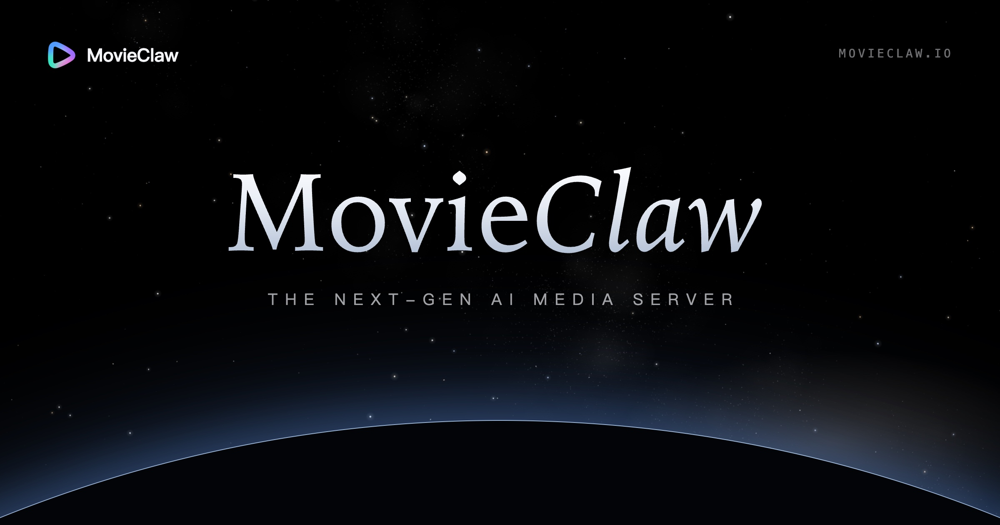
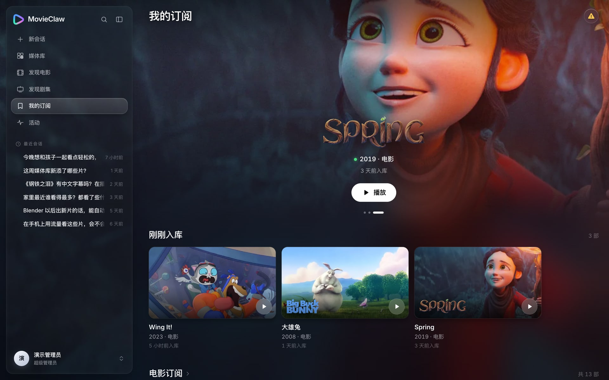
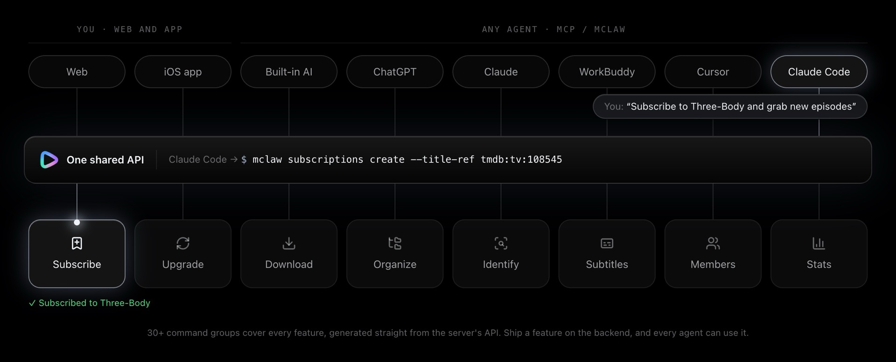
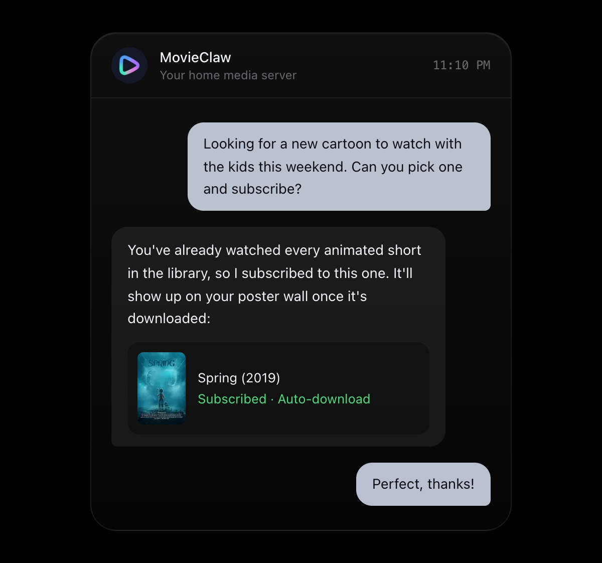

<p align="center">
  
</p>

<p align="center">
  Ein Server ersetzt deinen kompletten Medien-Stack.<br>
  Eine Web-App plus native Apps für Smartphone, TV und Mac – mit einem KI-Agenten, der die Dinge wirklich erledigt.<br>
  Alles bleibt auf deiner eigenen Hardware. Kostenlos für die private Nutzung und den eigenen Haushalt.
</p>

<p align="center">
  <a href="README.md">English</a> | <a href="README.zh-CN.md">简体中文</a> | <b>Deutsch</b>
</p>

<p align="center">
  <a href="#schnellstart">Schnellstart</a> ·
  <a href="https://demo.movieclaw.io">Live-Demo</a> ·
  <a href="https://movieclaw.io/en/download">Download</a> ·
  <a href="#ein-wort-genügt-den-rest-erledigt-movieclaw">KI-Agent</a> ·
  <a href="#grenzen">Grenzen</a> ·
  <a href="#von-überall-steuern">CLI</a> ·
  <a href="https://movieclaw.io/en/docs">Doku</a> ·
  <a href="docs/design/">Design-Dokumente</a> ·
  <a href="#community">Community</a> ·
  <a href="https://github.com/movieclaw/movieclaw/issues">Feedback</a>
</p>

<p align="center">
  <a href="https://github.com/movieclaw/movieclaw/releases"></a>
  <a href="https://hub.docker.com/r/movieclaw/movieclaw"></a>
  <a href="https://hub.docker.com/r/movieclaw/movieclaw/tags"></a>
  
  <a href="LICENSE"></a>
  <a href="https://t.me/movieclawio"></a>
</p>

<p align="center">
  
</p>

<p align="center">
  Erst mal umschauen? Öffne die <a href="https://demo.movieclaw.io">Live-Demo</a>: Auf der Anmeldeseite stehen vier Demo-Konten bereit, jeweils mit einem Klick.
  Die Demo ist schreibgeschützt und wird täglich zurückgesetzt. (Oberfläche und Logs sind derzeit auf Chinesisch.)
</p>

> **Hinweis zur Übersetzung:** Die **Weboberfläche** gibt es auf Deutsch (umschalten unter
> **Einstellungen → Darstellung und Sprache**); die Menüpfade in dieser Anleitung beziehen sich darauf.
> Was noch nicht auf Deutsch ist:
> - **Meldungen vom Server in der Weboberfläche** (z. B. Fehlertexte, Suche): erscheinen bei deutscher
>   Oberfläche auf Englisch.
> - **Native Apps** (iPhone, Android, TV, Mac): nicht übersetzt, sie laufen auf Englisch oder Chinesisch;
>   einzelne Texte sind noch fest auf Chinesisch.
> - **Benachrichtigungen im Hintergrund** (Push, WeChat, Telegram usw.): kommen auf Englisch oder
>   Chinesisch – je nachdem, welche Sprache zuletzt verwendet wurde.
>
> Im Zweifel gilt die [englische README](README.md).

## Eine Installation. Mehr brauchst du nicht.

Früher brauchte man dafür sechs oder sieben Dienste, sechs oder sieben Konfigurationen und
jede Menge Aufwand, damit sich alle über dieselbe Mediathek einig sind. Jetzt ist es nur noch MovieClaw:

| Aufgabe | Der übliche Stack | MovieClaw |
| --- | --- | --- |
| Wiedergabe, Poster-Wand, Wiedergabefortschritt | Jellyfin / Emby / Plex | Eingebaut |
| Disc-Rips und 4K HDR auf dem iPhone | Ein Drittanbieter-Player wie Infuse | Eine eigene native App – Infuse lässt sich trotzdem verbinden |
| Metadaten | Was der Server mitbringt, plus tinyMediaManager für die schwierigen Fälle | Eingebaut, mit TMDB und Douban als doppelte Quelle |
| Abos und automatische Downloads | Sonarr + Radarr | Eingebaut |
| Indexer und Tracker-Seiten | Prowlarr / Jackett | Eingebaut |
| Untertitel | Bazarr | Eingebaut, mit PGS-zu-SRT-Konvertierung und KI-Übersetzung, wenn keine vorhanden sind |
| Wünsche und Berechtigungen der Familie | Overseerr / Jellyseerr | Eingebaute Mitgliederverwaltung |
| All das mit einem einzigen Satz steuern | Gibt es nirgends | Eingebauter KI-Agent – externe Agenten lassen sich ebenfalls anbinden |
| Gesamt | 6 Container, 6 Konfigurationen | 1 Container, 1 `data`-Verzeichnis |

Alles-in-einem hat seine Kompromisse – sie werden ehrlich unter [Grenzen](#grenzen) aufgeführt.

## Native Apps mit einer Wiedergabe auf Infuse-Niveau

Schau direkt im Browser oder in den nativen Apps auf Smartphone, TV und Mac. iPhone, Apple TV
und Mac teilen sich eine eigene Wiedergabe-Engine: FFmpeg entpackt, Apple spielt ab.

<p align="center">
  
  <br>
  <sub>Standbild aus dem öffentlichen Trailer zu „Avatar: Fire and Ash“, ausschließlich zur Demonstration der Wiedergabe. Alle Rechte liegen bei den jeweiligen Inhabern. Rechteinhaber können per E-Mail an service@movieclaw.io die Entfernung veranlassen.</sub>
</p>

- Dolby Vision und Dolby Atmos; 4K HDR und Blu-ray-Disc-Rips werden direkt abgespielt.
- Zuerst Hardware-Dekodierung, Software-Dekodierung als Rückfallebene und Transkodierung nur als letzter Ausweg.
- 4K über Mobilfunk startet in ein bis zwei Sekunden; kommt deine Verbindung bei der Bitrate nicht mit, schlägt die App eine niedrigere Qualitätsstufe vor.
- Der Fortschritt wird zwischen Web-App, nativen Apps und Infuse synchronisiert – du machst genau dort weiter, wo du aufgehört hast.
- **Clips**: Wische vertikal durch Highlights aus deinen eigenen Filmen und Serien.

**Apps herunterladen**: Die Apps für iPhone, Android, Apple TV, Android TV und Mac findest du alle auf der
[Download-Seite](https://movieclaw.io/en/download), jeweils mit Version, Systemvoraussetzungen und
Installationsanleitung. Die iPhone-App ist auf dem Weg in den App Store. Bis dahin kannst du
`MovieClaw-iOS-unsigned.ipa` aus den [Releases](https://github.com/movieclaw/movieclaw/releases) laden
und per AltStore, SideStore oder Sideloadly mit deiner eigenen Apple-ID sideloaden (iOS 26 oder
neuer; per Sideload installierte Builds erhalten keine Push-Benachrichtigungen). Tracker und Download-Clients
werden in der Web-App konfiguriert.

Du möchtest per E-Mail erfahren, wenn eine neue App erscheint oder eine neue Version veröffentlicht wird?
Melde dich auf der Website für [Updates](https://movieclaw.io/en/download#updates) an: einloggen,
E-Mail-Adresse wählen, jederzeit abbestellbar.

Die Web-App ist im Liquid-Glass-Stil gehalten: Seitenleiste, Eingabefelder und schwebende Buttons
brechen das Hintergrundbild deiner Wahl, mit einem Hauch chromatischer Aberration an den Rändern.
Den Hintergrund änderst du unter **Einstellungen → Darstellung und Sprache** – er bleibt auf allen Geräten gleich,
die mit derselben Instanz verbunden sind.


Die Entwicklung des Windows-Clients findet in [`apps/desktop`](apps/desktop/README.md) statt (Tauri/WebView2 mit gebündeltem mpv). Lies dort die Anforderungen an Build, Paketierung und Validierung, bevor du einen Windows-Build verteilst.

## Ein Wort genügt. Den Rest erledigt MovieClaw.

MovieClaw bringt einen autonomen, universellen KI-Agenten direkt in deinen Medienserver.
Mediathek aufräumen, Untertitel erstellen, all die schrägen Einzelwünsche erledigen:
Du musst nur fragen.

- „Hast du eine Idee für etwas Leichtes, das ich heute Abend mit den Kindern schauen kann?“ Der Agent durchsucht deine Mediathek, wählt drei Titel nach Laufzeit und Bewertung aus und zeigt sie als Posterkarten.
- „Für Elephants Dream gibt es keine spanischen Untertitel. Kannst du welche machen?“ Er sucht Untertitel in einer anderen Sprache, übersetzt sie passend zum Ton des Films, synchronisiert das Timing und speichert eine SRT-Datei neben dem Video.
- „Falls Charge irgendwann in 4K erscheint, tausch es bitte aus.“ Er legt eine Upgrade-Regel an. Taucht ein besseres Release auf, wird es heruntergeladen und ersetzt die alte Datei – die vorher im Papierkorb landet.
- „Wer hat diese Woche am meisten geschaut?“ Er holt den Wiedergabeverlauf der Woche und summiert ihn pro Familienmitglied.

Du kannst auch über WeChat mit ihm reden, per Text oder Sprache; Telegram und Discord funktionieren ebenfalls,
und Feishu-Gruppen lassen sich als reiner Benachrichtigungskanal einbinden. Bevor er etwas löscht, fragt er
dich, und jedes Tool, das er aufruft, ist für dich sichtbar. Die Regeln dazu stehen unter [Grenzen](#grenzen).

Der Agent braucht ein LLM, das unter **Einstellungen → KI-Anbieter** angebunden wird (jeder OpenAI-kompatible
Endpunkt funktioniert). Lässt du das weg, funktioniert alles andere trotzdem. Du kannst ihm „Skills“ in
einfachem Markdown beibringen: Lege ein Verzeichnis mit einer `SKILL.md` in `data/agent-skills/` ab
(eine `description` im Frontmatter, Anweisungen im Hauptteil, Skripte sind willkommen), und der Agent lädt
den Skill selbstständig, sobald eine Aufgabe in einer Web-Sitzung dazu passt. Änderungen wirken sofort,
ohne Neustart. Ein Skill mit demselben Namen wie ein eingebauter überschreibt diesen (das Log weist darauf hin).
Details in [`docs/design/agent-skills.md`](docs/design/agent-skills.md).

### Schnelles, präzises Parsen von Release-Namen

Release-Namen werden nicht mit regulären Ausdrücken erraten. Ein kleines NER-Modell, destilliert aus einem
großen Sprachmodell, zerlegt einen Namen in etwa 3 ms auf einer normalen CPU – Auflösung, Quelle, Codec,
Untertitel, Audio und Release-Gruppe bekommen jeweils ein eigenes Feld:

```text
三体.Three-Body.2023.S01E05.2160p.WEB-DL.H265.AAC.国语中字-OurTV
↓
Serie · Staffel 1, Folge 5 · 2160p · H.265 · WEB-DL · AAC
Untertitel: Chinesisch    Audio: Mandarin    Release-Gruppe: OurTV
```

Selbst Kürzel wie „国语中字“ (Mandarin-Ton, chinesische Untertitel), die es nur auf chinesischen Trackern gibt,
werden sauber in getrennte Untertitel- und Audiofelder aufgeteilt. Ist sich das Modell unsicher, rät es nicht:
Mehrdeutige Einträge landen in einer Warteschlange *Identifizierung ausstehend*, mit einer verständlichen
Begründung („3 gleich plausible Treffer; ich wähle nicht für dich“), und eine einzige Bestätigung löst
die ganze Gruppe auf.

### Jeder Agent kann jede Funktion nutzen

<p align="center">
  
</p>

Jede Funktion ist über die `mclaw`-CLI und MCP verfügbar. Verbinde ChatGPT, Claude, WorkBuddy, Cursor
oder Claude Code, und sie können abonnieren, Qualitäts-Upgrades ausführen und deine Mediathek organisieren:
alles, was du auch in der Web-App kannst. Der Befehlsbaum wird direkt aus der Server-API generiert –
wird eine Funktion im Backend ausgeliefert, kann jeder Agent sie sofort nutzen.

- **MCP nach deinen Regeln**: Lege einen MCP-Endpunkt an und bestimme genau, was er darf. Jeder Endpunkt bekommt ein eigenes Token, das du jederzeit widerrufen kannst.
- **Die CLI läuft überall**: eine einzige statische Binärdatei. Siehe [Von überall steuern](#von-überall-steuern).
- **Deine Modelle**: Binde OpenAI, einen beliebigen OpenAI-kompatiblen Anbieter oder dein eigenes vLLM an.

### Eine Pipeline – vom Abo bis in die Mediathek

Abonniere eine Serie, und alles Weitere (Suchen, Herunterladen, Identifizieren, Metadaten abrufen,
Importieren, Benachrichtigen) läuft von selbst. Kein Abgleichen von Einstellungen über ein halbes
Dutzend Dienste mehr.

- Qualitäts-Upgrades: Beschreibe deine Zielqualität als Regel, und MovieClaw tauscht bessere Releases ein, sobald sie auftauchen. Ersetzte Dateien kommen in eine Papierkorb-Warteschlange mit verzögerter Löschung. Und wenn du lieber das 1080p-REMUX *und* die 4K-Fassung behalten willst, aktivierst du parallele Versionen.
- Health-Check: Spielt jeden Schritt der Kette (Tracker, Download-Client, Mediathek) im Probelauf durch, damit du siehst, wo es hängen würde.
- Gerade einem privaten Tracker beigetreten und musst auf deine Ratio achten? Aktiviere den Seitenschutz: Abos umgehen diese Seite, die manuelle Suche funktioniert weiterhin – so baust du erst deine Ratio auf, bevor du die Seite freigibst.

## So sollte sich eine private Mediathek anfühlen

<table>
  <tr>
    <td width="50%" valign="top">
      
      <p><b>8:30 Uhr, im Zug</b>: Den Film von gestern Abend auf dem Handy weiterschauen. Ob im Browser, in den nativen Apps oder in Playern wie Infuse – dein Fortschritt kommt mit.</p>
    </td>
    <td width="50%" valign="top">
      
      <p><b>18:20 Uhr, auf dem Heimweg</b>: Neue Folge erschienen? Nichts zu tun. Sobald du abonniert hast, werden neue Releases heruntergeladen und in die Mediathek aufgenommen, und du bekommst eine Nachricht per WeChat oder Telegram.</p>
    </td>
  </tr>
  <tr>
    <td width="50%" valign="top">
      
      <p><b>20:30 Uhr, im Wohnzimmer</b>: Jeder schaut sein eigenes Programm. Alle haben ein eigenes Konto, die Kinder sehen nur altersgerechte Cartoons, und niemand kommt dem anderen in die Quere.</p>
    </td>
    <td width="50%" valign="top">
      
      <p><b>23:10 Uhr, im Bett</b>: Heute Abend im Chat fragen, morgen schauen. Der Agent findet den Titel und abonniert ihn; am Morgen hängt er an deiner Poster-Wand. <sub>(Das Chatfenster ist eine Illustration.)</sub></p>
    </td>
  </tr>
</table>

Die Screenshots stammen aus der öffentlichen [Live-Demo](https://demo.movieclaw.io) und zeigen offene
Filme, die unter anderem von der Blender Foundation veröffentlicht wurden (CC BY).

## Die kleinen Dinge – schon erledigt

### Mediathek

- Beim Öffnen der App siehst du eine Poster-Wand. Inhaltsangaben, Bewertungen, Besetzung und Episodenbilder werden lokal gespeichert, sodass du auch komplett offline stöbern kannst.
- Umbenennen ist nie Pflicht: Verweise auf deine bestehenden Verzeichnisse, und MovieClaw arbeitet mit ihnen, wie sie sind. Das Organisieren deiner Dateien durch MovieClaw ist eine separate Option und standardmäßig deaktiviert.
- Scraping ist Geschmackssache, deshalb ist es konfigurierbar: Sprache, Artwork, Benennungsvorlagen, NFO-Dateien, Episodenbilder – alles unter **Einstellungen → Metadaten und Organisation**. Dir gefällt ein automatisch gewähltes Poster nicht? Ersetze es und fixiere es.
- Eine Mediathek vom Typ **„Sonstiges“** nimmt Heimvideos und Aufnahmen auf: Nichts wird identifiziert oder umbenannt, eine vorhandene NFO-Datei daneben wird berücksichtigt, und Vorschaubilder werden aus dem Video selbst erzeugt.
- Eine Mediathek vom Typ **„Fotos“** zeigt deine Bilder als Mauerwerk-Raster, gruppiert nach Monat und sortiert nach EXIF-Aufnahmezeit. Die Wand lädt dabei immer nur Vorschaubilder.

### Wiedergabe

- Trag die Serveradresse in Infuse oder VidHub ein, und du bist drin: Für Drittanbieter-Player sieht MovieClaw genau wie ein Jellyfin-Server aus, und der Wiedergabefortschritt wird zurücksynchronisiert.
- Auch direkt im Browser abspielbar. Wann immer möglich Direct Play; transkodiert wird nur bei Codecs, die der Browser nicht beherrscht – und vorher wird dir gesagt, was das kostet.
- Keine Hardware-Transkodierung auf deiner Kiste? Überlass das einem Mac: Der Remote-Transcoder ist eine Menüleisten-App für Apple Silicon, die über VideoToolbox kodiert.

### Familie & Berechtigungen

- Jeder bekommt ein eigenes Konto, mit individuellen Schaltern dafür, welche Mediatheken sichtbar sind, ob abonniert werden darf und ob direkte Downloads erlaubt sind. Wiedergabefortschritt und Favoriten werden getrennt geführt.

### Wartung

- Updates und Rollbacks sind Buttons in der Weboberfläche. Normale Upgrades laden nur wenige Megabyte, ein fehlerhaftes Update rollt sich selbst zurück, und deine Daten werden nie angetastet.
- Fehlermeldungen sind für Menschen geschrieben – für Leute, die Dinge deployen, aber keinen Code schreiben. (Logs sind derzeit auf Chinesisch; Meldungen vom Server erscheinen bei deutscher Oberfläche auf Englisch.)

### Plugins

- Der Kern bleibt allgemein; persönliche Setups werden zu Plugins. Messaging-Kanäle, Downloader, Direktlinks zu Cloud-Speichern und mehr liegen im
  Repo [movieclaw-plugins](https://github.com/movieclaw/movieclaw-plugins). Installiere sie über **Einstellungen → Plugins → Plugin-Marktplatz**; eine `.mcplugin`-Datei kannst du weiterhin auch manuell hochladen.
- Du willst selbst eins schreiben? Starte mit `example/GUIDE.md` in diesem Repo, oder lass den KI-Assistenten das Plugin für dich schreiben.

## Grenzen

### Was MovieClaw nicht tut

- Heruntergeladen wird weiterhin mit qBittorrent oder Transmission – MovieClaw ersetzt deinen Download-Client nicht.
- Hardware-Transkodierung hat dein Gerät entweder oder eben nicht; MovieClaw kann sie nicht herbeizaubern. Software-Transkodierung frisst CPU, und die Oberfläche sagt dir das klar, bevor du sie einschaltest.
- Den Fernzugriff richtest du selbst ein (Tailscale, WireGuard, ein Reverse Proxy). MovieClaw fasst deinen Datenverkehr nie an.
- Es werden niemals Medieninhalte mitgeliefert. Tracker-Konten sind deine eigenen; die mitgelieferten Seitenkonfigurationen sparen dir nur Einrichtungszeit.

### Was dir gehört

- Deine Dateinamen und deine Verzeichnisstruktur werden nie angefasst, solange du das Organisieren nicht ausdrücklich einschaltest – und du kannst die Mediathek jederzeit wieder an Jellyfin oder Emby übergeben.
- Der Laufzeitzustand liegt in einem einzigen `data/`-Verzeichnis. Sichere es, lösch den Container: Nichts geht verloren.
- Keine Telemetrie, kein Nach-Hause-Telefonieren, kein Cloud-Konto. Dein Wiedergabeverlauf verlässt nie das Gerät.

### Leitplanken für den KI-Assistenten

Eine Mediathek, ein Datei-Organizer und ein Assistent, der Befehle ausführen kann, in einem einzigen Produkt –
das Risiko ist real. In der Self-Hosting-Community kursieren bereits Horrorgeschichten von automatischen
Organizern, die ganze Mediatheken gelöscht haben: „Alles weg, keine einzige Quelldatei übrig.“ Deshalb werden
die Einschränkungen hier im Code durchgesetzt und nicht nur höflich im Prompt erbeten:

- Zugangsdaten erreichen nie die Bash. Der Assistent bedient das Produkt ausschließlich über dafür vorgesehene Tools; in der Umgebung eines `bash`-Unterprozesses taucht kein Token auf.
- Gefährliche Aktionen erfordern eine ausdrückliche Bestätigung. Beim Löschen von Mediendateien gilt sogar noch mehr: Der Assistent muss die betroffenen Einträge zuerst mit einem schreibgeschützten Befehl auflisten, sie dir vorlesen und im selben Austausch dein ausdrückliches Ja einholen. Ein vages „räum mal auf“ ist keine Zustimmung.
- Löschen bedeutet verzögertes Recycling, kein sofortiges `rm`. Kopien, die noch geseedet werden, bleiben unangetastet.
- Jeder Tool-Aufruf ist im Gespräch sichtbar und im Nachhinein nachvollziehbar – geht etwas schief, siehst du genau, welcher Schritt es war.

## Schnellstart

Du hast eins davon? Dann kann es losgehen:

- **Ein NAS**: Synology, QNAP, Unraid und weitere, über deren eingebaute Docker-Apps.
- **Einen Mac mini**: läuft hervorragend auf Apple Silicon und dient nebenbei als Transkodier-Rechner.
- **Einen Mini-PC, einen alten Rechner oder einen Cloud-Server**: Linux oder Windows, x86 oder ARM – alles mit demselben Image.

Eine Voraussetzung: Docker (der bei Synology eingebaute Container Manager zählt; andere NAS-Hersteller
haben eigene Docker-Pakete). Das offizielle Image
[`movieclaw/movieclaw`](https://hub.docker.com/r/movieclaw/movieclaw) betreibt alles in einem einzigen
Container – keine separate Datenbank, kein Redis, und ein TMDB-Schlüssel ist bereits eingebaut, du musst
also nichts beantragen. Ein einziges Tag deckt x86_64 und ARM64 ab.

**Schritt 1**: Lege einen neuen Ordner an, erstelle darin eine `docker-compose.yml` und füge Folgendes ein:

```yaml
services:
  movieclaw:
    image: movieclaw/movieclaw:latest
    container_name: movieclaw
    init: true
    ports:
      # Links steht der Host-Port – ist er belegt, ändere die linke Seite
      # (z. B. "8096:3000") und lass die rechte Seite auf 3000
      - "3000:3000"
      # Automatische Erkennung im LAN: MovieClaws Apps und Jellyfin-Player finden
      # darüber den Server. Auskommentieren, falls auf diesem Host bereits Jellyfin / Emby
      # läuft – der Portkonflikt würde den Start des Containers verhindern
      - "7359:7359/udp"
    volumes:
      - ./data:/app/data              # Laufzeitdaten – nur diesen Ordner musst du sichern
                                      # (enthält die versteckte Datei .secret_key; achte darauf,
                                      # dass dein Backup-Tool Dotfiles nicht überspringt)
      - /volume1/media:/media         # ← auf dein Medienverzeichnis ändern
      - /volume1/downloads:/downloads # ← auf das Speicherverzeichnis deines Download-Clients ändern
      # Mehrere Medienplatten / Download-Verzeichnisse? Je eine Zeile hinzufügen – ohne Limit:
      # - /volume2/movies:/movies
    environment:
      - TZ=Europe/Berlin              # ← auf deine Zeitzone ändern
      # Für NVIDIA-Hardware-Transkodierung diese beiden Zeilen zusammen mit
      # `runtime: nvidia` weiter unten aktivieren:
      # - NVIDIA_VISIBLE_DEVICES=all
      # - NVIDIA_DRIVER_CAPABILITIES=all
    # Hardware-Transkodierung mit einer Intel- / AMD-iGPU? Prüfe zuerst mit `ls /dev/dri`
    # auf dem Host, ob das Gerät existiert (ARM-Boxen und reine CPU-Hosts haben es meist nicht).
    # Aktivierst du die beiden Zeilen unten ohne das Gerät, wird der Container neu erstellt und
    # startet dann nicht – übrig bleibt nur „no such file or directory“.
    # devices:
    #   - /dev/dri:/dev/dri
    # Du nutzt eine dedizierte NVIDIA-GPU? Die läuft **nicht** über /dev/dri – binde das nicht ein,
    # wenn du keine iGPU hast (der Container startet sonst nicht). Installiere zuerst das
    # NVIDIA Container Toolkit auf dem Host und aktiviere dann diese Zeile:
    # runtime: nvidia
    # Im Zweifel nichts davon anfassen: Das Log beim ersten Start sagt dir klar, ob
    # Hardware-Dekodierung verfügbar ist und was fehlt.
    restart: unless-stopped
```

**Schritt 2**: Passe die `volumes`-Einträge an echte Pfade auf deinem Gerät an. Merk dir eine Regel:
**Links vom Doppelpunkt** steht ein Verzeichnis auf deinem Gerät; **rechts vom Doppelpunkt** steht, was
MovieClaw im Container sieht – und genau diesen rechten Pfad gibst du später in der Weboberfläche ein.
Binde unbedingt das Speicherverzeichnis deines Download-Clients ein, sonst sieht MovieClaw fertige
Downloads nicht und kann sie nicht in die Mediathek einsortieren.

> **Das linke Verzeichnis muss auf dem Gerät bereits existieren.** Docker meldet bei einem falschen Pfad
> keinen Fehler – es legt stillschweigend einen leeren Ordner an, der Container startet problemlos, die
> Logs sehen sauber aus, und deine Mediathek bleibt leer. Synology-Nutzer: Achtet auf die Volume-Nummer
> und die Groß-/Kleinschreibung (`/volume1` vs. `/volume2`, `media` vs. `Media`). Prüfe das Verzeichnis
> vor dem Einfügen mit `ls` oder kontrolliere es im Dateimanager.

**Schritt 3**: Starte aus diesem Ordner heraus (Nutzer einer NAS-Oberfläche: Container Manager →
**Projekt → Erstellen**, mit diesem Ordner als Ziel):

```bash
docker compose up -d
```

Der erste Start dauert auf einem schnellen Rechner etwa zehn Sekunden, auf einem langsameren NAS ein bis
zwei Minuten. In der Zwischenzeit zeigt die Seite nur „Verbindung zum Dienst wird hergestellt …“ – das ist
normal. Wirklich bereit ist alles, wenn `docker logs movieclaw` die Zeile `前端反代 已就绪` („Frontend-Proxy
bereit“) ausgibt. Bricht der Befehl stattdessen mit
`failed to bind host port 0.0.0.0:3000/tcp: address already in use` ab, ist Port 3000 belegt – siehe
[FAQ](#faq).

**Schritt 4**: Öffne `http://<host-ip>:3000`, leg mit dem Assistenten das Admin-Konto an und dann:

1. **Mediathek hinzufügen**: **Mediathek → Mediathek hinzufügen**. Der Stammpfad ist der Pfad **im Container** –
   also die rechte Seite des Doppelpunkts aus Schritt 2: im Beispiel oben `/media`, **nicht**
   `/volume1/media`. Der Scan startet sofort; vorhandene Dateien werden identifiziert und gescrapt,
   und alles Mehrdeutige wartet unter *Identifizierung ausstehend* auf deine Bestätigung.
   Gibst du einen falschen Pfad ein, zeigt die Seite trotzdem „Scanne …“ an – endet aber mit 0 Dateien,
   und im Ergebnis steht „Stammpfad existiert nicht, übersprungen“. Diese Zeile bedeutet: Der Pfad ist falsch.
2. **Download-Client verbinden**: **Einstellungen → Downloader**, für qBittorrent / Transmission.
   Sehen Client und MovieClaw unterschiedliche Pfade, richtest du hier die Pfadzuordnung ein.
3. **Seiten verbinden**: **Einstellungen → Tracker** – Cookies / API-Schlüssel einfügen oder sie
   automatisch über die Browser-Erweiterung synchronisieren lassen.
4. Optional: Unter **Einstellungen → KI-Anbieter** ein LLM anbinden (danach unter **Einstellungen → KI-Einstellungen** ein
   Standardmodell wählen) und so den Assistenten freischalten; unter **Einstellungen → Automatischer Import** Regeln
   der Form „Quellverzeichnis → Ziel-Mediathek“ anlegen, damit Downloads aus beliebigen Quellen ebenfalls
   in der Mediathek landen.

> Du willst es nur schnell mit einem einzigen Befehl ausprobieren?
> `docker run -d --name movieclaw --init -p 3000:3000 -p 7359:7359/udp --restart unless-stopped -e TZ=Europe/Berlin -v "$(pwd)/data:/app/data" -v /volume1/media:/media -v /volume1/downloads:/downloads movieclaw/movieclaw:latest`
> Für die Mounts gelten exakt dieselben Regeln wie oben. `-p 7359:7359/udp` ist die automatische LAN-Erkennung; lass es weg, wenn auf diesem Host bereits Jellyfin / Emby läuft.

### Alltägliche Upgrades ohne Image-Pull

Ab dann laufen alltägliche Upgrades über **Einstellungen → Updates und Wartung**: MovieClaw lädt ein wenige
Megabyte großes Artefaktpaket aus den GitHub-Releases (Mirrors konfigurierbar), wendet es auf dem
`data`-Volume an, und das Ergebnis übersteht auch ein Neuerstellen des Containers. Macht ein Update
Probleme, rollst du es auf derselben Seite zurück – und ein wirklich kaputtes rollt sich automatisch selbst zurück.

`docker compose pull && docker compose up -d` ist nur nötig, wenn die Release Notes ausdrücklich sagen,
dass ein Update geänderte Abhängigkeiten mitbringt und ein neues Image erfordert. Das kommt selten vor.
(So funktioniert es: [in-app-update.md](docs/design/in-app-update.md).)

## Bring deinen eigenen Player mit

MovieClaw spricht die Wiedergabe-API von Jellyfin, daher verbinden sich Drittanbieter-Player mit ihm,
**als wäre es ein Jellyfin-Server** – einfach die Adresse eintragen. Unterstützung nach Client;
„auf Gerät verifiziert“ heißt, dass jemand tatsächlich auf echter Hardware verbunden und abgespielt hat:

| Client | Status | Hinweise |
| --- | --- | --- |
| Web-Player | Eingebaut | Zuerst Direct Play; transkodiert wird nur, was der Browser nicht kann – und vorher wird dir gesagt, was das kostet |
| Infuse / VidHub | **Auf Gerät verifiziert** | Verbindung als Jellyfin-Server: Stöbern, Direct Play, Fortschrittssynchronisation – null Änderungen auf Player-Seite |
| Fileball / SenPlayer | Gleiche API | Nutzt denselben Jellyfin-kompatiblen Weg, wurde aber nicht einzeln auf Geräten verifiziert |
| Offizielle Emby- / Jellyfin-Apps | Nicht zutreffend | Sie verbinden sich mit ihren eigenen Servern; MovieClaw kann eine Emby-/Jellyfin-Instanz nach Importen zum Aktualisieren auffordern |
| Automatische LAN-Erkennung | Ja | Erfordert das Mapping von `7359/udp`. Im Bridge-Netzwerk kennt der Container die LAN-Adresse des Hosts nicht: Öffne MovieClaw einmal im Browser über die LAN-Adresse (z. B. `http://192.168.1.10:3000`), dann merkt sich der Server sie – oder setze **Einstellungen → Netzwerk → Externer Zugriff** |
| Remote-Hardware-Transkodierung | macOS Apple Silicon | Menüleisten-App, die über VideoToolbox kodiert (ein dauerhaft laufender Mac mini reicht völlig). Das Protokoll ist offen – andere Plattformen können es implementieren |

Details in [jellyfin-compat.md](docs/design/jellyfin-compat.md),
[web-player.md](docs/design/web-player.md) und
[remote-transcode.md](docs/design/remote-transcode.md).

## Von überall steuern

`mclaw`, der Kommandozeilen-Client von MovieClaw, ist eine einzige statische Binärdatei – kein Python,
kein Node, kein Paketmanager. Installiere sie auf einem beliebigen Rechner, und dieser Rechner kann deine
Mediathek steuern: Titel suchen, Abos anlegen, Jobs überwachen, Dateien organisieren.

**Auf dem Server selbst musst du nichts installieren** – das Image bringt die CLI bereits mit:

```sh
docker exec -it movieclaw mclaw status   # Containername wie in deiner Compose-Datei
```

**Überall sonst ist es ein einziger Befehl.** Das Installationsskript erkennt Betriebssystem und
Architektur selbst (x86 und ARM, jeweils unter Linux und macOS), prüft Checksummen und installiert in den
Standard-PATH – so finden auch cron, systemd und aus dem Dock gestartete Apps die CLI:

```sh
curl -fsSL https://raw.githubusercontent.com/movieclaw/movieclaw/main/scripts/install-cli.sh | sh
```

<details>
<summary><b>Unter Windows stattdessen das hier</b></summary>

PowerShell kann nicht an `sh` weiterleiten, deshalb gibt es für Windows einen eigenen Einzeiler – er
installiert dasselbe (amd64 und ARM64 werden beide abgedeckt):

```powershell
irm https://raw.githubusercontent.com/movieclaw/movieclaw/main/scripts/install-cli.ps1 | iex
```

</details>

Anschließend koppelst du mit `mclaw login`. Ohne Argumente durchsucht der Befehl zuerst das lokale
Netzwerk; über Subnetzgrenzen hinweg oder per VPN gibst du die Adresse selbst an
(`mclaw login --server http://192.168.1.10:3000`). Der Befehl zeigt einen Kopplungscode an – prüfe und
bestätige ihn in der Weboberfläche unter **Einstellungen → Geräte**. Das Token wird direkt an den Prozess
zurückgegeben und nie ausgegeben, landet also weder in der Zwischenablage noch im Shell-Verlauf.

Wo niemand im Browser auf „Bestätigen“ klicken kann (Cron-Jobs auf dem NAS, CI, Headless-Container),
nutzt du auf derselben Devices-Seite **Token manuell erstellen** und übergibst die beiden Zeilen, die du
dort bekommst – `MOVIECLAW_SERVER` und `MOVIECLAW_TOKEN` – als Umgebungsvariablen. Zugangsdaten werden
nie auf die Festplatte geschrieben.

### Auch für Agenten gebaut

Der Befehlsbaum wird aus der OpenAPI-Spezifikation des Servers generiert: Kommt im Backend ein Endpunkt
hinzu, übernimmt die CLI den passenden Befehl automatisch – ohne Raten. Außerhalb eines Terminals (Pipes,
Agenten) gibt sie standardmäßig JSON aus, es müssen also keine für Menschen formatierten Tabellen geparst
werden; destruktive Operationen verlangen ein ausdrückliches `--yes`. Jeder Assistent, der eine Shell
bedienen kann, kann MovieClaw damit steuern – der eingebaute KI-Assistent geht genau diesen Weg.

```sh
mclaw status                           # Server- und Anmeldestatus
mclaw search titles "Three-Body"       # Titel suchen
mclaw subscriptions list               # Abos auflisten
mclaw jobs list                        # Hintergrund-Jobs auflisten
mclaw library organize-files 1 --yes   # vorhandene Dateinamen in Mediathek 1 nach der Benennungsvorlage organisieren
mclaw subscriptions --help             # jeder Bereich hat --help mit allen Befehlen und Optionen
```

Bevor du einem externen Agenten ein Token gibst, lies die
[Leitplanken für den Assistenten](#grenzen): Ein Token hat dieselben Rechte wie die Person, die es
bestätigt hat, und widerrufen lässt es sich mit einem Klick auf der Devices-Seite.

## FAQ

<details>
<summary><b>Ich habe das Admin-Passwort vergessen</b></summary>

Führe einen Befehl auf dem Rechner aus, auf dem MovieClaw läuft. **Sonst wird nichts angefasst** – Seiten,
Download-Clients, Mediatheken und Abos bleiben, wie sie sind; nur das Passwort ändert sich:

```bash
# Docker-Installation (Containername wie in deiner Compose-Datei)
docker exec -it movieclaw python -m movieclaw_api.reset_password

# Installation aus dem Quellcode: zuerst ins Projektverzeichnis wechseln (das übergeordnete Verzeichnis von data/)
python -m movieclaw_api.reset_password
```

Gib das neue Passwort bei der Abfrage zweimal ein; ein Neustart ist nicht nötig. Den Benutzernamen auch
vergessen? Mit `--show` siehst du ihn vorher. Um auch andere angemeldete Geräte abzumelden, führe danach
`docker restart movieclaw` aus.

Warum es in der Weboberfläche keinen „Passwort vergessen“-Link gibt: Beim Self-Hosting gibt es keine
vertrauenswürdige dritte Partei, die bestätigen könnte, dass das Konto dir gehört, und eine echte
Wiederherstellung per E-Mail würde jeden, der MovieClaw betreibt, zwingen, zuerst SMTP einzurichten.
Stattdessen wird der Besitz durch etwas Stärkeres nachgewiesen: **Wer an das `data/`-Verzeichnis dieses
Rechners herankommt, dem gehört der Server.** Jellyfin, Vaultwarden und Gitea halten es genauso.

Familien**mitglieder**, die ihr Passwort vergessen, brauchen das alles nicht – ein Admin setzt es mit
einem Klick unter **Einstellungen → Mitglieder** zurück.
</details>

<details>
<summary><b>Port 3000 ist durch einen anderen Dienst belegt</b></summary>

Ändere die **linke** Seite des Doppelpunkts unter `ports` – z. B. `"8096:3000"` – und rufe
`http://<host-ip>:8096` auf. Der Port auf Container-Seite bleibt, wie er ist.

Nur bei `--network host` wird der Container-Port zum Host-Port, und nur dann änderst du tatsächlich den
Port, auf dem gelauscht wird: Füge `-e MOVIECLAW_WEB_PORT=8096` hinzu oder ändere ihn nach der Einrichtung
unter **Einstellungen → Netzwerk** (startet sich beim Speichern selbst neu).

**Host-Networking hat eine weitere Falle**: Das interne Frontend (3001) und das Backend (8000) des
Containers binden sich ebenfalls direkt auf dem Host. `MOVIECLAW_WEB_PORT` ändert nur den öffentlichen Port
von nginx. Ist 3001 belegt, setze `MOVIECLAW_NEXT_PORT=13001` (oder einen anderen freien Port), um das
interne Frontend zu verschieben; das Backend braucht weiterhin einen freien Port 8000. Entferne bei
Host-Networking den Abschnitt `ports`, da Port-Mappings ignoriert werden. Diese Frontend-Port-Option
erfordert ein neues Docker-Image: Lade das aktualisierte Image und erstelle den Container neu; ein
In-App-Update kann weder den Entrypoint noch die nginx-Vorlage ersetzen. Im Host-Modus wird außerdem auf
UDP 7359 für die LAN-Erkennung gelauscht, was mit einem bereits laufenden Jellyfin oder Emby kollidiert.

**Fazit: Ändere die linke Seite des Doppelpunkts und lass die Finger vom Host-Networking.** Die
automatische LAN-Erkennung funktioniert auch im Bridge-Netzwerk (einfach `7359/udp` mappen).
</details>

<details>
<summary><b>Scraping schlägt ständig fehl; die Logs sagen, TMDB sei nicht erreichbar</b></summary>

`无法连通 TMDB` („TMDB nicht erreichbar“), `ConnectTimeout`, `CircuitOpenError` oder
`CERTIFICATE_VERIFY_FAILED` – ob in den Logs oder im Verbindungstest unter **Einstellungen → Netzwerk** –
deuten alle auf dasselbe Problem hin.

Kann dein Netzwerk `api.themoviedb.org` nicht direkt erreichen, trag unter **Einstellungen → Netzwerk** einen
Proxy oder eine Mirror-Adresse ein und prüfe das mit dem eingebauten Verbindungstest. Standardmäßig deckt
der Proxy TMDB, das Abrufen von Artwork und GitHub-Updates ab, während Tracker-Seiten direkt verbunden
bleiben (so ist es meist schneller).
</details>

<details>
<summary><b>Als welcher Benutzer läuft der Container? Wird PUID / PGID unterstützt?</b></summary>

**Er läuft als root; PUID / PGID werden noch nicht unterstützt.** Die Datenbank und die Schlüsseldateien
unter `data/` gehören `root:root`.

Eingebundene Medienverzeichnisse **müssen beschreibbar sein** – sowohl das Einsortieren von Importen als
auch das Recycling ersetzter Versionen verschieben Dateien, und ein schreibgeschützter Mount legt diese
Funktionen lahm. Gehören die Verzeichnisse auf deinem NAS einem anderen Benutzer, kann root dort in der
Regel trotzdem schreiben; Reibung gibt es eher umgekehrt – deinem eigenen Konto fehlen womöglich Rechte an
Verzeichnissen, die MovieClaw anlegt. Ist dir das wichtig, lockere die Verzeichnisrechte auf dem Host,
bevor du sie einbindest.
</details>

<details>
<summary><b>Meine Mediathek liegt auf einem SMB- / NFS-Netzlaufwerk</b></summary>

Deaktiviere beim Anlegen der Mediathek die *Echtzeit-Dateiüberwachung*. Dateiereignisse über
Netzlaufwerke sind unzuverlässig; regelmäßiger Abgleich plus manueller Scan ist deutlich verlässlicher.
</details>

## Aus dem Quellcode bauen

Du brauchst einen kostenlosen TMDB-API-Schlüssel von
[themoviedb.org](https://www.themoviedb.org/settings/api) – das offizielle Image hat einen eingebaut;
nur bei eigenen Builds brauchst du einen eigenen.

```bash
git clone https://github.com/movieclaw/movieclaw.git
cd movieclaw
TMDB_API_KEY=dein_schluessel ./scripts/build-image.sh
#   Mirror-Beschleunigung für Festlandchina:  CN_MIRROR=1 TMDB_API_KEY=... ./scripts/build-image.sh
#   Cross-Build für ein NAS:                 PLATFORM=linux/amd64 TMDB_API_KEY=... ./scripts/build-image.sh
```

Der Schlüssel kann auch in einer `.env` im Wurzelverzeichnis des Repos liegen. Beachte, dass
`.env.example` die Zeile **auskommentiert** mitliefert (`# TMDB_API_KEY=`) – entferne das `#`, sonst
sieht das Skript den Schlüssel nicht. Ganz ohne Schlüssel bricht das Skript sofort ab, statt deine Zeit
mit einem Build zu verschwenden.

Der Build greift auf `deb.debian.org`, `repo.jellyfin.org`, `pypi.org`, `registry.npmjs.org` und GitHub
zu. In Netzen in Festlandchina füge `CN_MIRROR=1` hinzu. Hinter einem Firmen-Proxy, der TLS abfängt und
neu signiert, scheitert der Build an `curl ... exit code 60` oder an pips `CERTIFICATE_VERIFY_FAILED` –
das ist ein Problem mit dem Zertifikatsvertrauen, kein Fehler im Skript.

Setze danach die `image:`-Zeile in `docker-compose.yml` auf `movieclaw:latest` und starte. Zur
Selbstprüfung erzeugt der Build PGS-Testmuster, liest sie per OCR zurück in SRT und bricht bei jeder
Abweichung hart ab. Die Untertitel-Laufzeitumgebung und ihre Release-Gates sind in
[docker-subtitle-runtime.md](docs/design/docker-subtitle-runtime.md) beschrieben.

## Lokale Entwicklung

**Gib zuerst die Ports 3000 und 8000 frei.** Läuft auf diesem Rechner auch der MovieClaw-Docker-Container,
fahre ihn vorher mit `docker compose down` herunter – „erst das Image benutzt, jetzt will ich am Code
basteln“ ist die mit Abstand häufigste Geschichte von Mitwirkenden, und der Konflikt ist garantiert. Ist
ein Port belegt, bricht das Dev-Skript sofort ab und sagt dir, wie du den Verursacher findest
(erfordert `lsof`).

```bash
./scripts/dev.sh          # Backend und Frontend zusammen starten
./scripts/dev.sh api      # nur Backend
./scripts/dev.sh web      # nur Frontend
```

Das Skript erledigt die Ersteinrichtung selbst (virtuelle Umgebung, Abhängigkeiten, `.env`,
`pnpm install`). Die Logs tragen farbige Präfixe `[api]` / `[web]`, und `Strg-C` beendet alles sauber –
inklusive Kindprozessen, die Ports werden freigegeben. Beachte, dass es für die virtuelle Umgebung das
neueste Python wählt, das es findet (3.14 → 3.11) – das ist womöglich nicht das, auf das dein `python3` zeigt.

Von Hand brauchst du **zwei Terminals** – Backend und Frontend laufen beide als Vordergrundprozesse:

```bash
# Terminal 1: Backend (Python 3.11+)
python3 -m venv .venv && source .venv/bin/activate
pip install -e ".[dev]"
cp .env.example .env
uvicorn movieclaw_api.main:app --factory --reload --reload-dir src
```

> Behalte `--reload-dir src` bei. Standardmäßig überwacht uvicorn das gesamte Arbeitsverzeichnis, und
> Laufzeit-Logs landen in `data/logs/` – jeder Log-Eintrag löst also die Reload-Erkennung aus, die
> Erkennung schreibt eine weitere Log-Zeile, und die Schleife flutet das Log, bis es unlesbar ist.
> `./scripts/dev.sh` legt das für dich fest.

```bash
# Terminal 2: Frontend (Node.js 20+)
pnpm install && pnpm web:dev
```

Web-Konsole unter `http://127.0.0.1:3000`, API-Doku unter `http://127.0.0.1:8000/docs`. Mit einer leeren
`.env` startet alles problemlos – dir fehlen nur die Funktionen, die TMDB benötigen.

> Wer den Backend-Port ändert, muss ihn an zwei Stellen ändern. `APP_PORT` in der `.env` verschiebt das
> Backend, aber das Proxy-Ziel des Frontends ist fest auf `http://127.0.0.1:8000` voreingestellt – du
> **musst zusätzlich** `MOVIECLAW_API_PROXY_TARGET` in `apps/web/.env.local` auf den neuen Port setzen.
> Änderst du nur eins von beiden, lädt die Seite, aber jeder API-Aufruf kommt leer zurück. Der eigene
> Port 3000 des Frontends ist fest eingestellt und nicht konfigurierbar. Und auf dem manuellen Weg meldet
> ein uvicorn-Portkonflikt nur `[Errno 98] Address already in use`, ohne den freundlicheren Hinweis von `dev.sh`.

Beim Betrieb aus dem Quellcode **muss das NER-Modell für das Parsen von Torrent-Namen von Hand abgelegt
werden** (das Docker-Image enthält es): Lade `model.int8.onnx`, `tokenizer.json` und `labels.json` aus den
[Releases](https://github.com/movieclaw/movieclaw/releases) herunter, lege sie in `data/models/torrent-ner/`
ab (Pfad über `MOVIECLAW_NER_DIR` konfigurierbar) und starte neu. Ohne das Modell läuft die App problemlos –
nur diese eine Funktion bleibt aus. Wird die Extraktion zum ersten Mal tatsächlich ausgelöst, vermerkt das
Log, dass das Modell fehlt und die Felder Titel/Jahr/Staffel/Folge leer bleiben. Diese Warnung erscheint
allerdings **verzögert**: Beim Start taucht sie nie auf, ein sauberes Start-Log ist also kein Beweis dafür,
dass das Modell vorhanden ist.

Noch eine bekannte Grenze beim Betrieb aus dem Quellcode: Wird der Prozess so beendet, dass kein Aufräumen
möglich ist – `kill -9`, ein Stromausfall –, während der KI-Assistent einen Befehl ausführt, können die von
ihm gestarteten Unterprozesse weiterlaufen (normales Herunterfahren, Timeouts und der Stopp-Button des
Nutzers beenden jeweils die ganze Prozessgruppe, und unter Docker räumt auch ein Container-Neustart auf).
Nach einem harten Absturz auf Bare Metal lohnt sich ein kurzer Blick mit `ps` auf Überbleibsel.

## Community

Fragen zur Installation, Tipps zur Einrichtung, Ideen für Funktionen oder einfach deine Mediathek
herzeigen – komm vorbei und sag Hallo:

<p align="center">
  <a href="https://t.me/movieclawio"></a>
  <br><br>
  <b>Telegram</b><br>
  <a href="https://t.me/movieclawio">t.me/movieclawio</a>
  <br><br>
  Offen für alle, keine Einladung nötig.
</p>

## Doku & Support

Die wichtigsten Designentscheidungen hinter jedem Modul – und die Abwägungen, die sie geprägt haben –
findest du in [`docs/design/`](docs/design/), eine Datei pro Thema: Mediathek, Metadaten, Abos,
Qualitäts-Upgrades, Jellyfin-Kompatibilität, In-App-Updates, die CLI … stöbere einfach nach Dateinamen.
Die Überlegungen hinter dem Aufbau dieser README stehen in
[readme-rewrite.md](docs/design/readme-rewrite.md).

Plugins von Drittanbietern samt den jeweiligen Store-Metadaten (`store.json`) liegen in
[movieclaw-plugins](https://github.com/movieclaw/movieclaw-plugins). Wie man eins schreibt, steht in
`example/GUIDE.md` in diesem Repo. Der Plugin-Marktplatz in der App liest den signierten Katalog dieses
Repos; das Hochladen einer `.mcplugin`-Datei funktioniert ebenfalls.

Fragen, Ideen, Fehlerberichte – bitte
[eröffne ein Issue](https://github.com/movieclaw/movieclaw/issues).

## Lizenz

Versionen, die nach v0.27.0 veröffentlicht wurden, stehen unter der [MovieClaw-Lizenz](LICENSE):
der Apache License 2.0 mit zusätzlichen Bedingungen.

- **Kostenlos für nicht-kommerzielle Nutzung**: privates Self-Hosting und Nutzung im eigenen Haushalt,
  Teilen mit Familie und Freunden, Lernen und Forschung.
- **Kommerzielle Nutzung erfordert eine schriftliche Genehmigung**, darunter das Anbieten als SaaS oder
  gehosteter Dienst, der Verkauf oder die Bündelung mit Hardware wie NAS-Geräten, kostenpflichtige
  Installationsdienste und die Nutzung durch Unternehmen.

v0.27.0 und frühere Versionen stehen weiterhin unter der MIT-Lizenz. Für kommerzielle Lizenzen schreib
bitte eine E-Mail an [service@movieclaw.io](mailto:service@movieclaw.io).

---

<sub>Dies ist eine Community-Übersetzung der englischen README. Bei Abweichungen gilt die [englische Fassung](README.md); maßgeblich für Lizenzfragen ist ausschließlich die Datei [LICENSE](LICENSE).</sub>
