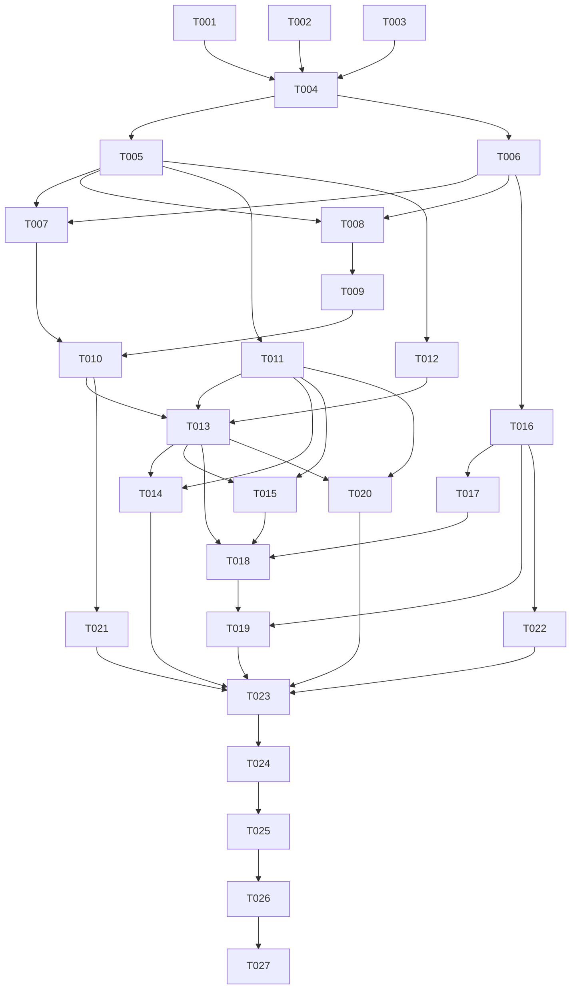

# Tasks: HarmonyOS 车机端（Car）适配

**Input**: Design documents from `spec/car-ui/`（spec.md + plan.md）
**Prerequisites**: plan.md (required), spec.md (required for user stories)
**Tests**: 未要求 TDD/单测；验证走 Verification 阶段（build + UI 验证，已选 build+ui 范围）
**Organization**: 任务按用户故事分组（US1~US9 对应 spec.md 九个故事），P1 → P2 → P3 排序

## Format: `[ID] [P?] [Story] Description`

- **[P]**: 可并行（不同文件、无未完成依赖）
- **[Story]**: 所属用户故事（US1~US9）
- 每条任务含确切文件路径

## Path Conventions

- 所有路径相对项目根 `apps/harmonyos/`
- 车机新代码全部位于 `entry/src/main/ets/car/`；本特性不触碰 `entry/src/main/ets/` 下其他现有目录（T002/T003/T004 涉及的清单与接线文件除外）
- 手机端与 TV 端零回归红线：除上述三个清单/接线文件外不得改动任何现有文件

---

## Phase 1: Setup（工程接线）

**Purpose**: 车机设备类型声明与入口分流接线——对现有代码的全部改动集中于此

- [x] T001 [P] 创建车机产品定制层目录骨架（car/ 及 theme/components/nav/welcome/home/library/detail/search/accounts/player/model 子目录），入口文件路径 `entry/src/main/ets/car/`
- [x] T002 [P] module.json5 的 deviceTypes 增加 `"car"`（保持 phone/tablet/2in1/tv 不变），文件 `entry/src/main/module.json5`
- [x] T003 [P] main_pages.json 的 src 增加 `"car/CarIndex"`，文件 `entry/src/main/resources/base/profile/main_pages.json`
- [x] T004 EntryAbility 按 `deviceInfo.deviceType` 分流加载（`'car'` → `loadContent('car/CarIndex')`，其余分支原路径原逻辑不动），文件 `entry/src/main/ets/entryability/EntryAbility.ets`

**Checkpoint**: 车机入口已可寻址；手机/TV 路径行为不变

---

## Phase 2: Foundational（阻塞前置）

**Purpose**: 车机设计令牌、状态基座与全局外壳——所有用户故事的前置依赖

- [x] T005 [P] 创建车机设计令牌 CarTheme（固定深色色板；1260×600 vp 超宽画布基准：基准边距 48、触控目标最小 48、字号阶梯、间距/卡距/圆角、海报卡/横版卡/大卡尺寸、动画时长与曲线；布局令牌全部弹性/Grid 取值不锁死画布），文件 `entry/src/main/ets/car/theme/CarTheme.ets`
- [x] T006 [P] 创建车机状态模型 CarUiState（@ObservedV2：路由栈 CarRoute、每库排序筛选记忆 CarWallOptions + Preferences 持久化 `car_wall_` 前缀、驾驶模式态 CarDriveState（手动开关持久化 `car_drive_mode` + 播放模式 video|audioLocked + DriveSignalProvider 接口位默认空实现）、CarMiniPlayerState、CarPlayerUiState、欢迎流程态 CarDiscoveryState），文件 `entry/src/main/ets/car/model/CarUiState.ets`
- [x] T007 创建车机主外壳 CarShell 骨架（左侧固定图标导航栏四页签：首页/媒体库/搜索/账号；页签内容容器（先用占位组件）；二级页按 CarUiState 路由栈 Stack 整屏覆盖；播放器覆盖层槽位；mini 播控条槽位；返回键分级语义：面板→二级页→页签→退出确认），文件 `entry/src/main/ets/car/nav/CarShell.ets`

**Checkpoint**: 设计令牌、状态基座、导航外壳就绪，用户故事可开始

---

## Phase 3: User Story 1 - 车机登录：扫码即用（Priority: P1）🎯 MVP 起点

**Goal**: 扫码配对为主（屏显二维码+配对码+轮询授权）+ 局域网发现/手动地址兜底 + 密码登录；已登录启动直达
**Independent Test**: 清数据首次启动走完扫码/手动地址→登录→进入主界面；再次启动直达；服务器不可达出可重试状态页

- [x] T008 [US1] 创建车机根页面 CarIndex（@Entry @ComponentV2，复用 common/AppModel：aboutToAppear 调 restore()，按 phase 切车机根视图——launching 加载态与 unreachable 重试卡先行），文件 `entry/src/main/ets/car/CarIndex.ets`
- [x] T009 [US1] 创建车机欢迎流程 CarWelcome（扫码配对主视图：配对码 + ScanKit 生成二维码屏显 + 轮询授权状态，扫码优先大布局；局域网 UDP 7359 单播发现与健康检查折叠为次级入口；手动地址兜底自动补全协议/端口；账号密码登录；needsSetup 引导态），文件 `entry/src/main/ets/car/welcome/CarWelcome.ets`
- [x] T010 [US1] 接线 CarIndex：needsServer/needsSetup/needsLogin → CarWelcome；chooseAccount → 车机账号选择列表（复用 AppModel 账号快照）；ready → CarShell（四页签先用占位组件），文件 `entry/src/main/ets/car/CarIndex.ets`

**Checkpoint**: 车机端可独立完成「启动→扫码登录→进入导航外壳」

---

## Phase 4: User Story 2 - 首页：3 秒内继续观看（Priority: P1）

**Goal**: 继续观看/收藏大卡置顶（一键续播）+ 宽屏左信息右内容布局 + 内容行 + 空态引导
**Independent Test**: 有续播记录点大卡直接进入播放（播放器 US5 前先占位承接）；收藏行可横滑进详情（详情 US4 前先占位）；无记录显示引导态

- [x] T011 [P] [US2] 创建车机卡片库 CarCards（继续观看大卡：宽幅+进度条+剧名/集数+一键续播回调；收藏大卡；海报卡 2:3 选中浮出「片名·年份」；横版卡 16:9；人物卡：头像+姓名+作品数，点击进影人作品行墙；分集卡：剧照+进度+集名；「查看全部」尾卡；全部触控目标 ≥48vp，官方按压态反馈），文件 `entry/src/main/ets/car/components/CarCards.ets`
- [x] T012 [P] [US2] 创建车机横滑行组件 CarRows（行标题 + 横滑 List + 「查看全部」尾卡路由回调），文件 `entry/src/main/ets/car/components/CarRows.ets`
- [x] T013 [US2] 创建车机首页 CarHomePage（继续观看/收藏大卡置顶、宽屏左信息右内容布局、内容行按 ui.preferences 偏好渲染/默认行集兜底、行数据复用 common/LibraryHomeStore 并发拉取、空态引导去媒体库、卡片点击路由进 CarUiState 路由栈）并挂入 CarShell 首页页签，文件 `entry/src/main/ets/car/home/CarHomePage.ets`、`entry/src/main/ets/car/nav/CarShell.ets`

**Checkpoint**: 首页完整可用——车机端核心价值故事达成

---

## Phase 5: User Story 3 - 媒体库海报墙（Priority: P1）

**Goal**: 大触控目标海报网格 + 排序筛选大按钮抽屉（本地记忆）+ 窗口分页 + 模糊背景
**Independent Test**: 进入任一媒体库滚动浏览；改排序/筛选即时刷新且重进保持（`car_wall_` 记忆）；点海报进详情（US4 前占位承接）

- [x] T014 [US3] 创建车机海报墙 CarLibraryWall（大触控目标海报网格（列数按 1260vp 宽弹性计算）、排序筛选大按钮抽屉（排序 addedAt/releaseDate/rating/title + 只看没看过 + 类型筛选，条件经 CarWallOptions 持久化）、窗口式分页不整库加载、背景=选中条目剧照模糊、空态占位）并挂入 CarShell 媒体库页签，文件 `entry/src/main/ets/car/library/CarLibraryWall.ets`、`entry/src/main/ets/car/nav/CarShell.ets`

**Checkpoint**: 车机「逛收藏」主路径达成

---

## Phase 6: User Story 4 - 详情页：一眼决策（Priority: P1）

**Goal**: 首屏大图+操作按钮行（继续/从头/收藏/已看）+ 季切换分集 + 演职员 + 相似推荐（宽屏布局，下半截简化）
**Independent Test**: 进入剧集与电影详情浏览全区块；收藏/已看点按即时反馈且返回一致；播放按钮触发（US5 前占位承接）；无片源播放按钮置灰

- [x] T015 [US4] 创建车机详情页 CarItemDetail（首屏大图+左下亮度渐变罩+Logo/标题/事实行+简介+操作按钮行「继续 第X季第Y集·mm:ss / 从头播放 / 收藏 / 标为已看」即时反馈；下半截：剧集=选季胶囊+分集卡横排（剧照+进度+集名）/电影=横向卡；演职员行（人物卡进影人作品行墙）；相似推荐行；底部背景=剧照模糊版；播放结束返回后重拉续播刷新按钮；无片源置灰可收藏）并接入 CarUiState 路由栈，文件 `entry/src/main/ets/car/detail/CarItemDetail.ets`

**Checkpoint**: P1 看片决策链路（首页/墙→详情）完整

---

## Phase 7: User Story 5 - 播放器：驻车看视频，行车听声音（Priority: P1）

**Goal**: AVPlayer+HLS 驻车全屏视频（传输条/信息面板/跳片头/下一集/错误态）；行车锁视频音频继续 + 大控件播控卡；手动驾驶模式开关
**Independent Test**: 起播/暂停/轨道切换/退出续播正确；开驾驶模式开关视频立即锁定转音频、播控卡可用；关开关恢复视频；转码错误出重试

- [x] T016 [P] [US5] 创建车机播放引擎 CarAvPlayerEngine（@kit.MediaKit AVPlayer 封装（沿用 TvAvPlayerEngine 已验证 API 模式）：decide→sessions 取 HLS 地址起播、轨道选择（字幕/音轨）、画质切换重建会话续接进度、seek/倍速快进分档、progress/ping 按既有端点节奏上报、错误归因回调（网络/解码/会话）、release 释放；车机增量：setVideoSurfaceVisible 布尔接口——audioLocked 仅隐藏视频输出表面音频链路不重建、恢复可见即回视频），文件 `entry/src/main/ets/car/player/CarAvPlayerEngine.ets`
- [x] T017 [US5] 创建车机播放器页 CarPlayerPage（驻车视频模式：AVPlayer 画面+传输条（标题/双层进度/时间）+信息面板三列（字幕/音轨/画质）+自动收起+错误视图重试/返回；行车模式：大控件播控卡（「行车中视频已锁定」提示+大播放暂停/上一集/下一集/收藏按钮+进度条）+驾驶模式开关入口；两模式经 CarDriveState 播放模式驱动无黑屏切换），文件 `entry/src/main/ets/car/player/CarPlayerPage.ets`
- [x] T018 [US5] 接线播放链路（CarShell 播放器覆盖层（起播 playback-first：按下播放即预建会话）；首页继续观看大卡/详情页按钮起播入口接入 CarAvPlayerEngine；驾驶模式开关变化→CarDriveState 播放模式→引擎 Surface 显隐+页面模式视图联动），文件 `entry/src/main/ets/car/nav/CarShell.ets`、`entry/src/main/ets/car/home/CarHomePage.ets`、`entry/src/main/ets/car/detail/CarItemDetail.ets`

**Checkpoint**: P1 全链路（启动→登录→首页→墙→详情→播放→行车锁）MVP 完整

---

## Phase 8: User Story 6 - 常驻 mini 播控条（Priority: P1）

**Goal**: 所有非播放器页面底部常驻播控条（封面/标题/播放暂停/下一集/点击回播放器），无播放隐藏
**Independent Test**: 播放中返回首页/墙/搜索 mini 条常驻可控；点击条体回播放器；停止播放后隐藏；不遮挡列表最后一行

- [x] T019 [US6] 创建车机 mini 播控条 CarMiniPlayer（封面/标题/大播放暂停按钮/下一集按钮/点击条体回播放器（行车锁时回播控卡）；显隐=引擎在播 && 播放器覆盖层关闭）并装配进 CarShell（内容区列表留底部安全边距防遮挡），文件 `entry/src/main/ets/car/components/CarMiniPlayer.ets`、`entry/src/main/ets/car/nav/CarShell.ets`

**Checkpoint**: P1 六故事全部达成

---

## Phase 9: User Story 7 - 搜索：语音优先（Priority: P2）

**Goal**: 大输入框（系统输入法，语音经输入法可达）+ 只搜媒体库 + 条目/影人大卡结果分页
**Independent Test**: 输入已知影片/影人名出结果分页追加；点条目进详情；点影人进影人作品行墙；无结果占位

- [x] T020 [US7] 创建车机搜索页 CarSearchPage（大尺寸 TextInput 拉起系统输入法、防抖触发 `search/library`、条目大卡列表 + 影人大卡（点击进影人作品行墙）、分页追加、无结果占位）并挂入 CarShell 搜索页签，文件 `entry/src/main/ets/car/search/CarSearchPage.ets`、`entry/src/main/ets/car/nav/CarShell.ets`

---

## Phase 10: User Story 8 - 车机账号：轻量切换（Priority: P2）

**Goal**: 当前账号展示 + 切换已保存账号 + 退出确认 + 关于折叠；不做头像墙
**Independent Test**: 切换第二账号数据隔离；退出登录回登录流程其他账号不受影响

- [x] T021 [US8] 创建车机账号页 CarAccountPage（当前账号头像/昵称展示、已保存账号列表切换（复用 AppModel 既有方法）、退出登录确认弹窗、关于折叠（版本+许可））并挂入 CarShell 账号页签，文件 `entry/src/main/ets/car/accounts/CarAccountPage.ets`、`entry/src/main/ets/car/nav/CarShell.ets`

**Checkpoint**: P2 全部达成

---

## Phase 11: User Story 9 - AVSession 系统集成播控（Priority: P3）

**Goal**: AVSession 元数据上报 + 系统播控指令（play/pause/playNext/playPrevious）联动
**Independent Test**: 播放中系统播控入口（模拟器可达范围内）验证播放/暂停联动与元数据显示

- [x] T022 [US9] CarAvPlayerEngine 接入 AVSession（参照手机端 PlaybackGuard 已验证模式：@kit.AVSessionKit 创建会话、元数据上报（标题/封面/时长/进度随 onProgress 更新）、指令回调 play/pause/playNext/playPrevious 接引擎控制、引擎释放时会话同步销毁；行车锁音频模式下会话持续有效），文件 `entry/src/main/ets/car/player/CarAvPlayerEngine.ets`

**Checkpoint**: 全部 9 个用户故事实现完毕

---

## Phase 12: Polish（横切收尾）

**Purpose**: 跨故事的车机通则与官方组件红线收尾

- [x] T023 [P] 车机通则复查（car/ 内触控目标 ≥48vp 全量复核；导航层级 ≤3；深色令牌全局一致无白底白字；全部页面空态/错误态/图片缺失占位到位；无高频闪烁动画；宽屏响应式不锁死画布（1260×600 vp 基准 ±断点弹性）；滚动容器显式 fadingEdge(false)），涉及 `entry/src/main/ets/car/` 全目录
- [x] T024 [P] 官方组件红线复查与静态检查清零（car/ 内无 Canvas/自绘视觉、无内联对象字面量等 ArkTS 违规；对 car/ 全部 .ets 跑 arkts_check 并修复至清零；手机端与 TV 端文件零改动复核），涉及 `entry/src/main/ets/car/` 全目录

---

## Phase 13: Verification

<!-- verification_scope: build+ui -->

**Purpose**: 构建、部署（Huawei_Car 模拟器）、逐用户故事 UI 验证

- [ ] T025 构建工程并修复全部编译错误（`devecocli build`，修复→重建循环直至成功）
- [ ] T026 启动 Huawei_Car 模拟器并部署应用（启动 car 模拟器后 `devecocli run --skip-build`；模拟器为 HarmonyOS 7.0.0(26) Beta1，出现前向兼容问题按降级处理并记录）
- [ ] T027 按 9 个用户故事逐一执行 UI 验证（verify_ui：每故事一条用例「动作 → 预期 UI 结果」，覆盖 P1 主链路 + 行车锁视频 + mini 播控条；验证→修复→复验，每故事至多 3 轮）

---

## 📊 Dependency Graph



## ⚡ Parallel Execution Guide

| Phase | Tasks | Required Files | Execution Notes |
|---|---|---|---|
| Setup | T001, T002, T003 | car/ 骨架、module.json5、main_pages.json | 三者不同文件可并行，均先于 T004 |
| Foundational | T005, T006 | CarTheme.ets、CarUiState.ets | 不同文件可并行；T007 依赖两者 |
| US2 组件 | T011, T012 | CarCards.ets、CarRows.ets | 卡片库与横滑行互不依赖可并行 |
| US5 引擎 | T016 | CarAvPlayerEngine.ets | 引擎与 US2/US3/US4 全部 UI 任务并行（仅依赖 T006） |
| P2 故事 | T020, T021 | CarSearchPage.ets、CarAccountPage.ets | 两故事不同文件，T013 完成后可两路并行 |
| Polish | T023, T024 | car/ 全目录 | 顺序建议 T023 → T024（先内容后静态检查） |

## Dependencies & Execution Order

### Phase Dependencies

- **Setup（Phase 1）**: 无依赖，立即可开始（T001/T002/T003 并行 → T004）
- **Foundational（Phase 2）**: 依赖 Setup 的 T004 接线完成；阻塞全部用户故事
- **User Stories（Phase 3~11）**: 全部依赖 Foundational 完成
  - P1 链路顺序依赖：US1 → US2 → US3/US4（可并行）→ US5 → US6（US5 引擎 T016 可与 US2/US3/US4 阶段并行启动）
  - P2 故事（US7/US8）依赖 US2 的 CarCards/CarHomePage，彼此可并行
  - P3 故事（US9）仅依赖 T016 引擎
- **Polish（Phase 12）**: 依赖全部用户故事完成
- **Verification（Phase 13）**: 依赖 Polish 完成；T025 → T026 → T027 严格顺序

### User Story Dependencies

- **US1（P1）**: Foundational 后即可开始，无其他故事依赖
- **US2（P1）**: 依赖 T007 外壳与 T010 接线；CarCards/CarRows 是 US3/US4/US7 的组件依赖
- **US3（P1）**: 依赖 US2 的 CarCards 与首页挂载后的 Shell
- **US4（P1）**: 依赖 US2 的 CarCards 与路由栈
- **US5（P1）**: 引擎仅依赖 T006；播放器页依赖引擎；接线（T018）依赖 US2/US4
- **US6（P1）**: 依赖 US5 引擎与接线（mini 条显隐联动引擎与播放器覆盖层）
- **US7/US8（P2）**: 依赖 US2（+US7 需 CarCards 影人卡）；彼此独立
- **US9（P3）**: 仅依赖 US5 引擎 T016

### Within Each User Story

- 组件先行（components/），页面组装随后
- 引擎/状态模型先于控制层 UI
- 每故事完成即到 Checkpoint，可独立验收（未实现的路由以占位承接）

### Parallel Opportunities

- Setup 内 T001/T002/T003 三任务并行
- Foundational 内 T005/T006 并行
- US2 的 T011/T012 并行；US5 引擎 T016 可与 US2/US3/US4 全阶段并行
- P2 两故事 T020/T021 两路并行

## Parallel Example: 车机端

```bash
# 并行启动 Foundational 两个独立文件任务：
Task: "创建车机设计令牌 CarTheme → entry/src/main/ets/car/theme/CarTheme.ets"
Task: "创建车机状态模型 CarUiState → entry/src/main/ets/car/model/CarUiState.ets"

# 并行启动 US2 两个组件任务（CarShell 就绪后）：
Task: "创建车机卡片库 CarCards → entry/src/main/ets/car/components/CarCards.ets"
Task: "创建车机横滑行 CarRows → entry/src/main/ets/car/components/CarRows.ets"
```

## Implementation Strategy

### MVP First（P1 主链路）

1. 完成 Phase 1 Setup + Phase 2 Foundational
2. 依序完成 US1 → US2 → US3/US4 → US5 → US6（T001~T019）
3. **STOP and VALIDATE**: Huawei_Car 模拟器独立验证 P1 主链路
4. 可部署/可演示 MVP：「启动 → 扫码登录 → 首页 → 墙/详情 → 播放（含行车锁）→ mini 条」

### Incremental Delivery

1. Setup + Foundational → 基座就绪
2. US1 → 独立验收（扫码登录流程）
3. US2 → 独立验收（导航 + 首页）
4. US3 + US4 → 独立验收（浏览与决策链路）
5. US5 + US6 → 独立验收（P1 全链路 MVP，含行车锁与 mini 条）
6. US7/US8（可并行）→ 独立验收（P2 功能对齐）
7. US9 → 独立验收（P3 系统集成）
8. Polish + Verification → 交付

## Notes

- **总任务数 27**：Setup 4 + Foundational 3 + 用户故事 15（US1=3/US2=3/US3=1/US4=1/US5=3/US6=1/US7=1/US8=1/US9=1）+ Polish 2 + Verification 3
- **MVP 范围**: T001~T019（全部 P1 故事）
- 单实现者顺序执行 T001→T027；多实现者按 Parallel Execution Guide 分路
- 每故事 Checkpoint 可停点验证（Huawei_Car 模拟器）
- 手机端与 TV 端零回归红线：除 T002/T003/T004 涉及的三个清单/接线文件外，不得触碰任何现有文件
- Verification 阶段已选 build+ui 范围（见 Phase 13 顶部标记），UI 验证用例由验证阶段按 spec.md 九个用户故事生成，目标设备 Huawei_Car 模拟器（3402×1620 px @432dpi ≈ 1260×600 vp）
