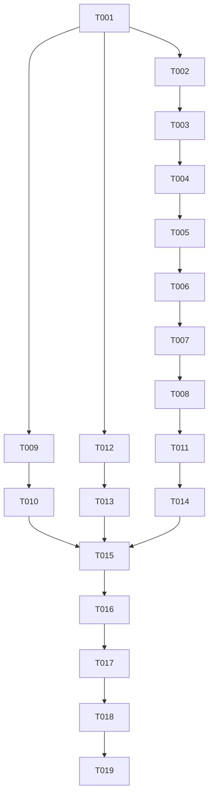

# Tasks: 播放器与播放详情页缺陷修复（player-bugfix）

**Input**: Design documents from `spec/player-bugfix/`（spec.md、plan.md）
**Prerequisites**: plan.md (required), spec.md (required for user stories)
**Tests**: 未要求独立测试任务；验证以构建 + 模拟器 UI 验证（Phase 5 spec-verify）为准
**Organization**: 按用户故事分组，每故事可独立实施与验证

## Format: `[ID] [P?] [Story] Description`

- **[P]**: 可并行（不同文件、无未完成依赖）
- **[Story]**: 所属用户故事（US1–US6，映射 spec.md）
- 任务描述含精确文件路径

## Path Conventions

- 单项目结构：所有源码路径相对 `apps/harmonyos/`（如 `entry/src/main/ets/player/PlayerPage.ets`）
- SDD 工件位于 `apps/harmonyos/spec/player-bugfix/`

---

## Phase 1: Setup

**Purpose**: 确认修改锚点，不写代码

- [X] T001 通读 `spec/player-bugfix/` 工件与四个目标文件的修改锚点区块：`entry/src/main/ets/player/PlayerPage.ets`（build() 约 L3424-3550、VideoSurface 约 L3703-3753、attachPlayer 约 L1055-1084、stopSession 约 L2649-2681、retryPlayback 约 L2823-2830、onReady 约 L3585-3614、restoreOrientation 约 L2735、onGesture 约 L2210-2229、Controls 约 L3844 起）、`entry/src/main/ets/reels/ReelsPage.ets`（bind 约 L504-525、playCurrent 约 L458-497）、`entry/src/main/ets/player/PlayerPrefs.ets`、`entry/src/main/ets/settings/PlaybackSection.ets`

---

## Phase 2: Foundational (Blocking Prerequisites)

**Purpose**: 跨故事共享的并发防护，必须先于所有 PlayerPage 故事任务完成

- [X] T002 在 `entry/src/main/ets/player/PlayerPage.ets` 增加代际令牌成员 `attachGeneration`，`attachPlayer` 与 `attachLocalPlayer` 入口取号、每个 `await` 之后与 `this.avPlayer = player` 赋值前校验编号，过期则释放刚创建的播放器实例并返回（plan R2；防 onLoad 兜底挂载、negotiate 挂载、切集/重试多入口交错的引擎泄漏）

**Checkpoint**: attach 串行化就位，后续故事任务可开始

---

## Phase 3: User Story 1 - 旋转屏幕不丢失播放进度 (Priority: P1) 🎯 MVP

**Goal**: 布局分支翻转（横竖屏旋转、剧集列表异步到达）时 XComponent 不销毁重建，播放位置与画面连续
**Independent Test**: 播放中旋转屏幕，画面连续、进度保持在旋转前位置 ±2s、无重复引擎创建日志

- [X] T003 [US1] 重构 `build()`：把 `VideoSurface()` 从 `showsDetailLayout()` 的 if/else 两分支提出，作为根 Stack 的第一个常驻子节点——详情模式宽 100% × `detailVideoHeight()` 贴顶，全屏模式铺满；`DetailPane` 在详情模式下叠放于视频带以下剩余区域，全屏模式不渲染；if/else 两分支中不得再保留任何 XComponent 实例（`entry/src/main/ets/player/PlayerPage.ets`）
- [X] T004 [US1] 修正视频面尺寸计算：`fitWidth()/fitHeight()/fillScale()` 在详情模式下以视频带容器尺寸（宽 = layerWidth、高 = detailVideoHeight）而非整层尺寸为夹紧基准，`displayMode` 各档语义保持不变（plan R1 注意项）（`entry/src/main/ets/player/PlayerPage.ets`）
- [X] T005 [US1] 代码走查确认：`showsDetailLayout()` 每个输入（isLandscape、episodes.length、phase、isClip）翻转时 VideoSurface 节点身份不变、onLoad 只在首挂触发一次；详情/全屏两形态下 DetailPane、Controls（详情模式的限高容器 L3472-3478）、手势层 onAreaChange/onTouch 绑定均正常工作（`entry/src/main/ets/player/PlayerPage.ets`）

**Checkpoint**: US1 独立可测——旋转与剧集到达不再触发重挂载

---

## Phase 4: User Story 2 - 快速切集与重试不泄漏、状态正确 (Priority: P1)

**Goal**: 快速连续切集/重试时旧引擎与旧服务端会话正确释放，播放与上报归属最后一次操作
**Independent Test**: 1 秒内连点 3 集，最终播放第 3 次点击的集数，活跃引擎恒为 1，无过期会话上报

- [X] T006 [US2] `retryPlayback()` 开头补清场：先 `stopSession()` 再 `releasePlayer()`，之后才 `negotiate()`，与切集路径（L1471-1473）时序对齐（plan R4）（`entry/src/main/ets/player/PlayerPage.ets`）
- [X] T007 [US2] `stopSession()` 末尾清空 `this.session = null`（share 与非 share 两分支统一），使切集/重试窗口内残留的 report/ping 定时器读到空会话（plan R4）（`entry/src/main/ets/player/PlayerPage.ets`）
- [X] T008 [US2] 走查 `startReport`/`startPingLoop`/`reportProgressEvent` 闭包对 `this.session` 的读取路径，补齐空会话防御（为 null 即静默跳过）；确认 ping 404 重建路径（L2802-2808）在 stopSession 清引用后不重复上报（`entry/src/main/ets/player/PlayerPage.ets`）

**Checkpoint**: US2 独立可测——切集/重试压测无泄漏、无过期上报

---

## Phase 5: User Story 3 - 刷片流有画面且稳定起播 (Priority: P1)

**Goal**: ReelsPage 视频画面正常渲染到 XComponent surface，单次 prepare 起播
**Independent Test**: 打开刷片流画面非黑屏；连滑 10 条无 invalid state 错误、起播成功率 100%

- [X] T009 [P] [US3] 重写 `bind()` 状态机：`initialized` → 设置 `player.surfaceId = this.surfaceController.getXComponentSurfaceId()` → `prepare()`；`prepared` → `play()`、`this.playing = true`、`startTick()`（plan R3）（`entry/src/main/ets/reels/ReelsPage.ets`）
- [X] T010 [US3] `playCurrent()` 删除 `player.url` 赋值后的显式 `await player.prepare()` 与紧随的 `player.play()`、`this.playing = true`、`startTick()`（全部移交 T009 的状态回调驱动），保留创建失败/无地址的错误分支（`entry/src/main/ets/reels/ReelsPage.ets`）

**Checkpoint**: US3 独立可测——刷片流画面与起播稳定（与 PlayerPage 任务无文件冲突）

---

## Phase 6: User Story 4 - 退出播放器后系统方向设置还原 (Priority: P2)

**Goal**: 进入播放页保存方向偏好，退出无条件还原
**Independent Test**: 竖屏锁定设备进播放页再退出，仍保持竖屏锁定行为

- [X] T011 [US4] `onReady` 在设 `AUTO_ROTATION` 之前保存当前窗口方向偏好到成员 `savedOrientation`（读取失败记 UNSPECIFIED）；`restoreOrientation()` 改为无条件还原 `savedOrientation`，删除以 `landscapeLocked` 为前提的提前返回（plan R5）（`entry/src/main/ets/player/PlayerPage.ets`）

**Checkpoint**: US4 独立可测——进出播放页方向行为对称

---

## Phase 7: User Story 5 - 设置页可切换播放引擎 (Priority: P2)

**Goal**: 引擎偏好有写入方，设置页提供 mpv / 系统播放器切换，改即存、下次起播生效
**Independent Test**: 设置页切 avplayer → 播放页按 avplayer 起播；切回 mpv 同样正常；重启后保持

- [X] T012 [P] [US5] `PlayerPrefs` 新增 `static writeEngine(name: string): void`：put `player.engine` + flush + 同步刷新 `engineName` 缓存，`name` 非 `'avplayer'` 一律归一 `'mpv'`（plan R6）（`entry/src/main/ets/player/PlayerPrefs.ets`）
- [X] T013 [US5] `PlaybackSection` 新增「播放引擎」卡片（置于 TogglesCard 之前）：mpv「mpv（默认）」/ avplayer「系统播放器」两行可选，`aboutToAppear` 经 `loadEngine()` 读初值，点击即 `writeEngine` 并更新选中态，无保存按钮、与该页既有「改即存」交互一致（plan R6）（`entry/src/main/ets/settings/PlaybackSection.ets`）

**Checkpoint**: US5 独立可测——设置页切换闭环（与 PlayerPage 任务无文件冲突）

---

## Phase 8: User Story 6 - 控制条交互在模拟器上可靠 (Priority: P2)

**Goal**: 控制条按钮点击/进度条拖动每次都被响应，不被手势层抢走
**Independent Test**: 模拟器连续 10 次点暂停/播放全响应；拖进度条落点准确

- [X] T014 [US6] 在 `Controls` 的三个交互容器（顶栏 Row、中部三键 Row、底栏 Column）各加 `onTouch` 认领：Down 置 `chromeTouchClaimed = true`、Up/Cancel 置回；`onGesture` 的 Down 分支在既有 `inChromeExclusion` 之外增加该标志检查（已认领则整次触摸不进手势层），几何禁区保留为兜底（plan R7）（`entry/src/main/ets/player/PlayerPage.ets`）

**Checkpoint**: US6 独立可测——控制条操作不被手势层翻转 chromeVisible 抢走

---

## Phase 9: Polish & Cross-Cutting Concerns

**Purpose**: 跨故事收尾检查

- [X] T015 对全部改动的 .ets 文件运行 `arkts_check`（PlayerPage.ets、ReelsPage.ets、PlayerPrefs.ets、PlaybackSection.ets），修复所有静态诊断
- [X] T016 走查回归约束（spec FR-009）：确认未引入 V1/V2 装饰器混用、无孤儿导入/成员；播放详情页视觉布局与既有功能（字幕、倍速、选集、清晰度、进度上报、PiP、画中画）行为不变

---

## Phase 10: Verification

<!-- verification_scope: build+ui -->

**Purpose**: 构建、部署，并按用户故事逐个 UI 验证

- [ ] T017 Build project and fix any compilation errors (invoke `devecocli build`; iterate fix → build until success)
- [ ] T018 Deploy application to device/emulator (invoke `devecocli run --skip-build`)
- [ ] T019 Run UI verification against deployed application (invoke verify_ui; 按 US1→US6 逐故事验证-修复-复验，每故事至多 3 次验证尝试)

---

## 📊 Dependency Graph



**说明**：T003–T008、T011、T014 全部触及 `PlayerPage.ets`，必须串行执行；US3（T009-T010，ReelsPage.ets）与 US5（T012-T013，PlayerPrefs.ets + PlaybackSection.ets）是独立文件分支，可与 PlayerPage 主线并行。

## ⚡ Parallel Execution Guide

| Phase | Tasks | Required Files | Execution Notes |
|---|---|---|---|
| US1-US2-US4-US6 主线 | T002→T003→T004→T005→T006→T007→T008→T011→T014 | PlayerPage.ets | 同文件严格串行；T002 先行是 US1 的 onLoad 防重复挂载与 US2 的防泄漏前提 |
| US3 分支 | T009→T010 | ReelsPage.ets | 与主线并行，T001 后即可开始 |
| US5 分支 | T012→T013 | PlayerPrefs.ets, PlaybackSection.ets | 与主线并行；T013 依赖 T012 的 writeEngine |
| Polish | T015→T016 | 全部改动文件 | 汇合三个分支后执行 |
| Verification | T017→T018→T019 | — | build 修复循环 → 部署 → 按故事 UI 验证 |

## Dependencies & Execution Order

### Phase Dependencies

- **Setup (Phase 1)**: 无依赖，立即开始
- **Foundational (Phase 2)**: 依赖 Setup；**阻塞所有 PlayerPage 故事任务**（代际令牌是 US1 防重复挂载与 US2 防泄漏的前提）
- **User Stories (Phase 3-8)**: PlayerPage 主线（US1→US2→US4→US6）同文件严格串行；US3 / US5 为独立文件分支，Foundational 后即可并行
- **Polish (Phase 9)**: 汇合全部故事分支后执行
- **Verification (Phase 10)**: 依赖 Polish 完成

### User Story Dependencies

- **US1 (P1)**: Foundational 后开始；无跨故事依赖
- **US2 (P1)**: 接续 US1（同文件顺序），逻辑上独立可测
- **US3 (P1)**: 仅依赖 Setup；独立文件分支
- **US4 (P2)**: 接续 US2（同文件顺序）
- **US5 (P2)**: 仅依赖 Setup；T013 依赖 T012
- **US6 (P2)**: 接续 US4（同文件顺序）

### Within Each User Story

- 先状态机/生命周期，后交互与展示
- 核心实现先于走查确认任务（T005/T008/T016）
- 每故事 Checkpoint 处独立可验证

## Parallel Example

```text
# 三条线并行（Foundational 完成后）：
主线（PlayerPage.ets）: T003 → T004 → T005 → T006 → T007 → T008 → T011 → T014
分支 A（ReelsPage.ets）: T009 → T010
分支 B（PlayerPrefs.ets / PlaybackSection.ets）: T012 → T013

# 汇合：T010、T013、T014 全部完成 → T015
```

## Implementation Strategy

### MVP First (User Story 1 Only)

1. Complete Phase 1: Setup（T001）
2. Complete Phase 2: Foundational（T002，CRITICAL - 阻塞 PlayerPage 主线）
3. Complete Phase 3: US1（T003-T005）
4. **STOP and VALIDATE**: 播放中旋转屏幕，位置保持 ±2s、无重挂载日志
5. 可部署演示（MVP：最高优先级的位置回退问题闭环）

### Incremental Delivery

1. Setup + Foundational → attach 防泄漏就位
2. US1 → 旋转不丢进度（MVP）
3. US2 → 快速切集/重试稳定
4. US3 → 刷片流画面与起播
5. US4/US5/US6 → 方向还原、引擎设置、控制条可靠
6. Polish → 静态检查 + 回归走查
7. Verification → build + 部署 + 逐故事 UI 验证

## Notes

- [P] 任务 = 不同文件、无未完成依赖
- [Story] 标签将任务映射到 spec.md 的具体用户故事，保证可追溯
- 每个用户故事独立可完成、可验证
- 避免模糊任务、同文件冲突、破坏独立性的跨故事依赖

## Summary Report

- **总任务数**: 19（Setup 1 / Foundational 1 / US1: 3 / US2: 3 / US3: 2 / US4: 1 / US5: 2 / US6: 1 / Polish 2 / Verification 3）
- **每故事任务数**: US1=3, US2=3, US3=2, US4=1, US5=2, US6=1
- **并行机会**: 两条独立文件分支（US3、US5）可与 PlayerPage 主线并行；PlayerPage 内任务因同文件必须串行
- **独立测试标准**: 每个故事均可独立验证（US1 旋转、US2 压测切集、US3 刷片流、US4 方向对称、US5 设置切换、US6 控制条点按），互不依赖
- **MVP 范围建议**: T001-T005（Setup + Foundational + US1）——最高优先级的位置回退问题先行闭环
