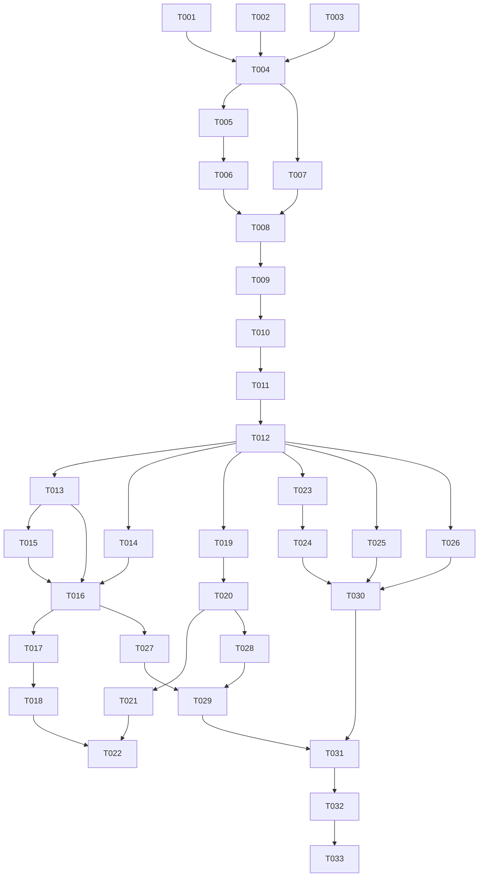

# Tasks: HarmonyOS TV 端（智慧屏）Apple TV 风格 UI

**Input**: Design documents from `spec/tv-ui/`（spec.md + plan.md）
**Prerequisites**: plan.md (required), spec.md (required for user stories)
**Tests**: 未要求 TDD/单测；验证走 Verification 阶段（build + UI 验证）
**Organization**: 任务按用户故事分组（US1~US10 对应 spec.md 十个故事），P1 → P2 → P3 排序

## Format: `[ID] [P?] [Story] Description`

- **[P]**: 可并行（不同文件、无未完成依赖）
- **[Story]**: 所属用户故事（US1~US10）
- 每条任务含确切文件路径

## Path Conventions

- 所有路径相对项目根 `apps/harmonyos/`
- TV 新代码全部位于 `entry/src/main/ets/tv/`；本特性不触碰 `entry/src/main/ets/` 下其他现有目录（T002/T003/T004 涉及的清单与接线文件除外）

---

## Phase 1: Setup（工程接线）

**Purpose**: TV 设备类型声明与入口分流接线——对现有代码的全部改动集中于此

- [x] T001 [P] 创建 TV 产品定制层目录骨架（tv/ 及 theme/components/nav/welcome/accounts/home/library/detail/search/player/model 子目录），入口文件路径 `entry/src/main/ets/tv/`
- [x] T002 [P] module.json5 的 deviceTypes 增加 `"tv"`（保持 phone/tablet/2in1 不变），文件 `entry/src/main/module.json5`
- [x] T003 [P] main_pages.json 的 src 增加 `"tv/TvIndex"`，文件 `entry/src/main/resources/base/profile/main_pages.json`
- [x] T004 EntryAbility 按 `deviceInfo.deviceType` 分流加载（`'tv'` → `loadContent('tv/TvIndex')`，其余维持 `pages/Index` 原路径原逻辑）；同时接入 DevConfig 调试开关「强制 TV 模式」供无真机时模拟器 UI 验证使用，文件 `entry/src/main/ets/entryability/EntryAbility.ets`、`entry/src/main/ets/common/DevConfig.ets`

**Checkpoint**: 构建 TV 入口已可寻址；手机路径行为不变

---

## Phase 2: Foundational（阻塞前置）

**Purpose**: TV 设计系统与状态基座——所有用户故事的前置依赖

- [x] T005 [P] 创建 TV 设计令牌 TvTheme（深色色板、字号阶梯、间距、圆角、卡片尺寸按 1920×1080→1280×720 vp 等比 ×0.667 换算：edge≈53/poster≈177/landscape≈277/行距≈37/卡距≈21/圆角≈13、焦点放大系数、动画时长与曲线），文件 `entry/src/main/ets/tv/theme/TvTheme.ets`
- [x] T006 [P] 创建双态交互基座 TvFocusable（onHover/onFocus/onBlur 统一驱动悬浮态=焦点态视觉：scale 放大 + 圆角亮边 + 阴影抬升，官方 animateTo 过渡，点击回调；focusable/defaultFocus 官方焦点能力接线），文件 `entry/src/main/ets/tv/components/TvFocusable.ets`
- [x] T007 [P] 创建 TV 状态模型 TvUiState（@ObservedV2：路由栈 TvRoute、每库排序/只看没看过记忆+Preferences 持久化 tv_wall_ 前缀、播放器 UI 状态机 TvPlayerUiState、首页焦点/防抖/预告计时 TvHomeFocus、欢迎流程发现态 TvDiscoveryState），文件 `entry/src/main/ets/tv/model/TvUiState.ets`

**Checkpoint**: 设计令牌、双态基座、状态基座就绪，用户故事可开始

---

## Phase 3: User Story 1 - 欢迎与登录（Priority: P1）🎯 MVP 起点

**Goal**: 局域网发现/手动地址 → 登录（密码/配对码+二维码）→ 记住账号；启动直达上次账号
**Independent Test**: 清数据首次启动走完发现→登录→进入主界面；再次启动直达；断网/未初始化出对应状态页

- [x] T008 [US1] 创建 TV 根页面 TvIndex（@Entry @ComponentV2，复用 common/AppModel：aboutToAppear 调 restore()，按 phase 切 TV 根视图——本任务先实现 launching 加载态与 unreachable 重试卡），文件 `entry/src/main/ets/tv/TvIndex.ets`
- [x] T009 [US1] 创建 TV 欢迎流程 TvWelcome（局域网 UDP 7359 单播扫描 `who is MovieClawServer?`+健康检查列候选、手动地址自动补全协议/端口、账号密码登录、设备配对登录——屏幕展示配对码与 ScanKit 生成二维码、needsSetup 引导态），文件 `entry/src/main/ets/tv/welcome/TvWelcome.ets`
- [x] T010 [US1] 接线 TvIndex：needsServer/needsSetup/needsLogin → TvWelcome；chooseAccount → TV 账号选择列表（复用 AppModel 账号快照）；ready → 临时占位（US8 接 TvShell），文件 `entry/src/main/ets/tv/TvIndex.ets`

**Checkpoint**: TV 端可独立完成「启动→登录→进入占位主界面」

---

## Phase 4: User Story 8 - 全局导航与双交互（Priority: P1）

**Goal**: 胶囊可收起侧边栏 + 三页签（账号/搜索/首页）+ 自管路由栈 + 播放器覆盖层槽位；返回分级
**Independent Test**: 展开侧边栏切换三页签；二级页整屏覆盖；返回逐级收回；指针/方向键双路径无死角

- [x] T011 [US8] 创建 TV 主外壳 TvShell（可收起胶囊侧边栏「‹ 当前页」：平时胶囊、按左/返回展开、栏内上下不切页确认才切；三页签页容器；二级页 Stack 按 TvUiState 路由栈整屏覆盖；播放器覆盖层槽位；返回键分级语义），文件 `entry/src/main/ets/tv/nav/TvShell.ets`
- [x] T012 [US8] 接线 TvIndex ready → TvShell（搜索/账号页签先用占位组件），文件 `entry/src/main/ets/tv/TvIndex.ets`

**Checkpoint**: TV 全局导航骨架可用，首页/搜索/账号页签可挂载内容

---

## Phase 5: User Story 2 - 首页（Priority: P1）

**Goal**: 焦点驱动大图区（0.16s 防抖、不轮播）+ 按偏好的横滑内容行 + 查看全部尾卡 + 默认焦点继续观看
**Independent Test**: 登录后首页大图随焦点交叉淡入切换；点卡片进详情（详情未实现前先出占位页）；按确认可直接续播

- [x] T013 [P] [US2] 创建 TV 卡片库 TvCards（海报卡 2:3/横版剧照卡 16:9/库卡/人物卡/分集卡/「查看全部」尾卡，caption 策略 always|focused|band 三档，全部经由 TvFocusable），文件 `entry/src/main/ets/tv/components/TvCards.ets`
- [x] T014 [P] [US2] 创建大图区组件 TvStage（背景大图铺满 + 左下文案块：Logo/标题/事实行/简介/按钮行 + 交叉淡入；首页与详情首屏共用），文件 `entry/src/main/ets/tv/components/TvStage.ets`
- [x] T015 [US2] 创建横滑行组件 TvShelf（行标题随行内焦点加亮、横滑 List、焦点分区最近落点、「查看全部」尾卡路由回调），文件 `entry/src/main/ets/tv/components/TvShelf.ets`
- [x] T016 [US2] 创建 TV 首页 TvHomePage（大图区选中驱动 + 0.16s 防抖切图、内容行按 ui.preferences 偏好渲染/默认行集兜底、默认焦点「继续观看」、行数据复用 common/LibraryHomeStore 并发拉取、行点击路由进 TvUiState 路由栈），文件 `entry/src/main/ets/tv/home/TvHomePage.ets`

**Checkpoint**: 首页完整可用——TV 端核心价值故事达成

---

## Phase 6: User Story 3 - 详情页（Priority: P1）

**Goal**: 两截式详情：首屏原图大图区 + 操作按钮；下滑分集/演职员/相似/系列/合集；收藏/已看即时反馈
**Independent Test**: 进入剧集与电影详情浏览全区块；收藏/已看点按即时变色且返回首页一致；播放按钮触发（播放器 US4 前先占位）

- [x] T017 [US3] 创建 TV 详情页首屏 TvItemDetail（复用 TvStage 全图模式：原图铺满 + 左下亮度渐变罩 + Logo/主文字/事实行（年份·类型·片长/季数）+ 画质/HDR/音频文字标签 + 简介三行 + 按钮行「继续 第X季第Y集·mm:ss / 从头播放 / 收藏 / 标为已看」+ 右下演职员两行 + 首屏底部露出下一截上沿约 60vp 提示），文件 `entry/src/main/ets/tv/detail/TvItemDetail.ets`
- [x] T018 [US3] 完成 TvItemDetail 下半截（下滑整页：剧集=选季胶囊/长剧集分段页签/分集卡横排（剧照+进度条+集名+固定行高简介+首播+接着看/已看/缺集角标）；演职员行（人物卡，有 TMDB id 可进影人路由）；相似推荐；作品系列「已有 n/共 m」；所属合集文字按钮；底部背景=剧照模糊版；播放结束返回后重拉续播刷新按钮），文件 `entry/src/main/ets/tv/detail/TvItemDetail.ets`

**Checkpoint**: P1 看片决策链路（首页→详情）完整

---

## Phase 7: User Story 4 - 播放器（Priority: P1）

**Goal**: AVPlayer+HLS 客厅播放：传输条、信息面板（字幕/音轨/画质）、跳片头、下一集卡、还在看吗、错误态
**Independent Test**: 从详情/首页起播；暂停/继续/轨道切换即时生效；退出再进续播正确；转码错误出重试弹窗

- [x] T019 [US4] 创建 TV 播放引擎 TvAvPlayerEngine（@kit.MediaKit AVPlayer 封装：decide→sessions 取 HLS 地址起播、轨道选择（字幕/音轨）、画质切换重建会话续接进度、seek/倍速、progress/ping 按既有端点节奏上报、错误归因回调（网络/解码/会话）、release 释放），文件 `entry/src/main/ets/tv/player/TvAvPlayerEngine.ets`
- [x] T020 [US4] 创建 TV 播放器页 TvPlayerPage（AVPlayer 画面呈现 + 传输条：标题/缓冲已播双层进度/当前剩余时间 + 信息面板三列（字幕/音轨/画质，选中即生效）+ 4s 无操作自动收起/暂停时常显 + 错误弹窗重试/返回），文件 `entry/src/main/ets/tv/player/TvPlayerPage.ets`
- [x] T021 [US4] 完成 TvPlayerPage 情境元素（跳过片头按钮、下一集卡（倒计时+观看片尾次按钮）、连播满上限「还在看《…》吗」确认、播放器内返回键分级：取消拖动→收面板→收卡片→退出），文件 `entry/src/main/ets/tv/player/TvPlayerPage.ets`
- [x] T022 [US4] 接线 TvShell 播放器覆盖层（起播 playback-first：按下播放即预建会话不等播放器视图）+ 首页/详情起播入口接入 TvAvPlayerEngine，文件 `entry/src/main/ets/tv/nav/TvShell.ets`、`entry/src/main/ets/tv/detail/TvItemDetail.ets`、`entry/src/main/ets/tv/home/TvHomePage.ets`

**Checkpoint**: P1 全链路（启动→登录→首页→详情→播放）MVP 完整

---

## Phase 8: User Story 5 - 媒体库海报墙（Priority: P2）

**Goal**: 5 列海报墙 + 排序筛选本地记忆 + 索引条 + 窗口分页 + 滚动浮标 + 模糊背景
**Independent Test**: 从首页「我的媒体库」进墙；改排序/筛选即时刷新且重进保持；索引条跳转 + 快速滚动中央浮标

- [x] T023 [US5] 创建 TV 海报墙 TvLibraryWall（5 列网格、海报下不挂字+选中「片名·年份」暗带 band、背景=选中条目剧照模糊放大交叉淡入、标题行=大标题+总数+「排序与筛选」（排序 added_at/release_date/rating/title、只看没看过的、类型/年代/画质筛选每项计数；记忆经 TvUiState 持久化）、空态占位），文件 `entry/src/main/ets/tv/library/TvLibraryWall.ets`
- [x] T024 [US5] 完成 TvLibraryWall 大库能力（右缘索引条：A–Z 拼音首字母/年份/评分档、空档压暗；窗口式分页不整库加载；快速滚动时中央浮出「2015·第 n 部/共 N 部」；「查看全部」行墙复用本组件），文件 `entry/src/main/ets/tv/library/TvLibraryWall.ets`

**Checkpoint**: P2 浏览故事达成

---

## Phase 9: User Story 6 - 搜索（Priority: P2）

**Goal**: 系统输入法输入、只搜媒体库、人物行+条目行分页、影人入口
**Independent Test**: 输入已知影片/影人名出结果；点影人卡进影人页（详情下半截同款人物卡复用）

- [x] T025 [US6] 创建 TV 搜索页 TvSearchPage（TextInput 拉起系统输入法、防抖触发 `search/library`、人物行头像卡「库内 N 部」+ 条目卡行、分页追加、进结果页不重复重搜、无结果占位），文件 `entry/src/main/ets/tv/search/TvSearchPage.ets`

**Checkpoint**: P2 查找故事达成

---

## Phase 10: User Story 7 - 谁在看（Priority: P2）

**Goal**: 多账号头像横排、添加账号、退出确认、关于入口
**Independent Test**: 添加/切换第二账号数据隔离；退出登录回登录流程其他账号不受影响

- [x] T026 [US7] 创建 TV 账号页 TvAccountsPage（深色星空背景 + 「谁在看？」大标题 + 大头像横排（当前账号高亮其余压暗、悬浮放大亮边）+ 「＋添加账号」+ 退出登录确认弹窗 + 底部「关于」入口（版本+许可）+ 换账号整树按账号重建），文件 `entry/src/main/ets/tv/accounts/TvAccountsPage.ets`

**Checkpoint**: P2 全部达成；TV 端功能对齐 Apple TV 参考范围

---

## Phase 11: User Story 9 - 首页高级体验（Priority: P3）

**Goal**: Ken Burns 慢推 + 焦点停 2 秒大图预告（声音渐入、移开即停）
**Independent Test**: 首页停留可见剧照缓慢推近；焦点停续播条目 2 秒原地播片段有声；移开即停回剧照

- [x] T027 [US9] 实现首页高级体验（TvStage 无操作 Ken Burns：约 40s/1.06× 官方动画慢推；大图预告：焦点停稳 2 秒原地播预告片段（续播点前约 30 秒）、声音 1.5s 渐入、滚走即停、进详情/播放前先行拆除；经由 TvHomeFocus 计时状态机），文件 `entry/src/main/ets/tv/home/TvHomePage.ets`、`entry/src/main/ets/tv/components/TvStage.ets`

---

## Phase 12: User Story 10 - trickplay 拖动与连发快进（Priority: P3）

**Goal**: 拖动进度浮出缩略图+目标时间；方向键按住 20×~160× 连发；触控板滑动拖动（满屏 1/5、1~15 分钟夹取）
**Independent Test**: 播放中拖传输条出 trickplay 缩略图并落点正确；按住快进档位递进松手定位

- [x] T028 [US10] 完成 trickplay 与快进快退（拖动浮层：目标时间 + 服务端 trickplay 缩略图 Image；方向键按住连发倍速 20×→40×→80×→160× 每 2s 翻倍松手跳落点；触控板滑动拖动一划≈片长 1/5 夹 1~15 分钟），文件 `entry/src/main/ets/tv/player/TvPlayerPage.ets`、`entry/src/main/ets/tv/player/TvAvPlayerEngine.ets`

**Checkpoint**: 全部 10 个用户故事实现完毕

---

## Phase 13: Polish（横切收尾）

**Purpose**: 跨故事的智慧屏差异与官方组件红线收尾

- [x] T029 [P] 智慧屏差异复查（tv/ 内滚动容器显式 fadingEdge(false)；深色令牌全局一致无白底白字；协议/隐私页改 Web 组件承载；全部页面空态/错误态/图片缺失占位到位），涉及 `entry/src/main/ets/tv/` 全目录
- [x] T030 [P] 官方组件红线复查与静态检查清零（tv/ 内无 Canvas/自绘视觉、无内联对象字面量等 ArkTS 违规；对 tv/ 全部 .ets 跑 arkts_check 并修复至清零；手机端文件零改动复核），涉及 `entry/src/main/ets/tv/` 全目录

---

## Phase 14: Verification

<!-- verification_scope: build+ui -->

**Purpose**: 构建、部署、逐用户故事 UI 验证

- [ ] T031 构建工程并修复全部编译错误（`devecocli build`，修复→重建循环直至成功）
- [ ] T032 部署应用到设备/模拟器（`devecocli run --skip-build`；无 TV 真机时经 T004 的 DevConfig 强制 TV 开关在模拟器/设备上以 TV 模式运行）
- [ ] T033 按 10 个用户故事逐一执行 UI 验证（verify_ui：每故事一条用例「动作 → 预期 UI 结果」，覆盖 P1 主链路 + 双交互路径；验证→修复→复验，每故事至多 3 轮）

---

## 📊 Dependency Graph



## ⚡ Parallel Execution Guide

| Phase | Tasks | Required Files | Execution Notes |
|---|---|---|---|
| Setup | T001, T002, T003 | tv/ 骨架、module.json5、main_pages.json | 三者不同文件可并行，均先于 T004 |
| Foundational | T005, T007 | TvTheme.ets、TvUiState.ets | 不同文件可并行；T006 依赖 T005 令牌 |
| US2 组件 | T013, T014 | TvCards.ets、TvStage.ets | 卡片库与大图区互不依赖可并行；TvShelf(T015) 需卡片库 |
| US4 引擎 | T019 | TvAvPlayerEngine.ets | 引擎与 US2/US3 全部任务并行（不依赖 UI 组件） |
| P2 故事 | T023, T025, T026 | TvLibraryWall.ets、TvSearchPage.ets、TvAccountsPage.ets | 三故事不同文件，US8 完成后可三路并行 |
| Polish | T029, T030 | tv/ 全目录 | 顺序建议 T029 → T030（先内容后静态检查） |

## Dependencies & Execution Order

### Phase Dependencies

- **Setup（Phase 1）**: 无依赖，立即可开始（T001/T002/T003 并行 → T004）
- **Foundational（Phase 2）**: 依赖 Setup 的 T004 接线完成；阻塞全部用户故事
- **User Stories（Phase 3~12）**: 全部依赖 Foundational 完成
  - P1 链路有顺序依赖：US1 → US8 → US2 → US3 → US4（US4 引擎 T019 可与 US2/US3 并行启动）
  - P2 故事（US5/US6/US7）依赖 US8 的 TvShell，三故事彼此可并行
  - P3 故事（US9 依赖 US2；US10 依赖 US4 的 T020）
- **Polish（Phase 13）**: 依赖全部用户故事完成
- **Verification（Phase 14）**: 依赖 Polish 完成；T031 → T032 → T033 严格顺序

### User Story Dependencies

- **US1（P1）**: Foundational 后即可开始，无其他故事依赖
- **US8（P1）**: 依赖 US1 的 TvIndex；其 TvShell 是 US2/US5/US6/US7 的挂载点
- **US2（P1）**: 依赖 US8； TvCards/TvStage/TvShelf 是 US3/US5/US6 的组件依赖
- **US3（P1）**: 依赖 US2 的组件与路由
- **US4（P1）**: 引擎仅依赖 Foundational；接线（T022）依赖 US3 与 T021
- **US5/US6/US7（P2）**: 依赖 US8（+US2 的 TvCards）；彼此独立
- **US9（P3）**: 依赖 US2 首页
- **US10（P3）**: 依赖 US4 播放器页

### Within Each User Story

- 组件先行（components/ ），页面组装（home/detail/library/…）随后
- 引擎/状态模型先于控制层 UI
- 每故事完成即到 Checkpoint，可独立验收（未接线路由以占位承接）

### Parallel Opportunities

- Setup 内 T001/T002/T003 三任务并行
- Foundational 内 T005/T007 并行
- US2 的 T013/T014 并行；US4 引擎 T019 可与整个 US2/US3 阶段并行
- P2 三故事 T023/T025/T026 三路并行

## Parallel Example: TV 端

```bash
# 并行启动 Foundational 两个独立文件任务：
Task: "创建 TV 设计令牌 TvTheme → entry/src/main/ets/tv/theme/TvTheme.ets"
Task: "创建 TV 状态模型 TvUiState → entry/src/main/ets/tv/model/TvUiState.ets"

# 并行启动 US2 两个组件任务（TvShell 就绪后）：
Task: "创建 TV 卡片库 TvCards → entry/src/main/ets/tv/components/TvCards.ets"
Task: "创建大图区组件 TvStage → entry/src/main/ets/tv/components/TvStage.ets"
```

## Implementation Strategy

### MVP First（P1 主链路）

1. 完成 Phase 1 Setup + Phase 2 Foundational
2. 依序完成 US1 → US8 → US2 → US3 → US4（T001~T022）
3. **STOP and VALIDATE**: 模拟器（DevConfig 强制 TV 模式）独立验证 P1 主链路
4. 可部署/可演示 MVP：「启动 → 登录 → 首页 → 详情 → 播放」

### Incremental Delivery

1. Setup + Foundational → 基座就绪
2. US1 → 独立验收（登录流程）
3. US8 + US2 → 独立验收（导航 + 首页）
4. US3 + US4 → 独立验收（P1 全链路 MVP）
5. US5/US6/US7（可并行）→ 独立验收（P2 功能对齐）
6. US9 + US10 → 独立验收（P3 体验增强）
7. Polish + Verification → 交付

## Notes

- **总任务数 33**：Setup 4 + Foundational 3 + 用户故事 22（US1=3/US2=4/US3=2/US4=4/US5=2/US6=1/US7=1/US8=2/US9=1/US10=1）+ Polish 2 + Verification 3
- **MVP 范围**: T001~T022（全部 P1 故事）
- 单实现者顺序执行 T001→T033；多实现者按 Parallel Execution Guide 分路
- 每故事 Checkpoint 可停点验证（模拟器 + DevConfig 强制 TV 模式）
- 手机端零改动红线：除 T002/T003/T004 涉及的三个清单/接线文件外，不得触碰任何现有文件
- Verification 阶段已选 build+ui 范围（见 Phase 14 顶部标记），UI 验证用例由验证阶段按 spec.md 十个用户故事生成
