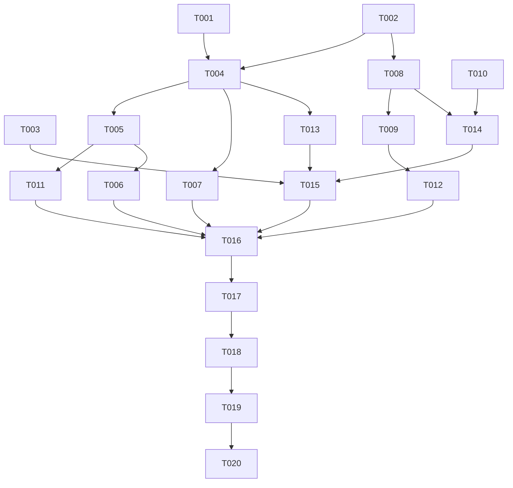

# Tasks: 统一多端播放器内核（unify-playback-core）

**Input**: Design documents from `spec/unify-playback-core/`（spec.md + plan.md）
**Prerequisites**: plan.md（架构决策）、spec.md（用户故事 P1-P3）

## Format: `[ID] [P?] [Story] Description`

- **[P]**: 可并行（不同文件、无未完成依赖）
- **[Story]**: 归属用户故事（US1-US5）
- 路径相对 `apps/harmonyos/`

## Path Conventions

- 单工程根：`apps/harmonyos/`（entry HAP + playback HAR + player_engine HAR）
- 任务描述中的 `entry/`、`playback/`、`player_engine/` 均相对 `apps/harmonyos/`
- 规格文档在 `apps/harmonyos/spec/unify-playback-core/`

---

## Phase 1: Setup

既有工程，无需项目初始化。无任务。

---

## Phase 2: Foundational（阻塞前提）

**Purpose**: 全部用户故事依赖的共享基础件（能力口径、会话端口、共享库唯一 API 增强）

- [X] T001 新增设备能力口径模块 `entry/src/main/ets/playback/DeviceCapability.ets`：按端（TV/车机 client 标识、非移动端口径、device_id）× 按引擎（AVPlayer/MPV）二维能力申报参数，供协商时动态申报（对齐 FR-006）
- [X] T002 [P] 新增 TV/车机会话端口实现 `entry/src/main/ets/playback/TvCarPlaybackSession.ets`：实现共享库 PlaybackSessionPort（start/progress/ping/stop），补 TV/车机既有上报字段口径（device_id 等），复用 PlaybackSessionCoordinator 心跳协议
- [X] T003 [P] 增强共享库播控合规层 `playback/src/main/ets/SystemPlaybackBridge.ets`：PlaybackGuard 新增可选的 playPrevious/playNext 指令回调注册；不注册时行为与现状完全一致（手机端零影响，共享库唯一公共 API 变更）

**Checkpoint**: 基础件就绪，TV/车机宿主可开始实现

---

## Phase 3: User Story 1 - TV 端统一内核播放 (Priority: P1) 🎯 MVP

**Goal**: TV 端播放走统一内核（双引擎、auto 降级、会话上报），删除对旧引擎的依赖
**Independent Test**: TV 模拟器播放普通 MP4（AVPlayer 路径）全流程正常；真机 arm64 验证降级路径

- [X] T004 [US1] 新增 TV 设备播放宿主 `entry/src/main/ets/tv/playback/TvPlaybackHost.ets`（@ObservedV2 viewmodel）：组装 PlaybackController + PlaybackGuard + PlaybackSessionCoordinator + TvCarPlaybackSession + Media（fd 租约）+ Gateway（DeviceCapability 按引擎协商）；静态 begin/adopt/end 跨页面协调（对齐旧 Playback 语义）；暴露与旧 AvPlayerEngine 等价的 @Trace 状态（phase/positionMs/durationMs/buffering/videoSize/subtitleCue/轨道列表/画质列表/engine/speed）
- [X] T005 [US1] 改造 TV 播放页 `entry/src/main/ets/tv/player/TvPlayerPage.ets`：engine 引用切换为 TvPlaybackHost（XComponent surfaceId 接入、surfaceGeneration 重建机制、状态读取与操作方法对齐）；保留遥控焦点与长按连发快进交互不变
- [X] T006 [US1] 改造 TV 起播调用点：`entry/src/main/ets/tv/home/TvHomePage.ets`、`entry/src/main/ets/tv/detail/TvItemDetail.ets` 的 Playback.begin 改为 TvPlaybackHost.begin；`entry/src/main/ets/tv/model/TvUiState.ets` 移除旧引擎 appContext 注入
- [X] T007 [US1] TV 宿主接入离线副本优先播放（离线命中 → 本机 fd 起播 → 失败回退服务器会话），复用 fd 租约模式，落点 `entry/src/main/ets/tv/playback/TvPlaybackHost.ets`（FR-009）

**Checkpoint**: TV 端统一内核 MVP 可独立验证

---

## Phase 4: User Story 2 - 车机端统一内核播放 (Priority: P1)

**Goal**: 车机端播放走统一内核，保留行车锁、mini 条、上下集播控
**Independent Test**: 车机模拟器播放全流程 + 行车锁触发/解除 + mini 条承接不中断

- [X] T008 [US2] 新增车机设备播放宿主 `entry/src/main/ets/car/playback/CarPlaybackHost.ets`（@ObservedV2 viewmodel）：组装同 TV 宿主；含 videoSurfaceVisible 行车锁开关（行车时仅音频、不中断播放）；单例槽位支持页面收起后播放存活、surface 变化原位重协商（mini 条承接）
- [X] T009 [US2] 改造车机播放页 `entry/src/main/ets/car/player/CarPlayerPage.ets`：engine 引用切换为 CarPlaybackHost；行车锁 @Monitor 接宿主 videoSurfaceVisible；surfaceGeneration 重建机制接入
- [X] T010 [US2] 改造车机调用点：`entry/src/main/ets/car/components/CarMiniPlayer.ets`（引用切到 CarPlaybackHost）、`entry/src/main/ets/car/home/CarHomePage.ets`、`entry/src/main/ets/car/detail/CarItemDetail.ets`（begin 调用点切换）、`entry/src/main/ets/car/model/CarUiState.ets`（移除旧引擎 appContext 注入）

**Checkpoint**: 车机端统一内核可独立验证

---

## Phase 5: User Story 3 - TV/车机 UI 补齐倍速与引擎选择 (Priority: P2)

**Goal**: TV/车机播放页新增倍速菜单与引擎选择入口（auto/MPV/AVPlayer）
**Independent Test**: TV 遥控/车机触控操作倍速与引擎选择，切换生效且偏好持久化（重启后仍生效）

- [X] T011 [P] [US3] TV 播放页新增倍速菜单（档位与手机一致 0.5-3.0）与引擎选择菜单项（auto/MPV/AVPlayer，读写全端共享偏好键 player.engine.v2），交互遵循 TV 遥控焦点风格，落点 `entry/src/main/ets/tv/player/TvPlayerPage.ets`（依赖 T005 完成）
- [X] T012 [P] [US3] 车机播放页新增倍速菜单与引擎选择菜单项（同上口径），交互遵循车机触控风格，落点 `entry/src/main/ets/car/player/CarPlayerPage.ets`（依赖 T009 完成）

**Checkpoint**: UI 补齐入口两端可用

---

## Phase 6: User Story 4 - 换集/连播跨端一致 (Priority: P2)

**Goal**: TV/车机换集/连播经统一内核完成，会话结束/新建、进度记忆与手机端一致
**Independent Test**: 播放剧集手动上下集、TV 自动连播，三个会话与进度分别正确

- [X] T013 [US4] TV 宿主实现换集与自动连播（playNext/playPrevious/switchToEpisode：结束当前会话 stop 上报 → 新协商起播 → 各集进度独立记忆），落点 `entry/src/main/ets/tv/playback/TvPlaybackHost.ets`（依赖 T004）
- [X] T014 [US4] 车机宿主实现换集（同上语义）并接通 mini 条与播控的上一集/下一集入口，落点 `entry/src/main/ets/car/playback/CarPlaybackHost.ets`（依赖 T008、T010）

**Checkpoint**: 换集/连播行为与手机端对齐

---

## Phase 7: User Story 5 - 系统媒体会话（AVSession）统一 (Priority: P3)

**Goal**: TV/车机 AVSession/后台长时任务由统一合规层承接，播控指令集合跨端一致
**Independent Test**: 播放中从系统媒体卡片下发播放/暂停/seek/上一集/下一集，均正确响应

- [X] T015 [US5] TV/车机宿主接入增强后的 PlaybackGuard（T003）：AVSession 元数据（含封面）+ play/pause/seek/playPrevious/playNext 指令响应 + 后台长时任务串行化，落点 `entry/src/main/ets/tv/playback/TvPlaybackHost.ets` 与 `entry/src/main/ets/car/playback/CarPlaybackHost.ets`（依赖 T003、T004、T008、T013、T014）

**Checkpoint**: 四端播控指令行为一致

---

## Phase 8: Polish（跨端收尾）

- [X] T016 删除旧引擎与死代码：`entry/src/main/ets/common/AvPlayerEngine.ets`、`entry/src/main/ets/tv/player/TvAvPlayerEngine.ets`、`entry/src/main/ets/car/player/CarAvPlayerEngine.ets`、`entry/src/main/ets/player/PlaybackGuard.ets`（无引用死代码）；全工程 grep 确认无残留 import 与引用（SC-001）
- [X] T017 手机端零改动核查：grep 核对 PhonePlaybackHost/PlayerPage/手机设置链路无本特性引入的改动（T003 共享库增强除外，且其不注册回调时行为不变），手机端冒烟播放回归（SC-004 手机侧）

---

## Phase 9: Verification

<!-- verification_scope: build+ui -->

- [ ] T018 构建工程并修复编译错误（`devecocli build`，修复循环直至成功）
- [ ] T019 部署应用：手机真机（HUAWEI Pura X View）、TV 模拟器（Huawei_TV）、车机模拟器（Huawei_Car）分别 `devecocli run --device <设备>` 部署成功
- [ ] T020 UI 验证：按 spec.md User Story 1-5 的验收场景逐项验证（TV/车机模拟器全流程：起播、降级容错、倍速、引擎选择、换集/连播、行车锁、mini 条、媒体卡片播控；手机真机回归播放）

---

## 📊 Dependency Graph



## ⚡ Parallel Execution Guide

| Phase | Tasks | Required Files | Execution Notes |
|-------|-------|----------------|-----------------|
| Foundational | T002, T003 | TvCarPlaybackSession.ets、SystemPlaybackBridge.ets | 与 T001 并行，三个基础件互不依赖 |
| US1 vs US2 | T004-T007 与 T008-T010 | tv/ 与 car/ 目录 | 宿主结构相似但文件独立，可并行推进 |
| US3 | T011, T012 | TvPlayerPage.ets、CarPlayerPage.ets | 两端菜单互不依赖，可并行；分别依赖 T005/T009 |
| US4 | T013, T014 | TvPlaybackHost.ets、CarPlaybackHost.ets | 宿主内换集实现，文件独立可并行 |

---

## Dependencies & Execution Order

### Phase Dependencies

- **Setup (Phase 1)**: 无任务，直接进入
- **Foundational (Phase 2)**: T001-T003 完成 → 阻塞解除
- **User Stories (Phase 3-7)**: 全部依赖 Foundational；TV 线（US1→US4）与车机线（US2→US4）可并行推进；US3 依赖对应端页面接缝（T005/T009）；US5 依赖两线换集完成（T013/T014）与共享库增强（T003）
- **Polish (Phase 8)**: 依赖全部用户故事完成
- **Verification (Phase 9)**: 依赖 Polish 完成；T018 → T019 → T020 严格串行

### User Story Dependencies

- **US1 (P1)**: Foundational 后即可开始，无其它故事依赖
- **US2 (P1)**: Foundational 后即可开始，与 US1 并行；模式复用 US1 经验
- **US3 (P2)**: 依赖 US1/US2 的页面接缝（T005/T009）
- **US4 (P2)**: 依赖 US1/US2 的宿主（T004/T008）与车机调用点（T010）
- **US5 (P3)**: 依赖 US4（换集方法作为播控指令目标）与 T003

---

## Parallel Example: User Story 3

```bash
# 两端菜单互不依赖，可同时启动：
Task T011: "TV 播放页倍速菜单 + 引擎选择（tv/player/TvPlayerPage.ets）"
Task T012: "车机播放页倍速菜单 + 引擎选择（car/player/CarPlayerPage.ets）"
```

---

## Implementation Strategy

### MVP First (TV 线先行)

1. 完成 Phase 2 基础件（T001-T003）
2. 完成 Phase 3 TV 端（T004-T007）
3. **STOP 验证**: TV 模拟器全流程独立验证（统一内核 MVP）
4. 车机线复用同一模式推进（T008-T010）

### Incremental Delivery

1. 基础件 → TV MVP → 车机 → UI 补齐 → 换集/连播 → AVSession 统一 → 删旧引擎 → 验证
2. 每个故事完成后可独立验证（各 Phase 头部 Independent Test）
3. T016 删除旧引擎前，全工程必须已无引用

---

## Notes

- [P] 任务 = 不同文件、无未完成依赖
- [USx] 标签对应 spec.md 用户故事，保证可追溯
- T003 是共享库唯一公共 API 变更，完成后立即手机端冒烟（不注册回调时行为不变）
- x86 模拟器 MPV 为 stub：模拟器只验证降级容错路径；MPV 完整降级验证需 arm64 真机
- 手机端播放链路（PhonePlaybackHost 及其下游）本特性零结构性改动，T017 做最终核查
- 每完成一个任务或逻辑分组后提交；检查点处停下独立验证

## Summary Report

- **总任务数**: 20（T001-T020）
- **按故事分布**: US1=4（T004-T007）、US2=3（T008-T010）、US3=2（T011-T012）、US4=2（T013-T014）、US5=1（T015）、基础=3（T001-T003）、收尾=2（T016-T017）、验证=3（T018-T020）
- **并行机会**: 基础件 3 任务并行；TV 与车机两条故事线整体并行；US3/US4 内部两端并行
- **独立测试判据**: 每个故事按其 Independent Test 单独验证（见各 Phase 头部）
- **建议 MVP 范围**: Phase 2 + US1（T001-T007）——TV 端先行跑通统一内核，车机复用同一模式跟进
- **风险提示**: T003 为共享库唯一 API 变更，完成后需立即手机端冒烟；x86 模拟器 MPV 为 stub，MPV 完整降级验证需 arm64 真机
