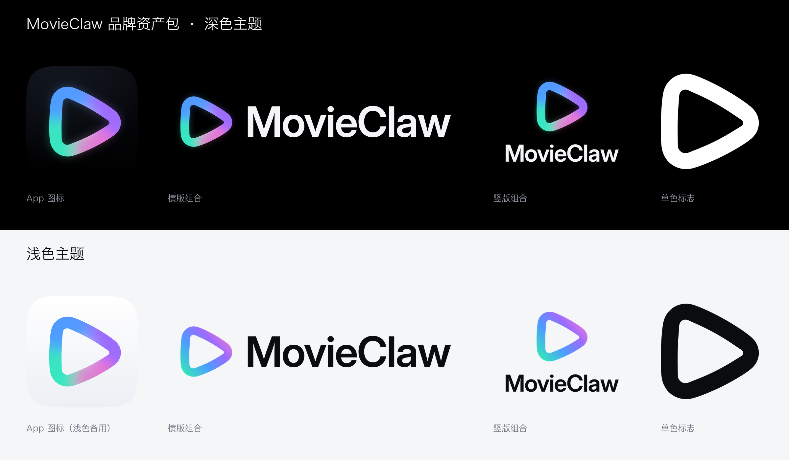

# MovieClaw 品牌资产包



定稿：**A9 极光**。一笔写成的圆角播放三角，笔画是青绿 → 湖蓝 → 紫 → 粉的极光渐变。
字标「MovieClaw」，字体 Inter（字重 620，Display 字形），已经转成路径，不依赖本机字体。

**图标比例（尺寸 B，2026-10-02 定稿）**：三角外框约占图标 64%，笔画约占 11%。
视觉面积（外轮廓围起来的面积）约占 32%，和 App Store、音乐这类同属线条图形的苹果图标一致。

---

## 目录

```
docs/brand/kit/
├── source/          矢量源文件（SVG）：标志、字标、组合、App 图标、Icon Composer 分层
├── ios/             iOS / iPadOS：Xcode 资源目录（含深色、着色外观）、浅色备用图标、各尺寸 PNG
├── macos/           macOS：深色 / 浅色两套 .icns、.iconset、Xcode 资源目录
├── web/             网页：favicon（ico / svg / png）、apple-touch-icon、PWA 图标、分享卡片、manifest、<head> 代码
└── brand/           品牌位图：标志、组合、字标、社交头像、GitHub README 用 logo
```

## 颜色

| 用途 | 色值 |
|---|---|
| 极光渐变（左下 → 右上） | `#36E2BD` → `#4C9DFF` → `#9A6BFF` → `#FF7FCF` |
| 深色底 / 图标背景 | `#000000`（图标背景顶部带极轻的 `#0C0E13` 渐变） |
| 深色底上的字标 | `#F3F5F9` |
| 浅色底 | `#FFFFFF` / `#F5F6F8` |
| 浅色底上的字标 | `#0B0C0F` |

## 标志的几种版本

| 文件 | 用在哪里 |
|---|---|
| `mark-aurora-on-dark` | **深色底**：完整极光，带一圈淡淡的外溢光，文件四周留了外溢光需要的空间 |
| `mark-aurora-on-light` | 大尺寸展示：极光，不带外溢光 |
| `mark-aurora-flat` | **浅色底、印刷、设计软件**：只有渐变，没有模糊滤镜，兼容性最好。浅色主题的组合都用这一版 |
| `mark-black` / `mark-white` | 单色：水印、压印、单色印刷、系统着色场景 |
| `mark-aurora-animated.svg` | 色光会缓慢漂移的动态 SVG，用于网页大图、启动页 |

## 组合规范

- **横版**：标志高 H；字标大写字母高 0.6H；两者间距 0.3H。
- **竖版**：标志在上；字标大写字母高 0.34H，间距 0.26H。
- **安全区**：四周至少留 0.25H（文件里已经留好）。
- **最小尺寸**：横版组合高度不小于 14px（屏幕）或 6mm（印刷）；再小就只用标志。
- 文件名里的 `on-dark` 表示用在深色底（白字），`on-light` 表示用在浅色底（黑字），`black` / `white` 是单色。
- `lockup-horizontal-on-dark-claw-aurora` 是「Claw」带极光渐变的写法，只用在启动页、海报这类大尺寸场景。

不要拉伸变形、换其他颜色、给字标加描边或投影；也不要把极光版放在杂乱的照片上，照片上请用单色白版。

---

## iOS / iPadOS（`ios/`）

依据苹果《人机界面指南》中 App 图标一节。

- **`AppIcon.appiconset/`**：直接拖进 Xcode，替换 `Assets.xcassets/AppIcon.appiconset`（Xcode 14 起的单尺寸 1024 写法）。
  - `AppIcon-1024.png`：默认外观。纯黑底、**不透明**、不带圆角，系统会自己裁。
  - `AppIcon-1024-dark.png`：深色外观（iOS 18+）。**透明底**，系统会补上深色背景。
  - `AppIcon-1024-tinted.png`：着色外观（iOS 18+）。**灰阶**，系统按用户选的颜色上色。
- **`AppIcon-Light.appiconset/`**：浅色主题的备用图标，可以做成 App 内「更换图标」（`setAlternateIconName`）的选项。
- **`icon-composer/`**：iOS 26 / macOS 26 Liquid Glass 图标用的分层素材，在苹果的 Icon Composer 里组装。
  - 背景层用 `background-dark.svg`，浅色版用 `background-light.svg`。
  - 前景层用 `foreground-aurora.svg`（纯渐变，没有滤镜）。玻璃高光、折射、半透明在 Icon Composer 里打开，**不要**画进图里。
  - 着色、透明外观需要单色前景时，用 `foreground-white.svg`。
  - Icon Composer 不认 SVG 滤镜时，改用带极光色光的位图 `foreground-aurora-glow-1024.png`。
- **`sizes/`**：深色、浅色两套常用尺寸 PNG（180 / 167 / 152 / 120 / 87 / 80 / 60 / 58 / 40），供第三方平台、旧工程或文档使用，文件名里写了对应的 pt 和用途。

## macOS（`macos/`）

依据苹果 macOS App 图标规范：1024 画布里放一个 824×824 的连续圆角方块，四周各留 100，带系统风格投影。macOS 不会替你裁圆角，所以外形已经画好、四角透明。

`dark/` 和 `light/` 各一套：
- `AppIcon.icns`：直接放进 App 包的 `Contents/Resources`。
- `AppIcon.iconset/`：`iconutil` 的源目录，16 / 32 / 128 / 256 / 512 各有 @1x 和 @2x。
- `AppIcon.appiconset/`：Xcode 资源目录版本。
- `AppIcon-1024.png`：母版。

## 网页（`web/`）

把文件放到站点根目录，再把 `head-snippet.html` 里的代码放进 `<head>`。

| 文件 | 规格 | 作用 |
|---|---|---|
| `favicon.ico` | 16 / 32 / 48 三档合一 | 兼容所有浏览器和老系统的书签 |
| `favicon.svg` | 矢量 | 现代浏览器的标签页图标，任意缩放都清晰。字形放大到约占 70%，16px 下也能认出来 |
| `favicon-16x16.png` / `favicon-32x32.png` | PNG | 少数场景单独引用 |
| `apple-touch-icon.png` | 180×180，不透明 | iPhone「添加到主屏幕」，iOS 自己加圆角 |
| `icon-192.png` / `icon-512.png` | 圆角，四角透明 | PWA 安装图标（purpose: any） |
| `icon-maskable-192.png` / `-512.png` | 全出血，不透明 | Android 自适应图标（purpose: maskable），字形在 80% 安全圆内 |
| `og-image-dark.png` / `og-image-light.png` | 1200×630 | 链接分享卡片，默认用深色版 |
| `site.webmanifest` | — | PWA 清单 |
| `light/` | — | 浅色主题的 favicon 和 apple-touch-icon（可选） |

## 品牌位图（`brand/`）

| 目录 | 内容 |
|---|---|
| `mark/` | 标志的各个版本，高 1024 / 512，透明底 |
| `lockup/` | 横版 / 竖版 × 深色 / 浅色 / 黑 / 白，宽 2048 / 1024 / 512，透明底 |
| `wordmark/` | 只有字标，深色底和浅色底两版 |
| `social/` | 社交头像 1024 / 400，字形落在圆形裁切的安全区内；`google-oauth-logo-120.png` 是 Google Cloud OAuth 授权页用的 120×120 logo；`github-app-logo-512.png`（透明底）/ `github-app-logo-black-512.png`（纯 #000 底）是 GitHub App 用的 logo，徽章底色填 `#000000` |
| `readme/` | `logo-dark.png` / `logo-light.png`，与仓库 `docs/images/` 下的同名文件用法一致 |

---

## 重新生成

本目录是 `movieclaw-logo-lab/MovieClaw-Brand-Kit/` 的定稿资产副本，保留原包分类；生成脚本与设计过程文件仍在 `movieclaw-logo-lab` 工作区。

如需重新生成，在该工作区中操作：

1. 用无头 Chrome 的 `--dump-dom` 读取 `kit-export.html`，把页面输出的 JSON 存为 `data/glyph.json`（定稿字形的轮廓和极光效果）。
2. 运行 `python build_brand_kit.py`。需要 `fonttools`、`uharfbuzz`、`brotli`、`Pillow` 和本机 Chrome。原包 README（模板是 `kit-README.md`）和总览图也由脚本一起产出。
3. 将生成的 `MovieClaw-Brand-Kit/` 同步到本目录，并保留本节针对开源仓库的路径说明。

位图先由 Chrome 把 SVG 渲染成 1024 / 2048 的母版（极光里的模糊和遮罩只有浏览器渲染才准确），再用 Lanczos 缩放到各个尺寸。
