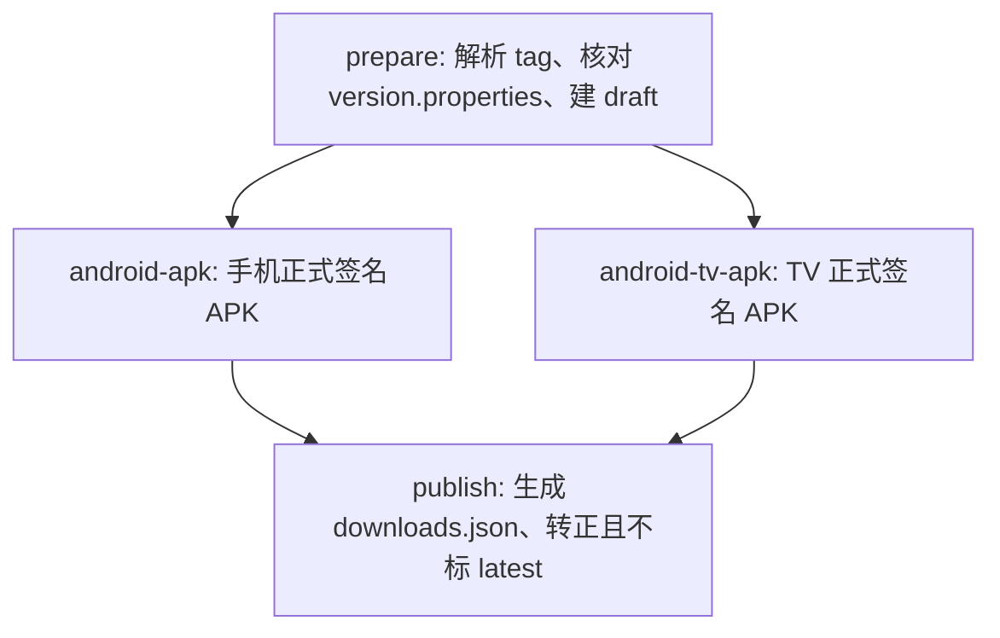

# Android 版本与 GitHub 发版作业

## 版本边界

Android 手机/平板使用独立发行版本，唯一来源是 `apps/android/version.properties`。
首个官方版本为 `0.1.0`，安装版本码为 `30000001`，高于旧开发包的 `YYYYMMDD` 编码。
每次发布有变化的 Android 客户端，递增 `versionName` 和 `versionCode`，例如
`0.1.1 / 30000002`。同一天可以发布多个版本；同一提交重复构建不会自动改版本。
`versionCode` 必须递增且不超过 Android 的 `2100000000` 上限。

服务器继续使用 `vX.Y.Z`，Apple App 继续使用 `apps/apple/project.yml` 中的
`MARKETING_VERSION`。Android 不再随服务器 Release 分发，而是单独发 `android-vX.Y.Z`
（TV 为 `androidtv-vX.Y.Z`）Release，tag 版本必须等于 `versionName`。
v0.37.0 及更早的服务器 Release 里仍附带当时的 APK，作为历史版本保留。

兼容性靠运行时判断：App 登录前读服务器 `/health` 的 `version`，低于
`MIN_SERVER_VERSION`（手机在 `SessionRepository`，TV 在 `AppModel`）时提示先升级服务器。
App 开始依赖更新的服务器接口时上调这个值。独立客户端各有自己的 applicationId、版本文件和附件名：
Android TV 见下文「Android TV」；当前不预建尚未实现的产品或构建变体。

## 现有工作流分工

| 工作流 | 入口 | 职责 |
|---|---|---|
| `ci` | PR | Python、Web、CLI、Worker 的改动检查 |
| `ios` | PR | iPhone / TV / Mac 编译与测试，按路径运行 |
| `Android stability` | Android 或发版工作流改动的 PR / main push | 原生生命周期、场景测试、lint、APK，以及临时测试证书的完整 release 打包 |
| `downloads` | 下载元数据、打包脚本或发版工作流的 PR | 清单、签名检查和旧包沿用回归测试 |
| `release` | `v*` tag 或手动输入 tag | 服务器：创建 draft、构建/复制附件、发布 Docker、终审后转正 |
| `android-release` | `android-v*` / `androidtv-v*` tag 或手动输入 tag | Android：校验版本、正式签名构建、生成 `downloads.json`、转正（不标 latest） |
| `apple-release` | `ios-v*` / `tvos-v*` / `macos-v*` / `transcoder-v*` tag | Apple 平台客户端与 Mac 转码器，见发版 skill 第九节 |
| `release-kick` | `release-kick/<tag>` 分支（服务器与各客户端 tag） | 校验版本并触发对应发版工作流，之后删除点火分支 |
| `docker-image` | `release` 调用或手动 | 多架构镜像及 tag 发布 |
| `release-notes` | changelog 合入 main | 同步对应 Release 的正文 |

`claude*` 和 `runtime-guard` 分别用于协作自动化、运行时兼容检查，不负责打包发布。

`android-release` 的作业链：



一次只发一个 App：tag 前缀决定跑 `android-apk` 还是 `android-tv-apk`。每个 tag 都重新构建，
不沿用旧包；同一版本已发布时 `prepare` 直接失败，发新版须递增 `version.properties`。
`downloads.json` 只能包含与 tag 同产品、同版本的那一个包（`build-download-manifest.py` 校验）。

## Android 产物与下载地址

当前支持 Android 8.0（API 26）及以上、arm64-v8a 手机/平板。

- `MovieClaw-Android-arm64.apk`：可直接安装的正式签名包，包含 Exo、MPV 及原生依赖。
- `MovieClaw-Android-arm64.json`：由 `aapt2` / `apksigner` 读取 APK 后生成的版本、
  安装版本码、最低 SDK、大小、SHA-256 和签名证书指纹，沿用时与 APK 一起复制。
- `downloads.json`：本 Release 的包信息，官网下载页从各 Release 汇总每个客户端的最新版本。

最新版固定地址：<https://movieclaw.io/download/android.apk>（TV 为
<https://movieclaw.io/download/androidtv.apk>），官网按各 Release 的 `downloads.json` 跳到最新 APK。
不要用 `releases/latest/download/...`：latest 永远是服务器 Release，里面已没有 APK。

指定版本（将 `X.Y.Z` 换成实际版本）：

`https://github.com/movieclaw/MovieClaw/releases/download/android-vX.Y.Z/MovieClaw-Android-arm64.apk`

## 签名与本地打包

Android 自签名证书由 JDK `keytool` 免费生成，无需 Apple 开发者账号。
正式版本长期使用同一密钥；GitHub Secrets 保存 CI 所需信息，私钥和密码不进入 git。
仓库所需 Secrets：`ANDROID_KEYSTORE_BASE64`、`ANDROID_KEYSTORE_PASSWORD`、
`ANDROID_KEY_ALIAS`、`ANDROID_KEY_PASSWORD`。保存离线备份，重配 Secrets 时沿用同一密钥。

本地设置 `ANDROID_HOME`、`JAVA_HOME` 和以下四个环境变量后运行：

```bash
# 密码从本机凭证配置加载，不写进脚本或 shell 历史。
# ANDROID_KEYSTORE_PATH / ANDROID_KEYSTORE_PASSWORD / ANDROID_KEY_ALIAS / ANDROID_KEY_PASSWORD
bash apps/android/scripts/package-release.sh
```

产物位于 `apps/android/build/release/`。脚本禁用 Gradle 配置缓存，校验正式签名、
版本、架构及 MPV 依赖。原生库下载或校验失败会中止正式打包；开发 debug 构建仍允许 Exo-only。
PR 检查只生成短期测试证书，不接触正式签名密钥。

之前装过其他签名的开发包时，Android 不允许直接覆盖；迁移到官方签名包需要先卸载旧包。
之后官方签名保持一致，递增版本码即可覆盖升级并保留应用数据。

## Android TV

Android TV（`apps/android-tv`，[设计](androidtv-app.md)）是与手机版完全独立的 App，发版沿用同一套口径：

- **版本**：独立，唯一来源 `apps/android-tv/version.properties`，首版 `0.1.0 / 1`；有变化时
  `versionName` 与 `versionCode` 一起递增。不跟手机版或服务器 tag 同步——两个 App 的发布节奏、
  内核与依赖各不相同，共用版本号只会让一边出现内容没变的「新版本」。applicationId
  `io.movieclaw.androidtv` 与手机版并存，`versionCode` 互不影响。
- **签名**：与手机版共用同一把正式密钥（同一组 `ANDROID_KEYSTORE_*` Secrets）。applicationId
  不同，共用密钥不会互相覆盖，只是少保管一把；同样必须长期沿用。
- **附件**：`MovieClaw-AndroidTV.apk` + 同名 `.json`（`product` 为 `androidtv`）。一个包同时带
  arm64-v8a 与 armeabi-v7a（电视盒子仍有大量 32 位机器），`arch` 记 `arm`，`abis` 列出两种架构；
  最低 Android 6.0（API 23）。打包脚本校验两种架构的 FFmpeg 音频解码与 libass 库都在。
- **作业**：`android-release` 的 `android-tv-apk`，tag 为 `androidtv-vX.Y.Z`。安装
  NDK / CMake 现编 FFmpeg（`native/ffmpeg/build.sh`，LGPL 共享库），再 `assembleRelease`。

本地打包（同样的四个签名环境变量；首次会编 FFmpeg，`NDK` 默认 `$ANDROID_HOME/ndk/27.3.13750724`）：

```bash
bash apps/android-tv/scripts/package-release.sh   # 产物在 apps/android-tv/build/release/
```

最新版：<https://movieclaw.io/download/androidtv.apk>；指定版本：
`https://github.com/movieclaw/MovieClaw/releases/download/androidtv-vX.Y.Z/MovieClaw-AndroidTV.apk`

## 发版操作

1. Android / Android TV 有功能/修复变动时，递增各自 `version.properties` 的 `versionName` 与
   `versionCode`，写 `docs/changelog/android-vX.Y.Z.md`（或 `androidtv-vX.Y.Z.md`），合入 main。
2. 推 `android-vX.Y.Z` / `androidtv-vX.Y.Z` tag；远程会话推点火分支
   `release-kick/android-vX.Y.Z`，或到 Actions → android-release 手动输入 tag。
3. 看 `publish` 作业：APK、JSON、`downloads.json` 在场，Release 已转正且没有被标成 latest。
4. 服务器新功能依赖这一版 App 时，先发 Android 再发服务器，服务器正文的「客户端」一节会取到它。

验证命令：`python3 -m unittest discover -s scripts/tests`。完整打包验证运行上面的脚本，
检查 `aapt2` 包内版本、`apksigner` 签名和 APK → 元数据 → `downloads.json` 链路。
