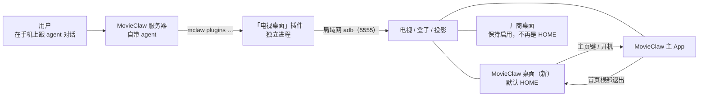

# Android TV 换桌面：MovieClaw 桌面 + 「电视桌面」插件

> 状态：设计稿（2026-10-21）。桌面壳的最小实现在插件仓库 `plugins/tv-home/launcher`（§6.1–6.3，不含「恢复原桌面」与「信号源」），
> 已提 PR movieclaw/movieclaw-plugins#15、**已合并**（2026-10-23）、未发版；2026-10-22 起桌面壳随插件发版、不再是主仓库的产品（§2「发版」）；
> 插件本体的 P1 接口（§8.3 的 guide/connect/probe/install/home/verify/restore/close）已在插件仓库分支
> `feat/tv-home-plugin` 实现（依赖改用服务器 v0.40+ 的 requirements.lock 机制，§8.1 的 wheels/ 方案不再需要），未推送、未装进真实服务器；
> 主 App 的改动 §7 第 2 条（开机网络晚到）已实现（上游 PR movieclaw/MovieClaw#975，已合并，未随发版）；
> §7 第 1 条（深链 movieclaw://home）已实现（2026-10-25，主仓库本地提交，编译过、未发版；「播放中收到深链退出、进度上报」要在有登录的真机上验证）。模拟器上的摸底已完成（[实测报告](../research/androidtv-home-emulator-2026-10.md)）；
> 索尼 X8500G 国行（Android 10）做了只读摸底，当晚用本地构建的桌面壳换成了（[报告](../research/androidtv-home-sony-x8500g-2026-10.md) §5）；
> 坚果 N1 等真机的摸底（§10）出来后定稿。
> 已确认（2026-10-21）：做**通用**方案，坚果 N1 只是第一台验证机；由 **MovieClaw 服务端自带的 agent** 执行；
> **以插件交付**——不改服务端核心、不进 Docker 镜像；主页键固定去 MovieClaw 首页；桌面壳名为「MovieClaw 桌面」、
> 包名 `io.movieclaw.androidtv.home`。
> 关联文档：[androidtv-app.md](androidtv-app.md)（TV 客户端）、[plugin-phase3.md](plugin-phase3.md)（插件包、批准、进程外运行）、
> [plugin-dependencies.md](plugin-dependencies.md)（插件依赖）、[plugin-phase2b.md](plugin-phase2b.md) §8（插件路由）、
> [plugin-extension-model.md](plugin-extension-model.md)（插件路由进入 `mclaw` 目录）、[plugin-web-pages.md](plugin-web-pages.md)（插件网页）、
> [login-devices.md](login-devices.md)（登录设备记录）、[android-release.md](android-release.md) /
> [download-manifest.md](download-manifest.md)（发版与下载清单）、[androidtv-home-scroll-2026-10.md](../perf/androidtv-home-scroll-2026-10.md)（弱机性能口径）。
> 外部参考：[Gathin23/cleanyourtv](https://github.com/Gathin23/cleanyourtv)（MIT）：经 adb 给 Android TV 去臃肿、换桌面，
> 按机型维护验证过的清单（一百多款）。本文的设备操作规则大多出自它，引用处注明。
> [pengchujin/aerial-tv](https://github.com/pengchujin/aerial-tv)（MIT，2026-10-20 创建）：参照 tvOS 的国产电视干净桌面；
> 它的 `guard/` 包是 §12 接管模式的已验证蓝本，`tools/install.sh` 是 adb 授权清单的参考，引用处注明。插件仓库：[movieclaw/movieclaw-plugins](https://github.com/movieclaw/movieclaw-plugins)。

## 0. 一句话

在安卓电视、盒子、投影上**把厂商桌面换成「MovieClaw 桌面」**：开机、按主页键直达 MovieClaw 首页，从 MovieClaw 退出是「全部应用」。
换桌面、去臃肿做成一个按需安装的插件**「电视桌面」**：设备操作是插件的接口，MovieClaw 自带的 agent 用 `mclaw` 调用它们，
带着用户一步步做——用户在手机上跟 agent 对话，拿遥控器点几下、扫一次码。不 root、不动系统分区，每一步都能还原。
能做到哪一步按机型分级（§3），说不清的机型宁可少做。

## 1. 背景与目标

厂商系统卡、自启动多、有广告（开机广告、桌面推荐位、屏保）；用户不买厂商的影视会员，开机就是为了看 MovieClaw。

目标：

1. **必须换桌面**：开机、按主页键都落在 MovieClaw 首页，厂商桌面不再出现（「应用」键打开厂商桌面的应用列表除外，§6.4）。
2. **通用**：Android 6.0 及以上的安卓电视、盒子、投影都能用（原生 Android TV、Google TV、国产定制系统）；
   能做到哪一步按机型分级（§3）。坚果 N1 是第一台验证机。
3. **小白能完成**：agent 执行，用户只做 §8.10 的手动步骤。
4. **厂商功能一个都不能坏**：投影的对焦、梯形、避障、入幕、人眼防护、云台；电视的信号源、调台；遥控器、投屏。
5. **随时可还原**：只改 /data 里的状态（停用、默认桌面、安装），最坏情况恢复出厂即原样。
6. **复用正式 Release**：MovieClaw 用已签名的正式包，不在任何地方现场编译。
7. **按需安装**：以插件交付，只有需要的人装；服务端核心不改、Docker 镜像不变。

不做：

- root、刷机、系统应用——投影光机、电视信号链路都在厂商闭源组件里，第三方 ROM 拿不到；人眼防护失效是安全事故。
- 通用桌面——没有小部件、主题、壁纸、天气、通知。
- MovieClaw 主 App 声明 HOME（§2 第一行）。
- 卸载系统应用（只停用）。
- Android 6.0 以下（同 MovieClaw TV 的 minSdk 23）；非 Android 系统（三星 Tizen、LG webOS）；Fire TV（只能去臃肿、换不了桌面，cleanyourtv 的记录）。

## 2. 决策

| 事项 | 结论 | 理由 |
|---|---|---|
| 谁当桌面 | 新做一个独立的小 APK「MovieClaw 桌面」（下称**桌面壳**，`io.movieclaw.androidtv.home`）；主 App `io.movieclaw.androidtv` **不加 HOME** | ① cleanyourtv 记录：有的大陆版电视拒装任何声明 HOME 且不带厂商签名的包——HOME 放进主 App，这类电视上 MovieClaw 本体就装不上、升不了；② 系统在 HOME 候选集合变化时会丢掉用户选好的默认桌面（cleanyourtv 安装脚本的注释）。Android 10 源码如此：候选集变大就丢掉，前两名优先级相同时，下次按主页键弹选择框。所以主 App 带 HOME 的话，厂商桌面优先级为 0 的机型（如国行索尼）装上 MovieClaw 后，下次按主页键就会弹框。Android 14 模拟器上没看到，是因为那里厂商桌面优先级 2，系统轮不到看默认桌面；③ 同一个 Activity 先以普通方式打开、再从主页键进，会按「桌面 / 普通」两种任务类型各起一份界面（模拟器实测） |
| 按主页键去哪 | MovieClaw 首页；播放中按主页键 = 退出播放回首页 | 用户确认（2026-10-21） |
| 其他应用在哪 | 桌面壳自己的「全部应用」页：在 MovieClaw 首页退出即到 | 桌面壳不依赖 MovieClaw：MovieClaw 没装、没登录、崩溃时，电视仍有一个能用的桌面 |
| 桌面壳怎么做 | Kotlin + View（RecyclerView），不用 Compose；不申请网络权限、没有后台服务、没有设置项、不含原生库；目标 1 MB 以内 | 桌面进程常驻后台，1～2 GB 内存的机器上要轻；不含原生库则 32 / 64 位系统都能装；cleanyourtv 的桌面约 405 KB，同一思路 |
| 厂商桌面 | 厂商桌面的 HOME 优先级大于 0 时**停用它这一个包**；等于 0 时只设默认桌面、不停用。由 `probe` 读优先级自动判断，不靠机型记录 | 原生 Android TV、Google TV 的原厂桌面优先级都是 2，第三方桌面最高 0（清单里写再高也被压到 0），系统解析主页意图时取优先级最高的，只设默认桌面不生效（模拟器实测，同 cleanyourtv 的做法）。停用是最危险的一步，配套三条：停用后 HOME 必须解析到桌面壳，否则立刻回滚；还原时先启用厂商桌面、再卸桌面壳（反过来会黑屏）；桌面壳提供「恢复原桌面」（§6.3） |
| 适用范围 | 通用，按机型分三级：已验证全流程、未验证只换桌面、做不了说清原因（§3） | 通用不等于每台都敢全做：没验证过的机型，停错一个包就可能坏掉光机或信号源 |
| **怎么交付** | 插件「电视桌面」（id `tv-home`，名字暂定），进程外运行；源码与发版在插件仓库 `plugins/tv-home/`，桌面壳的 APK 也在包里（见「发版」） | 用户确认（2026-10-21）。只有电视 / 投影用户需要，装插件时管理员在批准页看到它的网络与依赖并同意；不进镜像、不用发新镜像；机型记录常更新，单独发版；在独立进程里跑。做进核心则要改三处：镜像加依赖、服务器的客户端代下接口对 `mclaw` 开放、agent 用 bash 跑脚本 |
| 设备操作 | 插件的接口（连接、摸底、安装、换桌面、去臃肿、验证、还原、关调试……），自动出现在 agent 的 `mclaw plugins` 命令里；防护规则写在插件代码里，规则与清单格式沿用 cleanyourtv 并注明出处 | agent 不需要 bash；能用 `mclaw` 的入口都能用（网页、IM 通道、插件驱动的会话）；判断在代码里，不靠提示词 |
| 执行者 | MovieClaw 自带 agent（只有管理员能用）；服务器连不到电视时，电脑上的 agent 用插件包里的同一份代码（§8.9） | 用户确认；服务器本来就在局域网、全天在线，小白不用在电脑上装任何东西 |
| adb 客户端 | 纯 Python 的 `adb-shell`（cleanyourtv 的 `tools/tv.py` 同款），钉 0.4.3；连同 `pyasn1`、`rsa` 的预编译包放进插件包的 `wheels/`；`cryptography` 用宿主自带的 | 插件依赖只收预编译包，最新的 0.4.4 只有源码包；包内带轮子，安装时不联网（国内访问 PyPI 不稳）；三者下载约 180 KB、装好约 0.7 MB |
| agent 能决定什么 | 只决定「接下来问用户什么、调哪个接口」；哪些包能停、能不能停厂商桌面，全由插件按机型记录决定，插件拒绝的 agent 绕不过 | agent 背后的模型由管理员配置，能力参差；判断不了陌生的厂商包，投影功能一停就坏 |
| 去臃肿 | 只对已验证机型做「确定可停」的部分，可选项默认保留、不问 | 默认就对，不多问（AGENTS.md §5） |
| 安装包来源 | MovieClaw 主 App：插件经宿主的统一网络出口（`movieclaw_sdk.net.http_transport`，走设置里的代理与镜像）从正式 Release 下载，校验 sha256；也接受上传的 APK。桌面壳：用插件包里自带的 APK | 服务器的客户端代下接口是隐藏操作，插件不能调；统一出口同样复用服务器配好的代理。桌面壳只有约 0.2 MB，放进包里装的时候不联网 |
| 机型知识 | 机型记录放在插件包的 `devices/`，**以 cleanyourtv 为准**：从它验证过的机型人工过一遍再收，跟着它更新。不自己去摸别的机型，手头的机器（坚果 N1、索尼 X8500G）只用来试通用流程（用户确认，2026-10-21）；手头机器的清单提 PR 回 cleanyourtv | cleanyourtv 按机型维护、已有一百多款且持续更新，不重复这份工作；它的清单缺我们要的机读字段（匹配规则、级别、能否停厂商桌面、中文的开调试路径），而且混着贡献者的个人选择，所以要过一遍再收 |
| 发版 | 桌面壳的源码和发版都在插件仓库（`plugins/tv-home/launcher/`，独立的 Gradle 工程），APK 打进插件包、随插件发版；主仓库不为它加产品 | 用户确认（2026-10-22）：做成插件、按需安装，主仓库不为只有电视用户用得上的东西加发版作业、更新产品表和下载清单；插件和桌面壳之间有私有约定（§6.4 的机型配置），一起发版不会错配。代价：主 App 不能顺带更新桌面壳，更新走插件的 `install`（§9）；插件仓库要加 Android 构建和一把固定的签名密钥 |
| **桌面壳可选 aerial-tv** | 壳有两种（2026-10-25 用户拍板）：默认仍是极简壳「MovieClaw 桌面」；`install`/`home` 带 `shell=aerial` 时装 [pengchujin/aerial-tv](https://github.com/pengchujin/aerial-tv)（MIT，`app.orchard.tv`）当壳，从它正式 Release 下载 `aerial-standard.apk` 并按 GitHub digest 校验；其 guard 变体不装（对应 P4 接管模式） | 用户的「全部应用」页想要 Apple TV 观感：aerial-tv 5 天 4.4k star 且迭代极快，自己造是重复轮子；组合后 Apple TV 体验归它、我们只做安装器与防护（agent 引导、机型分级、记录还原）。极简壳继续当默认兜底（1 MB、不联网红线不动）；两种壳的换桌面/还原流程一致，记录按包名参数化，restore 只卸「我们装的」壳 |
| **远期形态：壳 + MC 双应用维持** | 2026-10-25 讨论定案：不把 MC 改造成 HOME。硬理由：① 拒装 HOME 机型上 MC 本体必须能装——壳被拒只丢换桌面（C 级），MC 被拒丢产品；② MC 高频发版 × Android 候选集变化丢默认桌面的机制（§2②）= 每次更新都威胁桌面选择，壳几乎不发版所以稳；③ 故障域隔离——壳死简单、崩溃只是停在全部应用，MC 是重应用，崩溃不能等于电视没桌面。收益侧小：体验已准直达（壳拉起 MC 冷启动 ~0.7s）、Apple TV 观感由 aerial-tv 壳承担；成本侧大：任务栈桌面语义重做 + 发版补偿逻辑。演进口子：§7.1 深链补完「回首页」体验、P4 接管模式兜拒装机型、根部「连按两次返回」是否退出的产品参数（电视 App 很少退出，改成根部留在 MC 会让 MC 体验上"就是"桌面而不动架构）。重新评估触发：拒装机型占比证明是长尾、新版 Android 实测覆盖安装不丢默认桌面、MC 发版放缓——三条同时成立再议 | 讨论定案（2026-10-25） |

## 3. 通用：分级与机型知识

### 3.1 三级

| 级别 | 条件 | 做什么 |
|---|---|---|
| **A 已验证** | 机型记录匹配（§3.3 的匹配规则） | 换桌面（记录允许时停厂商桌面）+ 去臃肿 + 信号源与按键配置 |
| **B 通用** | 没有记录，但能侧载、能装桌面壳，按 §8.4 换完后**真遥控器**的主页键到了桌面壳 | 只换桌面（需要时停用厂商桌面这一个包，§2），不做去臃肿；生成摸底报告（§3.3） |
| **C 做不了** | 拒绝侧载；或拒装声明 HOME 的包；或按 §8.4 换完（含停用厂商桌面）真遥控器的主页键仍不到桌面壳 | 不改设备（已改的还原），说清原因并生成摸底报告；能侧载但拒装 HOME 包的，留给接管模式（§12） |

级别由 `probe` 和换桌面的实测结果得出，不按品牌推断——cleanyourtv 明说同一品牌的不同机型行为不同。

### 3.2 已知的几类情况（cleanyourtv 的记录，摸底时先对照）

- **Google TV**（`launcherx` + 设置向导 `setupwraith`）：`launcherx` 的 HOME 优先级是 2，`set-home-activity` 打印成功却不生效，
  要停用 `launcherx`（模拟器实测）。真机上设置向导也声明 HOME，停了 `launcherx` 可能由它接管，停它之前要查已保存的 Wi-Fi 归不归它
  （停了会删掉这个网络）。模拟器镜像里没有设置向导，这部分只能在真机上验证；所以 Google TV 真机最好有 A 级记录。
- **原生 Android TV**（`tvlauncher` / `leanbacklauncher`）：`tvlauncher` 优先级同样是 2，停用它即可换（模拟器实测），B 级就能做。
- **国行索尼**（当贝桌面 `com.dangbei.TVHomeLauncher`，系统特权应用）：HOME 优先级 0，只设默认桌面、不停用。
  cleanyourtv 在 XR-75X91K（Android 12）上这样换过，注入的主页键到了新桌面；X8500G（Android 10）实测相同：只设默认桌面，真遥控器的主页键就到了桌面壳（[报告](../research/androidtv-home-sony-x8500g-2026-10.md) §5）。
  同一平台的国际版原厂桌面是 `tvlauncher`（优先级 2），两版的 model、device 相同（§3.3）。遥控器的设置、信号源、电视、帮助和 App 快捷键都不经桌面（§6.4）。
- **小米**（PatchWall `com.mitv.tvhome`）：cleanyourtv 能识别并替换；小米电视棒的主页键发的是 `ALL_APPS` 而不是 `HOME`（§6.4）。
  待机会**自动关掉 ADB**（aerial-tv 的 KEEP_ADB 用 `WRITE_SECURE_SETTINGS` 让应用自己重开；我们不学——「最后必须关调试」的安全语义优先，
  记进机型记录的怪癖，OTA 后重跑让用户重新开调试）。部分小米/国产 ROM 的自启管理会杀后台，放行走 `appops set APP_AUTO_START / APP_ASSOC_START allow`（§6.4）。
- **TCL**：大陆版部分机型拒绝侧载或第三方桌面（cleanyourtv 记录）——C 级。个别固件可免 root 用
  `setprop persist.vt.use_home_pkg` + `settings put global` 让固件直接认指定的桌面包（aerial-tv 的做法，机型记录核对后收纳）。
- **投影**：光机功能在厂商独立的包里，必留名单靠记录。坚果 N1S 海外版的记录是范例：`com.jmgo.hippo`（遥控按键、亮度、遥控器的
  无障碍服务）、`com.jmgo.autofocus`、`tofautofocus`、`autokeystone`、`dewarping`、`ptz` 以及全部 `com.mediatek.*`、`com.dolby.*` 不能停。
  极米（海外版）的信号源要用自家的 action 打开。

### 3.3 机型记录

- 一个机型一个目录，放在插件包的 `devices/<品牌-型号-代号>/`：
  - `device.json`：匹配规则（`ro.product.model` + `ro.product.device` + `ro.product.name`。同一平台的国行与国际版往往只有 `ro.product.name` 不同，
    厂商桌面却不同，如索尼 `BRAVIA_UR2_4K_CN` 是当贝、`_UC` 是 `tvlauncher`；零售型号多半读不到，只作展示）、级别、开调试的菜单路径（中文，agent 读给用户）、厂商桌面包名、
    能否停厂商桌面、隐藏的应用、信号源与按键配置、投影必留的放行项、已知怪癖（如开机会重新启用哪些包）。
  - `debloat.txt`：与 cleanyourtv 同格式，只放「确定可停」的包；可选组（语音助手、投屏、系统更新等）单独标注，默认不停。
- 固件版本与记录不同时只提示（清单可能不全），照常执行；包不存在的跳过。
- 来源：**以 cleanyourtv 为准，不自己去摸别的机型**（用户确认，2026-10-21）。
  1. cleanyourtv 的 `examples/` 与 `docs/devices/`：**人工逐条过**再收——它的清单里混着贡献者的个人选择（off by choice）和换它自家桌面才要停的包
     （厂商桌面、设置向导），只收确定可停的部分，保留出处与 MIT 声明。
  2. 手头的机器（坚果 N1、索尼 X8500G）：试通用流程时顺带记下，不为收机型专门去摸。
- 第二来源（**只作核对，不作记录源**）：[pengchujin/aerial-tv](https://github.com/pengchujin/aerial-tv)（MIT）的品牌文档与
  `tools/install.sh`——开调试的菜单路径（小米连按产品型号、海尔按信号源键+左左上右）、待机与自启的怪癖、免 root 的固件属性。
  它 2026-10-20 才创建、机型知识没有逐机型验证过，只用来交叉核对 cleanyourtv 的记录与补中文开调试路径。
- 回流：B 级跑完、判为 C 级时，`report` 生成一份摸底报告（型号、固件、包名、HOME 候选、按键键值；不含个人数据），
  agent 告诉用户可以提交到 GitHub（issue 模板），**不自动上传**。报告用来改进通用流程；机型记录只跟着 cleanyourtv 更新，随插件发版。
- 手头机器（如坚果 N1）的清单提 PR 回 cleanyourtv。

## 4. 组成



| 组件 | 位置 | 新增 / 改动 |
|---|---|---|
| 桌面壳 | 插件仓库 `plugins/tv-home/launcher/`（独立的 Gradle 工程，编出的 APK 打进插件包） | 新增 |
| 主 App | 主仓库 `apps/android-tv/app/` | 小改（§7） |
| 「电视桌面」插件 | 插件仓库 `plugins/tv-home/` | 新增（§8） |
| 服务端核心 | — | 不改；可选的宿主改进见 §11 末尾，不阻塞本设计 |
| 发版 | 插件仓库的打包与发版流程（插件连同桌面壳）；主仓库只随主 App 照常发版 | 插件仓库加 Android 构建（§9） |

## 5. 行为

| 场景 | 结果 |
|---|---|
| 开机（冷启动） | 系统启动桌面壳 → 桌面壳立即打开 MovieClaw 首页 |
| 待机唤醒 | 挂起到内存的机型停在关机前的画面（N1S 海外版实测如此；索尼 X8500G 用户描述相同，关得久了会真重启；国行 N1 待验证）；唤醒时固件发主页意图的，到 MovieClaw 首页 |
| 在 MovieClaw 任何页面按主页键 | 回 MovieClaw 首页根部；正在播放则退出播放，进度照常上报 |
| 在 MovieClaw 首页根部连按两次返回 | 退出 MovieClaw，看到「全部应用」 |
| 在「全部应用」按主页键 | 打开 MovieClaw 首页 |
| 在「全部应用」按返回 | 不动 |
| 从「全部应用」打开别的应用，在里面一路返回 | 回到「全部应用」 |
| 在别的应用里按主页键 | 打开 MovieClaw 首页 |
| MovieClaw 没装、或一启动就崩 | 停在「全部应用」，不反复拉起 |
| 厂商桌面停用时，直接在系统设置里卸载桌面壳 | 只剩设置里的空白占位：黑屏，遥控器救不回来（模拟器实测）。所以要先「恢复原桌面」（§6.3）再卸，§8.6 |

机制：按主页键时系统把桌面壳调到前台。桌面壳**收到主页意图就打开 MovieClaw**；被别的应用退回前台（没有新意图）就显示「全部应用」。
主 App 不需要知道自己是不是在当「桌面」。

## 6. 桌面壳

### 6.1 形态

- 一个 Activity，只声明 HOME（不声明 LEANBACK_LAUNCHER：从别的桌面以普通任务打开它，又会多起一份），`singleTask`，黑底。
- 不用 `stateNotNeeded`：靠「有没有保存的状态」区分开机和进程被杀后的恢复（§6.2）。
- 清单的 `<queries>` 声明 `LEANBACK_LAUNCHER` 与 `LAUNCHER` 两类意图——Android 11 起不声明就列不出别的应用。
- 签名用一把固定的密钥（电视上覆盖安装要求签名不变，§9）；minSdk 23，同主 App。

### 6.2 什么时候打开 MovieClaw

- 只在两种时候自动打开：**带主页意图的全新创建**（没有保存的状态，即开机）、**收到新的主页意图**（`onNewIntent`；进程被杀后按主页键，
  系统重建 Activity 后会补发这个意图）。两种模拟器上逐条实测成立，见实测报告 §2.2。
- 不能只看 `getIntent()`：进程被杀后带着保存的状态重建时，`getIntent()` 仍是原来的主页意图（实测），只看意图会把「从别的应用返回」误判成开机。
- 其余情况一律显示「全部应用」：从别的应用退回、MovieClaw 退出或崩溃、进程被杀后带着保存的状态恢复，以及插件用 `am start` 单独启动
  （§8.4 第 3 步借此先验证桌面壳本身）。
- 打开方式：`ACTION_VIEW movieclaw://home`，显式包名 + `NEW_TASK`；关掉转场动画，这一帧只画黑底、不画应用页。
- 防连环拉起：带主页意图的全新创建时，如果距上次自动打开不到 10 秒（多半是 MovieClaw 一启动就崩，桌面壳也跟着被重建），这次不打开。时间戳存本地。
- 老版本 MovieClaw 不认 `movieclaw://home`：深链被忽略，效果是把 MovieClaw 调到前台、停在原来的页面，可以接受。

### 6.3 「全部应用」页

> 本节是默认极简壳的规格。`shell=aerial` 时这些能力由 aerial-tv 自己承担（顶栏、壁纸、屏保、
> 应用整理、控制中心都是它的），我们的接口只负责装、设默认与还原。

- 第一格固定 MovieClaw（大卡片）；其余是所有可启动的应用，按名称排序；有横幅用横幅，没有用图标。
- 顶部：时钟、「设置」（打开系统设置；个别固件不响应 `ACTION_SETTINGS`，用机型记录里的显式组件）、「信号源」（§6.4）。
- 机型记录里列出的应用（工厂菜单、没有用处的厂商入口）不显示。
- 「恢复原桌面」：只在厂商桌面被停用时显示。打开厂商桌面的应用信息页（`ACTION_APPLICATION_DETAILS_SETTINGS`），用户点「启用」并确认，
  厂商桌面立刻接管主页键（两种模拟器实测）；之后才能卸载桌面壳。这是不用电脑的还原路径（§8.6）。
- 焦点回来时落在上次的位置，第一次落在 MovieClaw。
- 不做：排序编辑、文件夹、壁纸、任何联网内容。

### 6.4 信号源与遥控按键（电视必需，P2）

- **信号源**：能用 `TvInputManager` 列出 HDMI / AV / 调谐器就列出来，按输入的频道 URI 打开；不响应的机型用记录里的 `input_action` /
  `source_panel_service`（键名取 cleanyourtv 桌面 `config.json` 的子集，它在一百多款机型上的记录可以直接搬）。投影多半只有 HDMI，电视则是刚需。
- **按键**：遥控器的「信号源」「设置」、App 快捷键，以及主页键发的不是 `HOME` 的遥控器（小米电视棒发 `ALL_APPS`），在有的机型上由厂商桌面响应。
  厂商桌面被停用后这些键可能失灵，由桌面壳的按键服务接住（无障碍服务，同 cleanyourtv 的 `InputKeyService` / `HomeKeyService` 思路）。
  Google TV 的设置键打开的是 `launcherx` 自己的快捷设置面板，停用后按了没反应（模拟器实测）——Google TV 上按键服务是必需的。
- **全局键不经桌面**：固件可以把按键配置成全局键，由系统直接派给指定组件，前台是谁、桌面是谁都不影响（`dumpsys window policy` 的 `mKeyMapping` 能列出来）。
  国行索尼的设置、信号源、电视、帮助和 App 快捷键都由全局键或索尼的 systemui 处理，换桌面不受影响，不需要按键服务（真机只读摸底）。
- **`ALL_APPS`**（「应用」键、长按主页键）：系统只把它交给**系统应用**里的 HOME（`PhoneWindowManager.launchAllAppsAction` 用 `MATCH_SYSTEM_ONLY`；
  源码推断，见[索尼报告](../research/androidtv-home-sony-x8500g-2026-10.md) §2.3）。原则：遥控器本来就需要一个打开应用列表的键（用户确认，2026-10-21）。
  - 厂商桌面没停用时，换桌面后这两个键仍进厂商桌面的应用页，国行索尼就是当贝的「我的应用」。**保留，不接。**
  - 厂商桌面停用后，这两个键没有反应。补不补、怎么补，照 cleanyourtv 的按键服务与机型记录（上面「按键」一条）。
  - 小米电视棒的主页键发的是 `ALL_APPS`，cleanyourtv 要靠按键服务修，多半也是这个原因。
- 无障碍服务在应用重装后会被系统关掉（cleanyourtv 实测）：设置时用 `pm grant` 给桌面壳写安全设置的权限，桌面壳更新后自己重新开启。
  免 root 的开启序列照 aerial-tv 的 install.sh：`pm grant …WRITE_SECURE_SETTINGS` 后
  `settings put secure enabled_accessibility_services`（在现有值后追加自己）+ `settings put secure accessibility_enabled 1`。
- 按键过滤只敢开到 Android 11：开着的时候每个按键都绕经服务，有的应用把连按误当长按（小米的云视听小电视，aerial-tv 的实测案例）。
- 国产 ROM 的自启管理会杀后台：`appops set APP_AUTO_START / APP_ASSOC_START allow` 放行（aerial-tv 的做法）；
  厂商桌面被停用的机型上尤其必要。
- 机型配置由插件在安装后写给桌面壳；通道（`content call` 或广播）实现时定。

## 7. 主 App 的改动

只改两处，都不涉及 HOME（原第 3 条已作废）：

1. **深链 `movieclaw://home`**：`DeepLink` 加 `Home`；`MainActivity.onNewIntent` 收到后收起侧栏、退出播放（走播放器现有的退出路径，
   进度照常上报——实现时验证）、清空二级页、回首页页签根部。主页键的效果全靠它。
2. **开机时网络晚到**：首页第一次加载失败后，现在要等 `HomeScreen.kt` 每 60 秒一次的刷新才恢复；改成网络连上
   （`ConnectivityManager` 网络回调）就立即重试。开机直达 MovieClaw 时，Wi-Fi 比 App 晚几秒连上是常态。
3. ~~App 内更新顺带更新桌面壳~~：作废（2026-10-22）。桌面壳随插件发版，更新走插件的 `install`（§9）。

不改：首页根部「再按一次返回键退出」——退出后到「全部应用」，说「退出」仍然准确；系统首页「继续观看」照旧发布。

## 8. 「电视桌面」插件

### 8.1 清单与目录

```
plugins/tv-home/
├── movieclaw-plugin.toml    runtime = "process"；network = true；[dependencies] lock = "requirements.lock"
├── store.json               作者、主页、许可证（含 adb-shell / rsa 的 Apache-2.0、pyasn1 的 BSD-2-Clause 声明）
├── CHANGELOG.md
├── requirements.lock        adb-shell 0.4.3、pyasn1、rsa，== 钉死、带哈希；不含宿主已有的 cryptography
├── wheels/                  上面三个包的预编译包，安装时优先从这里取、不联网
├── tv_home/                 插件代码：接口、adb 操作、防护规则；同时是命令行入口（§8.9）
├── devices/<品牌-型号-代号>/  device.json + debloat.txt（§3.3）
├── launcher/                桌面壳源码（独立的 Gradle 工程，§6）；编译输出在隐藏的 .build/，不进插件包
└── web/                     插件网页（P3，§8.8）
```

桌面壳的 APK 由发版流程先编出、签好名，放进插件目录再打包（APK 不入库；放在哪、怎么接进插件仓库的发版流程，P1 定）。
打包规则只跳过以点开头的目录，`launcher/` 的源码会跟着进包（约 0.1 MB），可以接受。

- 接口挂在**管理员区**（`/api/v1/plugins/tv-home/…`，operationId 以 `plugins.tv-home.` 开头），宿主注入管理员鉴权。
- 不申请 `agent:*` 权限：插件不自己调 agent；P3 的网页以当前查看者（管理员）的身份开会话（§8.8）。
- 宿主操作只可能用到一项：读登录设备记录找电视的 IP（§8.3），实现时确认能否授权给插件；不能就不用。
- 包体积：代码、三个预编译包、机型记录、桌面壳 APK（约 0.2 MB）合计预计 1 MB 以内（插件包上限 50 MB）。
  MovieClaw 主 App 的 APK（约 23 MB）不放进插件包，用时下载。

### 8.2 能力核对

结论：**现有插件机制都够，服务端核心不用改**；有三处门槛要绕（表中「门槛」行），可选的宿主改进见 §11 末尾。

| 需要 | 插件机制现状 | 结论 |
|---|---|---|
| 只有管理员能用 | 插件路由按区挂载，`admin` 区由宿主注入 `require_admin`（plugin-phase2b §8） | 够：动家里电视的系统设置本来就该是管理员 |
| agent 能调用 | 插件路由进入运行期的 OpenAPI 目录，agent 经 `mclaw plugins …` 调用（`mclaw` 工具的 plugins 域，先 `--help` 现查）。MCP 的工具目录读的是构建期的基线 spec，插件接口目前不在里面 | 够（只限 agent 与命令行） |
| 连到电视 | `network = true` 只在批准页展示、运行时不拦截；插件进程与服务器同一网络环境 | 够；**前提**：服务器与电视在同一局域网（P0 实测）。连不到时用电脑备选（§8.9） |
| adb 客户端 | 插件依赖：锁文件 + 包内 `wheels/`，安装时经批准、校验哈希，装到 `data/plugins/deps/` | 够 |
| 存密钥与记录 | 插件专属数据目录 | 够：调试授权密钥、状态记录、摸底报告都放这里 |
| 下载安装包 | `movieclaw_sdk.net.http_transport` 走宿主统一出口 | 够 |
| 降权运行 | 主程序是 root 时插件子进程降权、只有授权的路径 | 不影响：adb 只用网络和自己的数据目录（P1 实测确认） |
| 长操作 | 一次调用不宜太久 | 每个接口几十秒内返回；等电视上点「允许调试」时，`connect` 返回「等待授权」，agent 请用户点完再调一次 |
| 门槛：agent 知道怎么做 | 插件还不能自带 agent 技能（plugin-extension-model 里 `AGENT_SKILLS`「纳入数据包」未做） | 用 `guide` 接口返回操作说明，每个接口的描述都写「先读 guide」（§8.7）；宿主支持后改成技能 |
| 门槛：小白入口 | 插件网页已实现（`/apps/<插件 id>/`，同源 iframe，以查看者身份调接口）；新建对话页 `/new` 不支持预填 | P3 做插件网页，「开始」由网页直接开会话（§8.8） |
| 门槛：装插件 | 应用内插件商店还没做；服务器只接受上传 `.mcplugin`；agent 也能代装（同样要管理员批准） | P3 前由用户上传或让 agent 装；商店做好后一键装 |

### 8.3 接口

在 agent 里的形态是 `mclaw plugins …` 下的命令（以 `--help` 为准），例如 `probe --host 192.168.1.50`。

| 接口 | 作用 | 改设备 |
|---|---|---|
| `guide` | 返回给 agent 的操作说明（§8.7） | 否 |
| `connect` | 连接电视；第一次连时电视上弹「允许调试」，返回「等待授权」，用户点完再调一次 | 否 |
| `probe` | 读型号、固件、SDK、内存、当前 HOME 与全部 HOME 候选、已装的 MovieClaw / 桌面壳版本，匹配机型记录、给出级别；附一句给用户看的中文说明（这台能做什么、不能做什么） | 否 |
| `install` | MovieClaw：下载最新正式版（或用上传的 APK）→ 校验 sha256；桌面壳：`shell=movieclaw`（默认）用插件包里的 APK，`shell=aerial` 从 aerial-tv 正式 Release 下载 `aerial-standard.apk`（GitHub digest 校验）→ 推送 → `pm install -r`（Android 14 上 `adb install` 会卡在屏幕确认，同 cleanyourtv）→ 预编译：桌面壳 `-m speed`，主 App `-m speed-profile`（不用等系统空闲时的后台编译，见性能文档 §2） | 是 |
| `home` | 换桌面（§8.4）；`shell` 与 install 一致，aerial 壳要求已由 install 装好 | 是 |
| `debloat` | 按机型记录去臃肿（§8.5） | 是 |
| `verify` | 汇总现状：HOME 归属、按主页键后前台是谁、停用列表与记录是否一致 | 否 |
| `report` | 生成摸底报告（§3.3） | 否 |
| `restore` | 按状态记录还原（§8.6） | 是 |
| `close` | 提示用户关掉调试，再确认 5555 端口拒绝连接（只认「连接被拒绝」） | 否 |

- 每个接口的返回带一句 `say`：给用户的中文说明和下一步。失败时 agent 原样转述后停下。
- 接口都是幂等的；同一台电视的操作在插件里串行。
- 电视的 IP：已装并登录过 MovieClaw TV 的，用登录设备记录里的 `last_seen_ip`；否则请用户在电视的网络设置里念出 IP。
- 只提供需要配对码的无线调试（Google TV 常见）的机型：纯 Python 客户端不支持配对，要先用官方 adb 配对再开 5555
  （cleanyourtv 也是这么做）。P1 只支持能直接开 5555 的机型；配对的支持放到通用化阶段再定。

### 8.4 换桌面

顺序照 cleanyourtv 踩出来的（其 `launcher/build-and-install.sh`）：

1. 写状态记录（§8.6）；写不成就不碰设备。
2. 安装桌面壳；输出里没有 `Success` 就停，厂商桌面不动。安装就报错的固件判为 C 级。
   厂商桌面优先级为 0 的机型，从装上桌面壳到第 4 步之间，按主页键会弹「选择桌面」：系统发现候选集变了，丢掉原来的默认（Android 10 源码如此，未实测）。
   所以 `install` 之后紧接 `home`，中间不请用户按主页键。
3. `am start -W` 单独启动桌面壳，要求 `Status: ok` 且没有 `Error`——先证明它真能起来。
4. `cmd package set-home-activity` 指向桌面壳（设好 HOME 角色；以后厂商桌面被重新启用时也不影响还原）。
5. 读 HOME 候选的优先级（`cmd package query-activities`）。厂商桌面的优先级大于桌面壳的 0（原生 Android TV、Google TV 都是 2）时，
   第 4 步不会生效（模拟器实测：打印 Success、HOME 角色也改了，主页键照旧回厂商桌面），要停用厂商桌面：
   - 先确认停用后剩下的 HOME 候选里只有桌面壳能当家（设置向导、设置应用、`FallbackHome` 占位不算）；
   - Google TV 还要确认已保存的 Wi-Fi 不归设置向导所有（停用它会删掉这个网络，adb 跟着断）；
   - 然后 `pm disable-user --user 0 <厂商桌面>`。机型记录可以补充要一起停的包（如真机 Google TV 的设置向导）。
6. 校验：`cmd package resolve-activity` 把 HOME 解析到桌面壳；注入一次主页键后，`dumpsys activity activities` 的前台是 MovieClaw。
   不对就立刻重新启用厂商桌面，同时把救援命令写进插件数据目录（连接断了也能照着恢复），判为 C 级。
7. **请用户按一下遥控器的主页键**，说屏幕上是什么：走无障碍服务的按键收不到 adb 注入的按键（cleanyourtv 的记录），注入成功不等于真遥控器成功。
   真遥控器仍回厂商桌面（厂商把主页键固定死了）：同样回滚，判为 C 级，告诉用户「这台的主页键被厂商固定了，暂时换不了桌面」，生成摸底报告。

### 8.5 去臃肿

- 只对 A 级机型可用；B、C 级直接拒绝：「这台还没有验证过的清单，只换桌面、不停用应用」。
- 默认只停 `debloat.txt` 里「确定可停」的部分；可选组保持启用、不问。
- 绝对规则，机型记录也不能改：
  - 清单每一行必须是合法包名（防止拼进 shell 命令），先去掉 BOM 与 CRLF（cleanyourtv #165、#208）。
  - 当前 HOME 的拥有者，在没有其他候选时不停（cleanyourtv #239）。
  - 申请了 `android.permission.TV_INPUT_HARDWARE` 的包不停：它是 HDMI / AV 输入的底层，停了接口只剩「无信号」，分批启用也救不回来，
    要全部还原再冷启动（cleanyourtv #321）。
  - 不启动名字带 factory、fac、AT 的包去看它是干什么的：部分板子打开一次就进工厂模式（cleanyourtv `PROMPT.md`）。看包用 `dumpsys package`。
- 默认保护，机型记录逐个显式放行才可停：包名含 `focus`、`keystone`、`tof`、`ptz`、`motor`、`dewarp`、`correct`、`eye`、`remote`、`hdmi`
  的包；输入法（按服务类型判断）；`com.mediatek.*`、`com.dolby.*`。
- 逐个包执行 `pm disable-user --user 0`（一条命令一次调用：连在一起的 `pm` 命令可能第一条后就静默停下），每停一批查一次
  `pm list packages -d`；全部完成后重启复查一次——有的固件每次开机会重新启用一部分，记进机型记录，不再反复停。

### 8.6 状态记录与还原

- 改设备前写状态记录：插件数据目录里的 `<序列号>.json`（电脑备选在 `~/.movieclaw-tv/`）。
  内容：原 HOME 组件、每个将要改动的包原来的状态、桌面壳与 MovieClaw 原先是否已装、时间、固件指纹。
  **第一次的记录不被覆盖**，重跑只补新增项（同 cleanyourtv）。
- `restore`：启用记录里原本启用的包（厂商桌面一启用就凭优先级接管主页键）→ 设回原 HOME → 卸载桌面壳 → 校验 HOME；
  MovieClaw 默认保留，加参数才卸。**顺序不能反**：厂商桌面还停用着就卸桌面壳，只剩设置里的空白占位——黑屏，遥控器的设置键也没反应，
  只能靠 adb 或恢复出厂（模拟器实测）。
- 不用 agent 也能还原：桌面壳「全部应用」里点「恢复原桌面」→ 应用信息页点「启用」并确认（厂商桌面立刻接管）→ 再到系统设置里卸载
  「MovieClaw 桌面」。厂商桌面没被停用的机型，直接卸载桌面壳即可。停用的其他应用可以在系统设置的应用列表里逐个启用。
- 卸载插件不动电视：记录留在插件数据目录，重新装回插件仍可 `restore`。

### 8.7 给 agent 的说明（`guide`）

插件还不能自带技能，说明由 `guide` 返回；每个接口的描述第一句都是「先调 guide 读操作说明」。写给能力一般的模型：短句、祈使句、编号步骤。

- 顺序：`connect` → `probe` → `install` → `home` →（A 级）`debloat` → `verify` → `close`；B、C 级之后加 `report`。
- 设备上的一切改动只通过插件接口；不用 bash 自己连电视或拼 `pm`、`settings`、`am` 命令。
- 接口失败就把 `say` 原样告诉用户，然后停下；不重试、不换别的办法。
- 只问用户三类事：遥控器上的手动步骤、看屏幕确认、要不要继续。
- 结论以接口返回的文字为准，截图只作补充（不是每个模型都能看图）。
- 结束前必须调 `close`，并告诉用户怎么还原（§8.6）。
- 用户要卸载 MovieClaw 桌面时，先调 `restore`（或请用户在「全部应用」里点「恢复原桌面」），绝不先卸桌面壳——厂商桌面还停用着就会黑屏。

宿主支持插件自带技能后，这段改成插件里的 `SKILL.md`，`guide` 保留给老版本宿主。

### 8.8 插件网页（P3，给小白）

插件网页已由宿主实现：放 `web/` 即在侧边栏多一项，同源 iframe、以当前查看者身份调接口。

- 列出记录过的电视：级别、桌面是否已换、最近一次操作。
- 「开始」：以查看者（管理员）身份调宿主现有的 agent 接口新建会话，第一句是「用电视桌面插件帮我给电视换桌面，先读 guide」，
  然后在主程序里打开这个会话。用户不需要知道任何命令。
- 「还原」：直接调 `restore`，不经 agent。

### 8.9 电脑上的备选（服务器连不到电视时）

- 插件包里的 `tv_home` 同时是命令行程序（`python -m tv_home …`，子命令与 §8.3 的接口一一对应），解压 `.mcplugin` 即可在电脑上跑；
  电脑上的 agent（WorkBuddy、Claude Code）照 `guide` 的说明用它。状态记录在 `~/.movieclaw-tv/`。
- 外部 AI 客户端经 MovieClaw 的 MCP 目前调不到插件接口（MCP 的工具目录读构建期的 spec）；若宿主以后让 MCP 收录运行期的插件接口，
  服务器连得到电视时 WorkBuddy 这类客户端也能直接调，不再需要这条备选。
- P3 做；只在服务器连不到电视时推荐。

### 8.10 用户亲手做的事

| 步骤 | 谁做 |
|---|---|
| 装好「电视桌面」插件（P3 前：上传 `.mcplugin` 或让 agent 代装；批准页同意一次） | 用户（管理员） |
| 在手机上打开 MovieClaw，对 agent 说要给哪台电视换桌面（P3 起：插件页点「开始」） | 用户 |
| 电视上打开开发者选项和网络调试（已验证机型的菜单路径由 agent 读出；未验证的给通用步骤） | 用户 |
| 电视上弹出「允许调试吗」：选允许并勾选「始终允许」 | 用户 |
| 换桌面后按一下主页键，说屏幕上是什么 | 用户 |
| MovieClaw 出现二维码：用手机扫码登录 | 用户 |
| 最后关掉调试 | 用户（agent 随后确认端口已关） |
| 其余：找电视、备份、下载与校验、安装、换桌面、去臃肿、验证、还原记录、摸底报告 | agent + 插件 |

## 9. 发版与更新

- **桌面壳**：随插件发版（2026-10-22 起；原先定的主仓库独立产品 `androidtv-home` 不再做）。源码在 `plugins/tv-home/launcher/`，
  版本文件 `launcher/version.properties`，内容变了就递增 versionCode（电视上覆盖安装不能降版本）。插件仓库的发版流程先编出 APK、
  签名，放进插件包再打包（P1 接上：GitHub 的 ubuntu 机器自带 Android SDK，加 JDK 即可）。签名用一把固定的密钥，放在插件仓库的
  机密里，可以沿用主 App 那把；换密钥后，电视上要先卸掉旧的桌面壳再装（厂商桌面没停用的机型卸掉就回原桌面；停用了的先「恢复原桌面」，§8.6）。
- **更新桌面壳**：插件新版带着新桌面壳。桌面壳没有网络权限，设置完调试也关了，所以要用户重新打开调试、让 agent 重跑插件的 `install`——
  与 §12「OTA 改回默认桌面」同一条路。桌面壳很少变。
- **插件**：插件仓库 `plugins/tv-home/`，按仓库流程打包（`scripts/pack.py`，钉时间戳、打印 sha256）、登记 `index.json`、tag 发版；
  版本号独立。机型记录更新只发插件，不动服务器和 App。
- 插件下载的是主 App 各 Release 的最新正式版，所以主 App 发新版后，插件不用跟着发。

## 10. 摸底（只在手头的机器上做：坚果 N1、索尼 X8500G）

只读，不改设备。别的机型不摸，以 cleanyourtv 的记录为准（§3.3）；在用户电视上能自动做的部分由 `probe` 做。
国行 N1 不是 Google TV，cleanyourtv 的 N1S 记录（澳洲 Google TV 固件）只能当线索。
原生 Android TV 与 Google TV 的模拟器部分已做（[实测报告](../research/androidtv-home-emulator-2026-10.md)），下表针对真机。
索尼 X8500G 国行（Android 10）的只读部分与换桌面实测已做（[报告](../research/androidtv-home-sony-x8500g-2026-10.md)），待机唤醒未测。

| 要回答的问题 | 怎么看 | 影响 |
|---|---|---|
| 服务器（插件进程）能否连到电视的 5555 | 装上插件后实际连一次 | 服务端执行的前提 |
| 固件、Android 版本、内存 | `getprop`、`/proc/meminfo` | 机型记录的基础 |
| 网络调试能不能开、要不要配对码、重启后还在不在、`ro.adb.secure` | 开关后连 5555；重启再连 | 救命绳；决定能不能做重启验证 |
| 能否侧载 | 装一次 MovieClaw 正式包 | 不能侧载即 C 级 |
| 能否安装声明 HOME 的包 | 装一次桌面壳 | 不能装即 C 级，接管模式是否提前（§12） |
| 厂商桌面包名、全部 HOME 候选及优先级 | `cmd package query-activities -a android.intent.action.MAIN -c android.intent.category.HOME`；默认桌面看 `dumpsys package preferred`，HOME 角色看 `dumpsys role`（Android 10 的 `cmd role` 没有 `get-role-holders`） | §8.4 第 5 步要不要停用厂商桌面、停了谁接管 |
| `set-home-activity` 后，真遥控器和注入的主页键各去哪 | 实测 | 厂商是否把主页键固定死 |
| 待机是否挂起到内存、唤醒后停在哪 | 实测 | §5 的唤醒行为 |
| 开机时谁把电视应用拉到前台（`com.android.tv.action.FORCE_LAUNCH_ON_BOOT`） | 重启后看 `logcat -b events` 的 `am_create_activity` 与 `START` | 换桌面后开机先到 MovieClaw 还是电视画面；「开机进上次的信号源」会不会丢（§12） |
| 「应用」键、长按主页键（`ALL_APPS`）换桌面后去哪 | 实测 | 厂商桌面不停用时是否仍进厂商的应用页（§6.4） |
| 开机广告、屏保广告由谁出（厂商桌面还是独立服务） | 开机与空闲时看前台，`dumpsys` | 换桌面后还要不要额外处理 |
| 光机、遥控、信号源相关的包 | 包列表 + `dumpsys package` | 必留名单与放行项 |
| 遥控器各键的键值：主页、设置、对焦、信号源；各键由谁处理 | `getevent -lt` 与 `logcat -v monotonic` 同时录（同一时钟，逐键对出处理者）；全局键表 `dumpsys window policy`（`mKeyMapping`） | 按键配置；哪些键原本归厂商桌面（§6.4） |
| 开机自启、常驻、占内存的包 | `dumpsys meminfo`、开机广播接收者 | 去臃肿候选 |

## 11. 分期与验收

| 阶段 | 内容 | 验收 |
|---|---|---|
| **P0 摸底** | N1 按 §10；服务器到 N1 的 5555 是否通；~~Android TV 与 Google TV 模拟器镜像的 HOME 行为~~（2026-10-21 已完成，见实测报告）；索尼 X8500G 国行的只读摸底与换桌面实测（2026-10-21 已做，见[报告](../research/androidtv-home-sony-x8500g-2026-10.md) §5） | 一份 N1 摸底报告；定下接管模式要不要提前 |
| **P1 自用闭环** | 桌面壳（§6.1–6.3）；主 App 的深链与网络重试；插件的 `guide` `connect` `probe` `install` `home` `verify` `restore` `close`；N1 机型记录。安装包先用本地构建（`install` 接受上传的 APK） | 插件包过插件开发技能的 `check_plugin` 校验，上传安装（含依赖批准）。**由网页 agent 的对话驱动**：模拟器（原生 Android TV 镜像 + Google TV 镜像）按 §5 行为表逐条用按键脚本验证，`restore` 后 HOME 与包状态和记录一致；N1 真机同上，加真遥控器、待机唤醒、重启，以及投影功能回归——开机自动对焦与校正、挪云台后重新校正、避障、入幕、人眼防护、对焦键 / 设置键 / 信号源、HDMI、投屏 |
| **P2 通用化** | 机型分级与记录（§3）；从 cleanyourtv 收第一批机型；信号源与按键（§6.4）；`debloat`；`report` 与 issue 模板；N1 清单提 PR 回 cleanyourtv | 收进来的机型以 cleanyourtv 的验证为准，不另找机器复测；B 级在手头没有记录的机器上验证「只换桌面、不停应用」（国行索尼就是这一类）；C 级用故障注入验证「不改设备、说清原因」（装一个装不上的包、让第 6 步的校验失败），不专门去找拒绝侧载的机器；去臃肿在手头有记录的机器（N1）上对比开机到 MovieClaw 可操作的秒数、开机后可用内存，全程不出现广告 |
| **P3 发布与小白** | 插件（连同桌面壳）进插件仓库发版（§9）；插件网页（§8.8）；电脑备选（§8.9） | 一个没用过 MovieClaw agent 的人，只在手机上操作，从装插件到走完全程；另在一台 Windows 电脑上用 WorkBuddy 跑一遍电脑备选；记下每一处卡住的地方 |
| **P4 接管模式** | 能侧载但拒装 HOME 包的固件（§12） | 另定；P0 / P2 发现需要就提前 |

可选的宿主改进（不阻塞本设计，各自另立设计）：

- **插件自带 agent 技能**（`AGENT_SKILLS` 纳入插件包）：`guide` 换成插件里的 `SKILL.md`，agent 不用先发现插件再读说明。
- **应用内插件商店**：装插件从上传文件变成一键安装。
- **`/new` 支持预填**：插件网页的「开始」可以直接跳到预填好的新对话。
- **MCP 收录运行期的插件接口**：外部 AI 客户端（WorkBuddy 等）经 MCP 也能调用这组接口。

## 12. 风险与待定

- **大陆固件拒装 HOME 包、拒绝侧载**：cleanyourtv 已记录多款。拒绝侧载无解（C 级）。只拒 HOME 包时的备选是**接管模式**：桌面壳另出一个
  不声明 HOME 的变体，用无障碍服务在主页键按下、或厂商桌面出现时打开 MovieClaw。代价：厂商桌面进程还在、会闪一下；无障碍服务重装后被关
  （处理同 §6.4）；主页键能不能被无障碍服务收到要实测。通用化越往国产机型走，越可能需要它。
  **蓝本（P4 必读）**：aerial-tv 的 `guard/` 包已把这条路走通（MIT，小米 PatchWall、部分 TCL/海信，4.4k star）：
  `HomeGuardService.kt`（无障碍服务只看窗口切换事件、从不读屏内容；只在自己不是 HOME 时动作；
  用户主动从应用格进厂商桌面时给宽限白名单）、`RevivalListener.kt`（通知监听——被国产 ROM 杀掉后让系统拉起）
  加 `BootReceiver` 与悬浮窗开机拉起，共三层复活；≤ Android 6 的 PatchWall 不发无障碍事件，用 UsageStats 每秒轮询前台兜底
  （我们 minSdk 23 用不到，记下备用）。授权序列照 install.sh（§6.4）。
- **屏保广告**：换桌面不动屏保，厂商屏保照旧（国行索尼是 `com.sony.dtv.braviashow`，§2.5）。免 root 的处理路径是
  `settings put secure screensaver_components`（先 `pm grant` WRITE_SECURE_SETTINGS），aerial-tv 实测可把自家的 DayDream 设为系统屏保；
  想看航拍内容的用户推荐装 [AerialViews](https://github.com/theothernt/AerialViews)（开源，250+ 段素材）。
  桌面壳不自己做屏保：壳不联网、素材有版权。要不要做成插件接口，P2 定。
- **厂商桌面兼管厂商功能**：信号源键、设置键、App 快捷键有的由厂商桌面响应（cleanyourtv 的海信、Google TV 记录；Google TV 的设置键模拟器上实测如此）。
  厂商桌面优先级大于 0 的机型非停不可，停了之后缺的靠 §6.4 补。
- **厂商桌面停用时卸掉桌面壳会黑屏**：遥控器救不回来（模拟器实测）。还原顺序写进 `restore` 与桌面壳的「恢复原桌面」，插件网页与 `guide` 里都提醒
  「先恢复原桌面，再卸 MovieClaw 桌面」。
- **模拟器覆盖不到的**：Android 9 及以下（不少投影仍是 Android 9）、真机 Google TV 的设置向导、国产定制系统、真遥控器，见实测报告 §4。
  国行索尼（Android 10）已在真机上换成：厂商桌面优先级 0，只设默认桌面；按键几乎都不经桌面（[报告](../research/androidtv-home-sony-x8500g-2026-10.md) §5）。
- **开机进电视可能归桌面管**：原生 Android TV 由桌面在开机后发 `FORCE_LAUNCH_ON_BOOT` 把电视应用拉起（`tvlauncher` 的做法）。
  国行索尼开机时，电视播放器也是被这个意图拉起的；换桌面后重启实测，开机只起了桌面壳和 MovieClaw，电视播放器没被拉起——
  「开机进电视 / 上次的信号源」这一厂商行为随之消失（[报告](../research/androidtv-home-sony-x8500g-2026-10.md) §5）。别的机型待实测（§10）。
- **服务器不在电视所在的局域网**（云服务器、隔离网段）：服务端执行不了，用电脑备选（§8.9）。
- **装插件的门槛**：应用内商店未做，P3 之前要上传 `.mcplugin` 或让 agent 代装。
- **agent 不知道有这个插件**：插件不能带技能，靠 `guide` 与接口描述；较弱的模型可能不会主动去查 `mclaw plugins --help`。
  P1 由用户在对话里点名「用电视桌面插件」；P3 的网页「开始」把这句写进第一句；宿主支持插件带技能后消除。
- **依赖版本**：钉 `adb-shell` 0.4.3（有预编译包），cleanyourtv 用的是 0.4.4，两版差异实现时核对；0.4.3 不行就把 0.4.4 的源码放进插件的 `vendor/`
  （Apache-2.0，带许可声明）。
- **插件进程的限制**：降权、只有授权路径；adb 只需要网络和自己的数据目录，P1 实测确认。
- **OTA 可能改回默认桌面、重新启用应用**：让 agent 重跑插件即可，接口都是幂等的（前提是用户重新开一次调试）。
- **调试端口的安全**：5555 是明文；`ro.adb.secure=0` 的固件上，局域网里任何设备都能拿到 shell。`close` 必调，插件发现 `ro.adb.secure=0` 时明确警告。
  调试授权密钥只在插件数据目录里，只有管理员能经插件用到；调试关掉后它也连不上电视。
- **模型能力差异**：判断全在插件代码和机型记录里，agent 只转述和询问；P3 的验收专门找新手实跑。
- **机型知识的维护量**：机型记录跟着 cleanyourtv 收，不自己去摸新机型；只收它验证过的；没有记录的机型由 B 级兜底，不冒险。
- **cleanyourtv 是外部项目**：只借它的规则、清单格式和机型知识，不依赖它的代码与目录结构；搬用它的清单时保留来源与 MIT 声明。

待 P0 回答：

1. 服务器（插件进程）到电视的 5555 在常见 NAS 部署（桥接 / NAT / host）下是否都通。
2. 国行 N1 能否装声明 HOME 的包、主页键是否被固定——决定接管模式要不要提前。
3. 只提供配对式无线调试的机型（多为 Google TV）怎么配对：纯 Python 客户端不支持，要么插件带官方 adb，要么这类机型只走电脑备选。

## 13. 深度融合：aerial 壳以「MovieClaw 桌面」呈现（2026-10-25 勘察与方案）

目标（用户 2026-10-25 定）：接受 aerial-tv 当桌面，但 MC 必须表现得是它的「默认播放器」——桌面处处体现 MC。
系统层没有「默认视频播放器」可设（Android 默认应用只有浏览器等少数类别），所以它是**事实三件套**：
dock 第一格是 MC（点击走 §7.1 的 `movieclaw://home` 回首页根部）＋ 观影入口只有 MC ＋ 待机屏保是 MC 的内容。

### 13.1 勘察结论（读 aerial-tv v1.48 源码：ConfigReceiver.kt、ARCHITECTURE.md）

- **免 fork 就能配置**：`ConfigReceiver` 是 ADB 广播入口（`am broadcast -a app.orchard.tv.CONFIG`，manifest 要求发送方持
  `WRITE_SECURE_SETTINGS`——adb shell 满足，插件的 adb 链正好能发）。可配：首页布局布尔（`large_clock` / `clock_right` /
  `one_row_home` / `peek_next_row` / `home_plate` / `show_all_names`）、屏保模式（aerial / photos / clock / videos / system）、
  `own_screensaver`、`keep_adb`、`check_update` 等。**插件装完壳可以顺手把布局和屏保配置好，用户不用进个性化页。**
- **必须 fork 才能做的**：dock/网格磁贴的预置与排序（`LayoutStore` 是应用私有数据，外部注入不了）、品牌更名与图标、MC 磁贴特绘。
- **fork 的挂点是现成的薄位**（ARCHITECTURE.md 证实）：`TileRecipes` 本来就按包名给 App 指定磁贴重绘方式（品牌色、白色 logo、
  自绘图标）——给 `io.movieclaw.androidtv` 配一条即是 tvOS 质感的 MC 磁贴；`LayoutStore` 补一个「首启预置排序」；
  `Wallpapers` 内置壁纸列表换 MC 品牌图；MC tile 的点击启动特判走 deep link（现在用 getLaunchIntent）。

### 13.2 方案

- **「MovieClaw 桌面（aerial 版）」fork**：源码放插件仓 `plugins/tv-home/aerial-fork/`，pin 上游 v1.48、定期评估合并；
  补丁四处——品牌资源（名/图标/关于页，MIT 与出处写进关于页）、首启预置 MC 第一格、默认壁纸、MC tile 走 deep link。
  产物 APK（约 2.9 MB）打进插件包（与 wheels 同思路，安装零联网）；`shell=aerial` 改装 fork。
- **配置注入**：插件的 `install`（shell=aerial）装完经 adb broadcast 写入布局与屏保模式（13.1），作为 `say` 的附加动作。
- **MC 海报屏保（DayDream）**：MC 侧独立工程，待机轮播媒体库海报/剧照/继续观看卡 + MC 角标（小设计见 [androidtv-mc-screensaver.md](androidtv-mc-screensaver.md)）；与 aerial 屏保互斥
  （`screensaver_components` 单槽），agent 在 say 里问用户「待机看航拍还是你的海报墙」，装哪个设哪个；fork 版默认指向 MC 屏保。
- 付给上游：MC 磁贴的 TileRecipes 条目、体验反馈，按上游惯例提 PR 回 aerial-tv（经用户同意）。

### 13.3 排期

1. 免 fork 部分先落地：插件注入布局与屏保模式（模拟器截图验收）。
2. fork 薄补丁 + 上游 pin；CI 的 Android 构建接 fork 产物进插件包（与 P1 的壳构建同一批）。
3. MC DayDream 另立小设计（数据源：媒体库海报 API；待机/充电触发；焦点无关）。
