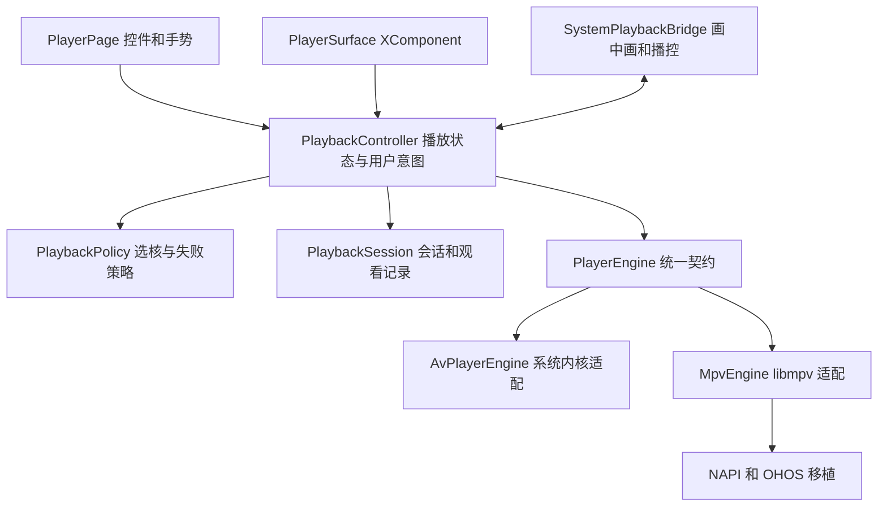

# 鸿蒙手机播放器重构评估

评估日期：2026-10-30。代码基线：`581ce5b8ff21c11f9d655d3817f6a222b96ce254`。

后续设计见[鸿蒙多设备播放器设计方案](harmony-playback-architecture.md)。用户已确定手机、Pad、车机共用独立引擎，因此本文的手机目录内实现建议已被两个独立 HAR 的方案取代；本文件保留调研事实和初始评估。

结论：**支持完整重写鸿蒙手机播放器的应用层，采用独立播放控制器、统一引擎接口、AVPlayer 优先及 MPV 兼容性回退。** 技术路径成立，项目已有两种内核的接入基础；主要工作是重新定义职责、状态和故障处理，并补齐真实播放回归。现阶段可确认架构可行，不能据此宣称 AVPlayer 在所有片源、机型上表现最佳，或两种内核可以无缝切换。

范围按本次请求限定为手机端播放器。包含播放页面、控制器、内核适配、系统集成和服务端播放协议接入；媒体库、下载存储、账户等业务保留。TV、车机共用的 `common/AvPlayerEngine.ets` 暂不迁移。后续实现允许删除旧手机播放器，不以兼容旧内部代码为目标。本文是调研和设计建议，尚未实施重写。

## 1. 现有实现为什么适合重写

| 代码位置 | 已核实的事实 | 重构含义 |
| --- | --- | --- |
| `apps/harmonyos/entry/src/main/ets/player/PlayerPage.ets` | 4,597 行；同时管理页面、手势、会话协商、内核、字幕、离线、续播、上报、画中画和降档 | 重写为页面与播放控制器，不能只搬成多个页面辅助文件 |
| `player/MpvPlayer.ets` | 553 行；`PlayerEngine` 是 `media.AVPlayer \| MpvPlayer`；MPV 模拟 AVPlayer 的状态及事件 | 替换为应用自己的接口，两种内核各自适配 |
| `PlayerPage.ets:917` | 默认 MPV，仅 MPV 创建抛错时回 AVPlayer | 当前没有用户提出的 AVPlayer → MPV 运行期回退 |
| `PlayerPage.ets:1126` | 按错误消息字符串处理失败；`404`、`IO error`、`unsupport` 等都可能将档位 0～2 加入失败列表 | 网络、片源、内核能力、服务端产物流失败必须分开归因 |
| `PlayerPage.ets:590` | 能力固定为 H.264/HEVC、AAC/MP3、MP4/MKV/TS，不随内核改变 | MPV 的能力可能在服务端决策时就被挡住；不能只改创建内核的顺序 |
| `PlayerPage.ets:991` | 页面处理原生状态；`prepared` 后直接 seek/play；`playing` 即解除起播看门狗 | 操作完成、状态变化与实际首帧需要分别建模 |
| `common/AvPlayerEngine.ets` | 1,499 行，被 TV/车机别名复用，含协商、上报、后台和内核 | 名字虽叫 Engine，实际上混有控制器职责，不适合直接当新手机端内核接口 |
| `entry/src/main/cpp/mpv_napi.cpp` | 620 行；销毁在 NAPI 调用中执行 `pthread_join`、`mpv_terminate_destroy` | 存在阻塞调用线程的风险，需测耗时并设计异步释放；不是本次已复现的卡顿结论 |

旧代码应作为功能清单和历史问题资料，不作为新设计的结构模板。底层 OHOS/EGL/OHAudio 补丁有实际工程价值，无需为了“完全重构”一并重新发明。

## 2. iPhone 架构中值得借鉴的部分

Apple 官方将 `AVPlayer`、`AVPlayerItem` 定义为非视觉对象；自定义 UI 通过 `AVPlayerLayer` 呈现画面，控件由应用提供。这支持“播放控制与显示分离”，但 Apple 并未替应用提供跨内核回退策略。[Apple AVPlayer 文档](https://developer.apple.com/documentation/avfoundation/avplayer)

本项目 Apple 端已有更直接的参考：

- `Shared/Player/PlayerEngine.swift`：统一控制命令、事件、轨道、时间、统计与释放边界。
- `Shared/Player/PlaybackController.swift`：会话协议、选核、失败恢复、观看记录；绑定事件时校验当前引擎身份。
- `Shared/Player/PlaybackRouting.swift`：将失败策略做成可单测的纯函数。
- `Shared/Player/PlayerSurface.swift` 与手机 `Features/Player/PlayerScreen.swift`：显示与交互。

**借鉴这些边界，不照搬当前 iPhone 的内核路线。** 该端现在主要走 `NativeEngine → AetherCore/AetherEngine`，内部含本地重封装后交给 Apple AVPlayer 的路径，也有软件解码路径；系统 `AVPlayerEngine` 负责特定回退场景。`PlaybackRouting.swift` 明确记录 MPV 已移除。鸿蒙无需为了相似架构先移植 Aether、本地 HLS 服务或自研解码器。

## 3. AVPlayer 优先的有效性与边界

AVPlayer 是合理的默认选择：它提供资源解析、解封装、解码、渲染和状态管理，应用可用 XComponent 提供 Surface。OpenHarmony 的官方说明明确列出 MP4、MKV 等播放场景；**不能沿用 iOS 的经验把 MKV 一律排除在鸿蒙 AVPlayer 之外。**[官方视频播放指南](https://raw.githubusercontent.com/openharmony/docs/master/en/application-dev/media/media/video-playback.md)

以系统内核作为主路径，可以减少应用维护解码和输出链路的范围。较低功耗、更好 HDR 表现、较短首帧时间是需要对比测试的预期收益，不是本次已经测得的结果。

必须分清四种能力：

1. 容器能否解析，例如 MKV。
2. 视频和选定音轨能否解码，包括 profile、位深、分辨率、帧率及声道。
3. 所选字幕能否正确呈现，包括字体、特效及图形字幕。
4. 输出是否符合需求，例如 HDR 颜色、音频路由及后台恢复。

AVCodec 的某编码器/解码器存在，不代表 AVPlayer 对某个容器、传输协议和轨道组合端到端可用。官方也要求按设备查询能力。OpenHarmony 最新文档已有较早版本没有的编解码条目，因此既不能把旧清单当永久上限，也不能把新清单当所有 HarmonyOS 手机的承诺。[官方 AVCodec 支持格式说明](https://raw.githubusercontent.com/openharmony/docs/master/en/application-dev/media/avcodec/avcodec-support-formats.md)

| 片源或功能 | 推荐处理 |
| --- | --- |
| 常见 MP4/MKV、H.264/HEVC、AAC 等组合 | 默认尝试 AVPlayer；以设备能力和测试组合细化策略 |
| 未知编码或组合 | 可以尝试 AVPlayer，但必须保留原始错误、超时阶段及 MPV 回退机会 |
| 已证实该设备不支持的组合 | 可直接交 MPV，避免每次等待一次必然失败；规则需有机型/系统/片源条件，不能只按扩展名 |
| ASS 特效、PGS 等字幕需求 | 以实际呈现能力选路径；需要完整效果时允许改用 MPV，不以“视频有画面”判定全部成功 |
| 多音轨切换 | 映射服务端轨道 ref 与当前内核 track id，禁止直接复用数组下标 |
| HDR Vivid、HDR10、HLG、Dolby Vision | 分别验证解码、显示和回退颜色；不要把它们合并成一个 HDR 支持结论 |
| 后台、画中画、音频中断 | 独立系统集成；AVPlayer 本身不能替代完整应用生命周期管理 |

华为外挂字幕指南给出的约束是播放前设置，并通过 `subtitleUpdate` 获取文本；不能据此承诺动态添加、ASS 特效或 PGS 支持。新适配层应封装字幕装载时序，需要重建时保留进度和暂停意图。[华为外挂字幕指南](https://developer.huawei.com/consumer/cn/doc/doccenter-capabilities/video-subtitle)

## 4. MPV 能解决什么

MPV 是兼容性后备内核，不代表画质必然降低。它可用于 AVPlayer 的解封装、音轨、字幕等能力缺口；libmpv 是上游推荐的嵌入方式。[libmpv 嵌入文档](https://github.com/mpv-player/mpv/blob/master/DOCS/man/libmpv.rst)

本项目已有 `dex2oat/mpv` 和配套 FFmpeg 的 OHOS 移植，使用 `gpu-context=ohos`、`hwdec=ohcodec`、OHAudio、libass；具体版本和补丁见 `apps/harmonyos/scripts/mpv-ohos/`。这降低了从零接入成本，但 **OHOS 专用路径来自 fork 和本项目补丁**，不能把桌面 MPV 的成熟度直接等同于这个移植的成熟度。[当前 fork](https://github.com/dex2oat/mpv)

`VERIFIED.md` 有 2026-10-27 的历史真机及模拟器记录，也记录了模拟器未暴露的真机 EGL 黑屏修复。这是已有基础的证据，不能代替重写后的验收。当前 CMake 的 x86_64 路径链接 `mpv_stub.c`，创建内核会失败；该模拟器只能覆盖 AVPlayer、界面和控制逻辑，MPV 必须使用真实 arm64 库验证。

两种播放器可能最终使用相同系统硬件解码能力。若失败发生在硬件不支持的编码档次或系统资源层，切 MPV 不保证解决；MPV 软件解码也可能无法流畅处理高码率 4K。上游明确区分硬解与软解回退，并建议在目标内容上验证硬解配置。[MPV 硬件解码手册](https://mpv.io/manual/stable/#options-hwdec)

MPV 适配重点：异步关闭、事件解绑、Surface/NativeWindow/EGL 生命周期、缓冲内存预算、音频焦点、轨道和字幕映射、构建可复现性。当前 `tls-verify=no` 不能变成证书错误时切 MPV 的隐式处理方式；两种内核应遵守一致的连接信任策略。

## 5. 推荐架构

这是职责划分，不要求先创建大量模块或框架。第一版保持在手机 `player/` 范围内，等实际复用需求出现再提取公共模块。

统一契约只暴露应用需要的能力：

- 输入：URL 与请求头，或拥有明确生命周期的本地文件描述；起播位置、暂停/播放意图、倍速和轨道偏好。
- 命令：装载、播放、暂停、seek、倍速、音轨/字幕选择、Surface 绑定、释放。
- 事件：ready、首帧、播放/暂停/缓冲、seek 完成或失败、结束、轨道变化、分类错误。
- 快照：时间、时长、缓冲、尺寸、能力、可获得的统计。不提供的统计返回未知，不能伪造为零。

上层不得出现 `media.AVPlayerState` 或 `instanceof MpvPlayer`。原生状态机和支持的调用顺序全部留在适配器中。Promise 返回表示命令接受还是操作完成必须逐项定义；例如 seek 应有实际完成事件和请求编号，不能把函数返回当成画面已到位。

**生命周期和状态规则：**

1. 一个播放单元有一份用户意图：目标位置、暂停状态、倍速和所选轨道。引擎切换不能重置它们。
2. 每次打开/换集增加 generation；网络结果、引擎事件、Surface 回调只接受当前 generation。释放幂等，不能让旧回调改动新一集。
3. 同一时刻只允许一个内核拥有有效视频输出和音频播放。切换先解除旧内核的回调及输出，再挂新内核；通常存在短暂重新缓冲，不承诺零黑屏。
4. 文件时间与服务端流时间分开定义，统一毫秒单位，并由会话层显式转换。换核、重开 HLS、seek 都用同一份时间轴信息。
5. `playing` 不等于首帧可见。AVPlayer 使用 `startRenderFrame`；MPV 的文件加载/播放恢复事件不能直接当严格首帧证明，需核实输出侧信号并用端到端画面验证。
6. Surface 创建、销毁、尺寸变化、PiP 迁移由表面边界报告；内核处理底层资源。页面退出与进入 PiP 的所有权变化需区分。

## 6. 回退策略与服务端协商

建议默认路线：**原片 AVPlayer → 同一原片 MPV → 服务端必要的重封装或转码 → AVPlayer 播放产物流**。服务端已有档位应继续利用；这不是在每个档位里无限重复两种内核。

| 原因 | 操作 |
| --- | --- |
| 明确不支持格式/所选轨道，或确认有数据但解码失败 | AVPlayer 切 MPV，保持位置、暂停、倍速、轨道意图 |
| DNS、断线、超时、暂时的服务端错误 | 有限次数同路径重连，必要时更新会话/令牌；不自动换核或降画质 |
| 401/403、证书或明文访问策略问题 | 修复授权/连接问题；不能靠换内核绕过 |
| 原文件确实不存在 | 明确报错；会话或临时分片 404 则先判断是否应重建会话，不能混同原片丢失 |
| API 参数、非法状态、Surface 生命周期错误 | 修复实现或有界重建；不能记录成片源格式不支持 |
| 非致命字幕或 seek 操作错误 | 保留可继续的播放，反馈对应操作，不强制整段切核 |
| MPV 也确实无法播放，或用户主动限制画质 | 使用服务端策略；保留现有软件转码同意流程 |
| 只是网络吞吐不足 | 缓冲并提示用户选择画质，不自动判定内核失败 |

AVPlayer 官方接口区分格式、网络、找不到资源、证书和状态等错误，适配器应保留错误码及发生阶段；`error` 事件也不能一概视为整段播放已终止。[官方 AVPlayer 接口](https://raw.githubusercontent.com/openharmony/docs/master/en/application-dev/reference/apis-media-kit/arkts-apis-media-AVPlayer.md)

**后端协商是必须一起梳理的边界。** 如果先按 AVPlayer 的能力请求会话，服务端可能已转码，随后把同一个转码 URL 交 MPV 并不能实现“MPV 尽量播放原片”。相反，也不能直接设置 `universal=true`，因为现有后端会跳过大量能力判断。

建议首版用已验证的双内核能力集合参与可行性判断，同时保留每种内核的独立能力用于本地选核。优先验证现有会话 API 能否在常见单文件片源上返回原片，并正确处理 `local_tracks`、字幕及 HDR；若不足，再新增明确的“优先原片、允许本机后备内核”协议语义，避免借用 `universal`。不承诺仅改鸿蒙目录就能完成所有兼容性目标。

同一原片 AVPlayer 失败后，不能立刻把原片档位加入 `failed_tiers`，必须让 MPV 有机会。用“来源/产物 + 内核 + 失败原因”的尝试记录限制回退；服务端换了产物后，可重新用 AVPlayer，旧原片失败不能污染新 HLS。

另外，现有 `mse="full"` 是为绕开后端 `native_hls && is_mobile && mse == "none"` 的浏览器保守策略，鸿蒙代码已有相关说明。重构时需要后端契约测试，不能因“鸿蒙没有 MSE”简单改成 `none`，再次引入无谓的 4K 降档。

## 7. 保留与替换边界

| 部分 | 建议 |
| --- | --- |
| 手机 PlayerPage、MPV 的 AVPlayer 仿真接口、内嵌失败循环 | 完整替换 |
| 播放入口和路由参数、服务端 API、离线存储及观看记录语义 | 保持外部契约，在新控制器接入 |
| MPV/FFmpeg 构建与必要 OHOS 补丁 | 先固定版本复用，再针对验证暴露的问题修改 |
| NAPI 桥 | 逐项审计；释放、错误和事件所有权需要时重写，不默认视为可靠黑盒 |
| 后台、PiP、音频焦点、常亮和窗口方向 | 独立系统适配边界，按真实用户行为重建 |
| UI 控件布局与手势 | 可独立重写实现，完整保留当前需要的用户行为 |
| `PlayerPrefs` | 保留画质/字幕等偏好；引擎设置明确迁移为默认自动策略，区分历史默认与用户显式选择 |
| TV、车机播放器 | 本次保留，避免扩大回归面；公共改动仍需做启动/播放冒烟 |

新的生产路径应只有一套控制器。开发分支可暂留旧入口用于比较，正式切换后删除旧手机实现，避免长期维护两套逻辑。

## 8. 实施阶段与可验证目标

| 阶段 | 工作 | 通过条件 |
| --- | --- | --- |
| A 环境和能力验证 | 固定 API/SDK、真实 arm64 构建；建立合法测试片源清单，分别测两内核 | 每条样本有容器/编码/轨道/设备信息、实际内核、首帧/错误及日志；确认真实可复现的 AVPlayer 失败而 MPV 成功样本 |
| B 最小播放核心 | 实现接口、控制器、两个适配器、Surface 和有界回退；先无复杂 UI | AVPlayer 起播，指定失败切 MPV；seek/暂停状态保留；快速关闭无旧回调；单测与真实双核 E2E 同时通过 |
| C 接回产品行为 | 正片/剧集/分享/片段/离线入口，音轨字幕、画质、记录、连播、后台/PiP | 从媒体库点播放到退出后恢复的完整流程通过，服务端记录可核对 |
| D 压力与切换 | 故障注入、长播、反复换集/旋转/PiP，删旧路径 | 无泄漏趋势、双音频、错误转码或回退死循环；新入口覆盖功能清单 |

工程量属于中大型客户端重构，主要不确定性在真机 MPV 输出、字幕/HDR、后台/PiP 和会话策略，远超过“换默认内核”。先完成 A/B 可以显著降低后续排期不确定性。无需先造插件注册框架、通用跨端媒体平台或第三种本机内核。

## 9. 端到端验收矩阵

这些是实施验收要求，不是本次已执行的测试结果。

| 用户场景 | 必须观测的结果 |
| --- | --- |
| 媒体库 → 普通 MP4/MKV → 暂停/seek → 退出 → 续播 | 实际内核为 AVPlayer；画面、声音、进度一致；上报位置正确 |
| AVPlayer 确认不支持的真实片源 → MPV | 实际换核且只换一次；使用原片；音画正确，无双音频；暂停意图和轨道偏好保留 |
| 自动化故障注入触发换核 | 控制策略确定性可重复；与上一条真实媒体兼容性测试分别记录 |
| 断网、限速、鉴权到期、原片 404、会话失效 | 原因与恢复路线正确；不能一律切 MPV/转码；恢复后进度连续 |
| 多音轨、外部文字字幕、ASS、PGS | 对应语言和样式符合能力声明；切核后不误选轨；失败有明确反馈 |
| 4K HEVC 10-bit、HDR、长 GOP、高码率 | 真机检查颜色、首帧、seek、丢帧、A/V 同步、温升与内存；同源比较两内核 |
| 连续 seek、快速 A→B→C 换集、起播立即退出 | 无旧声音/旧帧，无释放后回调，无进度写到错误条目 |
| 折叠/展开、旋转、PiP 往返、锁屏/前后台 | Surface 生命周期正确；恢复目标位置和暂停状态；系统播控一致 |
| 来电、蓝牙断连、其他应用抢焦点 | 按用户意图暂停/恢复，避免误自动播放 |
| 飞行模式下离线文件切核 | 无网络依赖；FD 生命周期正确；离线记录联网后补传 |
| 分享、片段边界、自动下一集、切画质 | 权限和播放区间正确；上一会话收尾一次；时间轴不跳回零 |
| 反复打开关闭与长播 | 建议起点：50 次打开关闭、2 小时播放；句柄/线程/内存无单调增长，退出后无音频和长时任务残留 |

单测覆盖策略、重试预算、时间轴、generation、轨道映射和事件序列；Hypium/UI 自动化连接真实播放器及测试服务端，记录选择的内核和会话请求。画面截图/录屏、系统音频或可控采集、服务端观看记录共同验收，不能只断言 UI 显示 playing。建议初始位置恢复误差目标为 1 秒以内，长 GOP 和不同 seek 模式另列可解释范围；性能阈值在 A 阶段建立基线后确定。

## 10. 本次证据与未验证项

- 已检查最新远端基线、手机/Apple/TV/车机相关源码、MPV 构建和历史验收资料、现有测试入口、后端能力/决策契约。
- 手机 `entry/src/test/List.test.ets` 当前登记离线单元、服务器和配对码测试；`ohosTest/Ability.test.ets` 仍为示例断言。本次检查未发现覆盖手机双内核回退的自动化 E2E。
- 项目 `build-profile.json5` 的 target/compatible 是 `6.1.1(24)`；本机 DevEco 默认 SDK 元数据是 API 26、`26.0.0.105`。已检查该 SDK 的 AVPlayer 定义及版本注释，不能把其新增 API 直接用于 API 24 目标。
- `hdc list targets` 当前返回一个本地连接目标 `127.0.0.1:5555`；未据此断言真机能力。本次未重新构建、安装或跑播放测试，没有测得功耗、HDR 或切核性能。
- 华为部分动态文档页未能通过网页读取工具打开；接口细节以本机华为 SDK、可读取的华为指南和 OpenHarmony 官方文档交叉核对。OpenHarmony 通用能力不能替代商业 HarmonyOS 目标机型的能力测试。

推荐下一步是阶段 A/B 的最小真实播放闭环。在它证明“AVPlayer 主播、MPV 补位、原片与会话策略正确、切核不破坏用户状态”后，再完整替换手机播放页面和业务接入。
