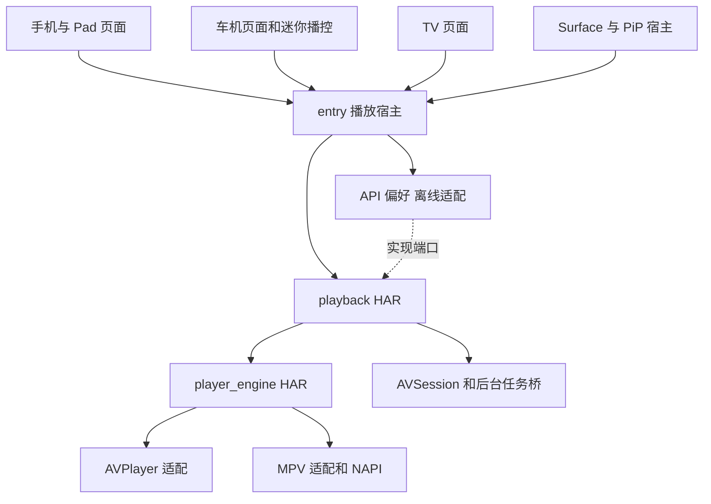
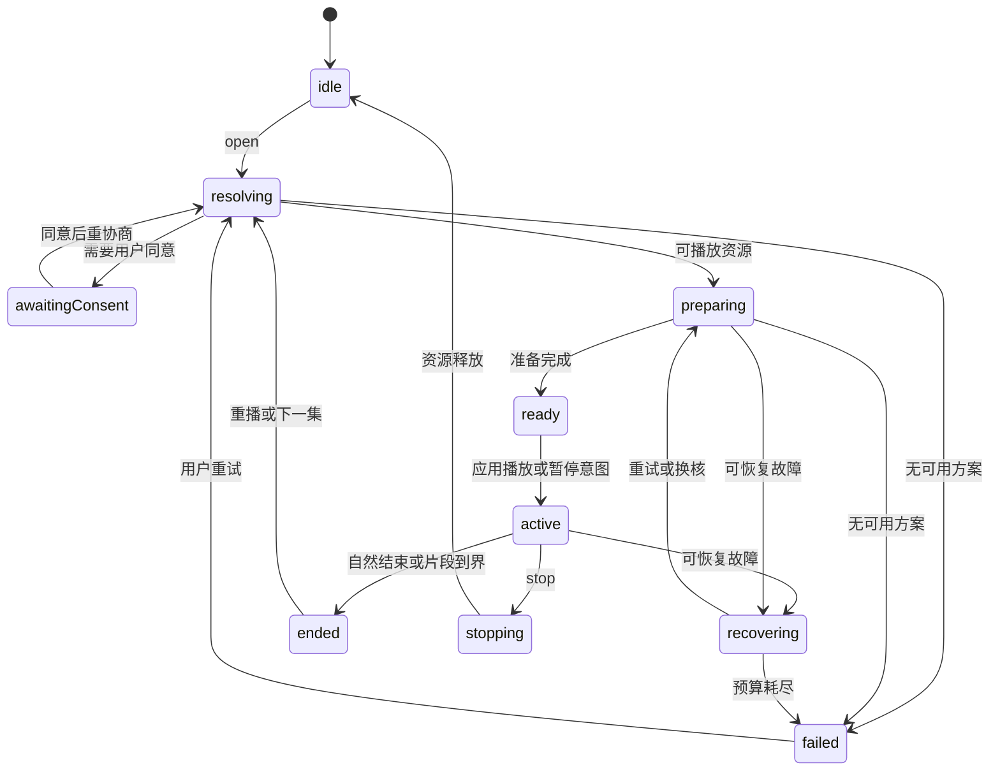
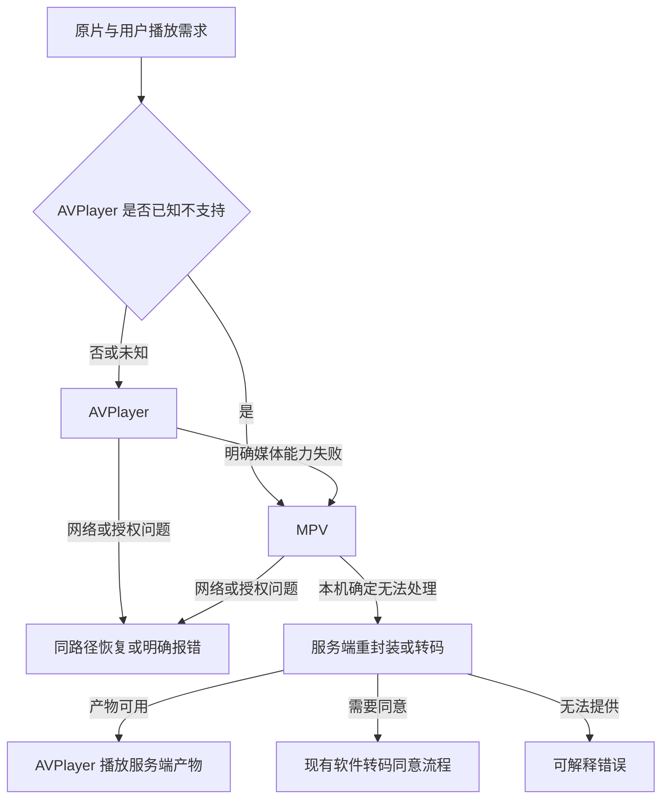

# 鸿蒙多设备播放器设计方案

状态：待实施的完整设计。日期：2026-10-30。代码基线：`581ce5b8ff21c11f9d655d3817f6a222b96ce254`。

本方案落实已确定的方向：**播放器内核独立成模块，手机、Pad、车机共用；默认 AVPlayer，能力不足时由 MPV 接替。** 在内核之上进一步共享播放控制与恢复逻辑，各端保留自己的界面和设备行为。

此前的[手机播放器重构评估](harmony-phone-player-refactor.md)保留为调研依据；其中“先只在手机 player 目录内实现”的建议由本文取代。本文设计最终的共享架构，实施先完成手机/Pad，再迁移车机；TV 按同一契约接入，不要求本次同时重新设计各端 UI。

## 1. 目标与成功标准

1. `player_engine` 可以脱离 MovieClaw 账户、接口、数据库、页面独立构建，在测试宿主中播放 URL 或本地文件。
2. 手机、Pad、车机使用同一份引擎和播放控制实现；各端页面不出现 `media.AVPlayer`、MPV 调用或独立失败循环。
3. AVPlayer 能满足当前播放需求时优先使用；明确的格式、轨道或呈现能力不足才换 MPV。网络、鉴权和实现错误单独处理。
4. 切核保存目标位置、暂停意图、倍速、音轨与字幕选择，避免不必要的服务端转码。
5. 页面出现/消失不直接决定播放实例生死；车机迷你播控、后台、PiP 与手机返回行为均可正确实现。
6. 功能和接口改动有单测与真实播放 E2E；模拟器通过不能替代 arm64 真机双内核验收。

本次不移植 Apple Aether，不增加第三种内核，不搭建通用插件平台，不实现多设备之间的会话流转。这里的“共享”是共享代码与契约，各设备有独立实例；分布式接续是另一个功能。

## 2. 已确认的现状与约束

| 现状 | 设计影响 |
| --- | --- |
| `entry` 一个 HAP 声明 phone、tablet、2in1、car、tv | 先采用本地 HAR 依赖，无需为了代码共享引入多个 HAP/HSP |
| `EntryAbility` 将手机/Pad 路由到同一入口，车机、TV 各自入口 | 手机与 Pad 可以先接同一控制器，布局继续响应窗口尺寸 |
| 手机 `PlayerPage.ets` 4,597 行，直接管理内核及业务 | 全面替换其内部结构，按现有功能清单验收 |
| `MpvPlayer` 模拟 AVPlayer，类型为二者联合；当前默认 MPV | 废弃仿真接口，重新建立中立内核契约及自动选核策略 |
| `common/AvPlayerEngine.ets` 供 TV/车机共用，但直接依赖 AppModel、API、偏好和系统会话 | 作为功能资料，不原样搬进底层引擎 |
| 车机 `aboutToDisappear` 不停止播放，TV 退出会停止 | 实例属于应用宿主，退出行为属于设备策略 |
| 车机行车锁隐藏 Surface 并保持音频，默认锁定；真实行车信号目前未接 | 保留现有约束，新增核心不能默认允许视频；不把手动模式测试当真实车辆信号验证 |
| 刷片 `ReelsPage` 另持有 AVPlayer | 第一阶段需接入播放互斥，避免与新正片核心同时出声；刷片 UI 不必同期重写 |
| 工程 target/compatible 为 API 24，本机默认 SDK 为 API 26 | 固定匹配的构建工具链；API 26 专属能力不得未经检查进入代码 |
| x86_64 MPV 是失败桩，真实库为 arm64 | 区分内核不可用与片源不兼容，建立独立测试报告 |

Apple 可参考边界为 `PlayerScreen → PlaybackController → PlayerEngine`，引擎适配器内部各自处理平台状态。它目前的 Aether 播放路线不复制到鸿蒙。

## 3. 模块划分

采用两个独立 HAR：

| 模块 | 职责 | 不得依赖 |
| --- | --- | --- |
| `@movieclaw/player-engine` | 中立输入/输出契约，AVPlayer/MPV 适配，内核能力与统计，NAPI、底层输出及资源释放 | MovieClaw API、账户、媒体库 ID、观看记录、路由、UI 控件、AVSession、长时任务 |
| `@movieclaw/playback` | PlaybackController、选核及恢复策略、时间轴、轨道意图、会话编排、观看记录编排、系统播控桥 | `entry`、AppModel、生成的 API Models、设备页面、主题、全局路由 |
| `entry/playback` | 组装以上两模块；实现 API/存储适配；持有播放实例；提供 Surface/PiP 宿主及页面状态绑定 | 不重新实现解码、选核或失败策略 |
| 手机/Pad/车机/TV 页面 | 渲染状态、提交用户命令、布局、手势/遥控、设备规则 | 原生播放器对象、MPV 句柄、服务端档位恢复循环 |

`playback` 的业务相关类型是自己的小型领域模型，通过端口访问应用；不把全套生成 API 模型复制进 HAR。系统播控桥可以使用 HarmonyOS Kit，但须显式注入有效宿主 Context，不能静态保存全局 Activity/UIAbility。



图中端口的实现位于 `entry`，调用方向由 `playback` 指向注入对象；编译依赖始终是 `entry → playback → player_engine`，没有反向 import。`entry` 若直接使用引擎导出的类型，也显式声明 `player_engine` 依赖。

HAR 支持 ArkTS、C++ 库和资源的编译态复用；多个 HAP 引用同一个 HAR 可能重复打包。当前单 HAP 足够，以后确实拆成多个 HAP 再评估 HSP，届时保持公开接口不变。[官方 HAR 说明](https://raw.githubusercontent.com/openharmony/docs/master/en/application-dev/quick-start/har-package.md)

### 3.1 目录与打包

```text
apps/harmonyos/
  player_engine/                     # HAR: @movieclaw/player-engine
    Index.ets                       # 仅导出稳定契约及工厂
    oh-package.json5
    build-profile.json5
    hvigorfile.ts
    src/main/module.json5
    src/main/ets/
      contract/                     # Source、Snapshot、Event、Error、Capabilities
      avplayer/AvPlayerEngine.ets
      mpv/MpvEngine.ets
      mpv/MpvLoader.ets
      EngineFactory.ets
    src/main/cpp/                   # NAPI、类型声明、CMake、mpv 头文件
    libs/arm64-v8a/                 # libmpv、必要依赖；唯一打包位置
    src/test/                       # 适配器状态及事件契约测试
  playback/                         # HAR: @movieclaw/playback
    Index.ets
    oh-package.json5
    build-profile.json5
    hvigorfile.ts
    src/main/module.json5
    src/main/ets/
      PlaybackController.ets
      PlaybackState.ets
      PlaybackPolicy.ets
      PlaybackTimeline.ets
      PlaybackTracks.ets
      PlaybackSession.ets
      PlaybackRecord.ets
      PlaybackPorts.ets
      system/SystemPlaybackBridge.ets
    src/test/
  entry/src/main/ets/playback/
    PlaybackHost.ets                 # 所有权、设备策略、刷片互斥
    MovieClawPlaybackGateway.ets     # API 与领域模型映射
    PlaybackStore.ets               # 偏好与观看记录适配
    LocalSourceProvider.ets         # 离线资源租约
    PlayerSurfaceHost.ets           # XComponent 生命周期
    PictureInPictureBridge.ets
    PlaybackViewState.ets           # @ObservedV2 状态绑定
  scripts/mpv-ohos/                 # 构建脚本保留，导出路径改到 player_engine
  tests/playback/                    # 样本清单、E2E、报告规范
```

目录是职责清单；小类型可合并到单文件，不要求逐类型建文件。`Index.ets` 不导出原生播放器、native handle 或内部配置。宿主只通过包入口导入；CI 检查越层导入。

工程 `build-profile.json5` 增加两个 library 模块；`entry/oh-package.json5` 使用本地模块依赖；原生 CMake 与 SO 从 entry 移到 player_engine 后删除原入口，防止重复打包和符号冲突。构建产物检查 arm64 和 x86_64 的实际依赖，而不只检查编译成功。[华为依赖配置](https://developer.huawei.com/consumer/cn/doc/HarmonyOS-Guides/ide-hmos-hvigor-dependencies)

## 4. 底层引擎契约

以下是接口设计草图，尚非可编译实现；具体类型使用目标 ArkTS 支持的显式 interface/class/enum，不依赖复杂 TypeScript 类型运算。

```typescript
interface PlayerEngine {
  readonly kind: EngineKind;
  setListener(listener: EngineListener | null): void;
  open(source: EngineSource, options: EngineOpenOptions): Promise<void>;
  bindSurface(surface: EngineSurface): Promise<void>;
  unbindSurface(surfaceToken: number): Promise<void>;
  play(): Promise<void>;
  pause(): Promise<void>;
  seek(request: EngineSeekRequest): Promise<EngineSeekResult>;
  setRate(rate: number): Promise<void>;
  setVolume(gain: number): Promise<void>;
  selectAudio(trackId: string): Promise<void>;
  setSubtitle(selection: EngineSubtitleSelection): Promise<void>;
  snapshot(): EngineSnapshot;
  release(): Promise<void>;
}
```

| 类型 | 必要内容及语义 |
| --- | --- |
| `EngineSource` | URL + 请求头，或本地 FD + offset + length；不含媒体库 ID、令牌管理或会话 API |
| `EngineOpenOptions` | 起播流时间毫秒、倍速、初始轨道/字幕偏好及已知轨道描述；open 完成时保持暂停 |
| `EngineSurface` | Surface ID、单调递增 token、有效尺寸；不含页面组件或路由 |
| `EngineSeekRequest` | requestId、目标流时间、exact/keyframe 模式 |
| `EngineSnapshot` | 状态、position/duration/buffer ranges、尺寸、轨道、实际倍速、实际解码路径、可用统计 |
| `EngineEvent` | ready、playing/paused、buffering、firstFrame、seekResult、tracksChanged、subtitleCue、ended、interruption、failure |
| `EngineFailure` | kind、stage、nativeCode、nativeMessage、fatal、retryability；错误细节供诊断，用户文案由宿主映射 |

引擎接口时间统一为流时间毫秒；AVPlayer 和 MPV 的单位转换只存在于各自适配器中。未知时长、带宽、帧数用缺省值表达，不用 0 冒充已测得的值。快照不允许上层修改内部状态。

`setVolume` 只调整当前音频流的 0～1 增益，用于静音及 duck；手机音量手势调系统媒体音量仍由宿主执行，恢复焦点不能改写用户的系统音量。

### 4.1 操作和事件语义

- `open` 在资源准备完成、初始轨道设置和必要定位结束后 resolve，保持暂停；是否播放由控制器随后明确命令。首帧另发事件，不用 `open` 成功冒充实际出画。
- 初次 Surface 和资源可以任意顺序到达；适配器缓存输入并遵守原生状态限制，视频路径在表面可用后才完成相应准备。`bindSurface` 可以登记待绑定表面，其 Promise 不代表首帧已经显示。
- `play/pause/setRate/selectAudio` 返回对应状态/设置已确认的结果，不仅是 NAPI 函数返回。底层没有完成事件时，读回状态确认；不能确认时返回有界超时。
- `seek` 返回实际落点及 completed/cancelled/unsupported，带 requestId。连续拖动只保留最新目标；不会把旧 seekDone 归给新操作。底层不提供 ID 时，每个实例至多一个已提交 seek，其余合并；超时后的迟到事件不能用来完成后续 seek。
- `firstFrame` 与 `playing` 分开。AVPlayer 采用 `startRenderFrame`；MPV 若暂时只能提供 playback-restart，则报告 playbackResumed，不冒充精确首帧。严格首帧需由输出侧信号及 E2E 图像核验支撑。
- `release` 幂等：先禁止新命令和事件，再异步释放输出、native 线程和实例；完成后不再回调。它不发送业务层 stop、不上报观看记录。
- open 等待中的 release 必须取消未完成准备并使对应 Promise 以 cancelled 结束，不能等网络超时才响应退出。
- 单个引擎实例只服务一次 open；换源/换核创建新实例，避免复用原生状态机造成隐性依赖。Surface 迁移能力不足时由控制器显式重建。

AVPlayer 的 initialized/prepared/playing 等状态只在适配器内部；上层不接触 `media.AVPlayerState`。官方要求遵守状态下的合法操作，并提供首帧、seek、音频中断等独立事件。[官方视频播放指南](https://raw.githubusercontent.com/openharmony/docs/master/en/application-dev/media/media/video-playback.md)

### 4.2 能力模型

分开维护：设备静态能力、当前引擎可用性、当前资源运行能力。采用 supported/unsupported/unknown 三态，未知并不等于明确拒绝。能力包括媒体组合、轨道切换、字幕呈现、速率范围、Surface 迁移、无可见视频时播放及可观测统计。

AVCodec 查询只作为编码能力的证据之一，不能覆盖容器、协议和输出组合。AVPlayer 支持 MKV 不等于支持所有 MKV 内容。MPV 支持广也不能声明 `universal`。设备型号、系统版本、ABI、引擎版本共同标识测试矩阵；首版只会话内记失败，不新增永久“黑名单”数据库。

字幕能力按内封/外挂、文字/ASS/PGS 分开；HDR 按实际格式、位深和输出路径判断，不承诺仅一个 hdr 布尔值即可描述。高码率软解的性能资格以真机测试为准。

## 5. 共享播放控制

`PlaybackController` 是播放状态的唯一写入者，持有当前 Engine、会话尝试、用户意图及记录器。页面、系统播控、迷你播放器都发同一组命令，不能直接改变引擎或修改播放快照。

公开命令：`open(request)`、`play/pause`、`seek(fileMs)`、`setRate`、`selectAudio(ref)`、`selectSubtitle(ref)`、`setQuality`、`retry`、`next/previous`、`setPresentationPolicy`、`stop`。`next/previous` 的候选由业务端口提供，控制器负责停止旧单元和启动新单元的事务。

### 5.1 最小应用端口

| 端口 | 应用负责的实现 | 共享层负责的规则 |
| --- | --- | --- |
| `PlaybackGateway` | 账户/分享 API、令牌、服务器选路、源探测；映射响应 DTO | 协商顺序、心跳、恢复、释放旧会话、consent |
| `PlaybackStore` | 既有偏好、分享本地进度、离线观看存储和待传队列 | 何时读取/保存、观看时长、重复收尾抑制 |
| `LocalSourceProvider` | 查找已下载资源，打开独立 FD，返回可释放资源租约 | 在线/离线选择、租约何时结束、离线失败不能无限请求网络 |
| `PlaybackCatalog` | 条目摘要、分集、章节、跳过段、缩略图索引 | 自动下一集触发、取消与次数规则；图片下载和排版留在界面 |

实际实现可由同一个适配类实现多个端口，避免为了依赖注入增加容器。测试中注入 fake；生产时由 PlaybackHost 显式构造。控制器使用可替换时钟验证超时，不需要通用事件总线。

### 5.2 业务输入与状态

`PlaybackRequest` 包含服务器/账号作用域、播放单元和可选文件、起播位置、正片/片段/分享模式、片段边界。令牌只在 gateway 内和短生命周期 EngineSource 中出现，不进入 UI 状态或日志。

用户意图独立保存：`desiredPlaying`、`targetFileMs`、`rate`、音轨/字幕稳定 ref、画质上限。自动暂停、音频焦点、重连和切核不覆盖用户意图；用户在恢复过程中按暂停必须立即取消后续自动播放。

主状态如下，buffering、seekPending、presentation 单独表达，避免所有维度组合成巨大枚举：



所有非 idle 状态均可 stop；stop 后禁止旧状态复活。`active` 通过 confirmedPlaying 表达实际播放/暂停，desiredPlaying 表达意图。UI loading 根据准备、恢复、seek 和缓冲状态计算，不能只看 playing。

### 5.3 并发与时间轴

- 每次 open/换集/stop 更新 `sessionEpoch`；每次重开内核更新 `engineEpoch`；Surface 自有 token。网络结果、事件和清理动作均带所属标识。
- 短状态修改串行执行，长网络和 native 工作异步运行。不能把 stop 排在一个不可取消的网络请求后；先使旧 epoch 失效，再收尾。
- 旧会话响应即使已过期，也需要通过其原 gateway/账号作用域释放新产生的服务端资源；不得误停当前会话。
- 原片和 `timeline=file` 的 `originMs=0`；`timeline=session` 的 `originMs=session.start_ms`。`fileMs=originMs+streamMs`，向内核 seek 用 `max(0,fileMs-originMs)`。
- 片段只改变 UI 显示区间：`displayMs=fileMs-clipStartMs`；内核与业务仍使用各自定义的时间轴。边界停止不当作整片已看完。
- 例：文件位置 1,800,000ms，在 session 时间轴起点 1,740,000ms 的流内应 seek 60,000ms；切到原片 MPV 后应 seek 1,800,000ms。
- 切核优先使用尚未完成的用户目标位置，否则使用最后确认位置；不能保存一次因原生 reset 读到的 0。

## 6. 实例与 Surface 所有权

`PlaybackHost` 按应用播放作用域持有一个正片控制器，生命周期长于页面；不引入全局多实例池。Pad 多窗口第一版也只允许一个有声正片实例，后打开的窗口显式接管，旧窗口退出不能停止新窗口。刷片进入前暂停正片，正片接管前刷片确认停止/释放；旧刷片回调不能重新开播。

上述多窗口规则用于宿主已有或后续启用的多窗口，不在本次新增多窗口入口；当前需验证 Pad 分屏/窗口尺寸变化及模拟宿主接管。

| 资源 | 所有者 | 结束条件 |
| --- | --- | --- |
| 控制器与当前用户意图 | PlaybackHost | 明确 stop、退出账号、切服务器或宿主销毁 |
| 服务端会话、心跳 | PlaybackSession | 当前产物被替换或播放结束 |
| 原生播放器/解码输出 | Engine | 换核/重建/stop，异步 release 完成 |
| FD 和字幕临时资源 | LocalSourceProvider 租约 | 对应 Engine 完全释放后关闭；新引擎使用独立打开的 FD |
| XComponent/Surface | PlayerSurfaceHost | 宿主视图真正销毁；销毁前通知控制器，回调携带 token |
| AVSession/长时任务 | SystemPlaybackBridge | 无有效播放需求或显式停止；按系统要求释放 |
| UI 订阅、手势计时器 | 各端页面 | 页面退出，无权顺带销毁核心 |

### 6.1 表面与页面分离

车机的 SurfaceHost 放在稳定的播放宿主层，不作为 CarPlayerPage 的临时子节点。收起页面时保留有效 Surface 并隐藏画面，迷你播控订阅同一状态；不得把“隐藏”和“销毁”混为一谈。隐藏表面不等于停止视频解码，首版不承诺因此省电。

手机/Pad 正常播放视图、全屏及 PiP 由同一个 SurfaceHost 协调。调整大小不重开媒体；Surface 真正更换时先验证适配器能否热绑定，不能则在相同内核中有界重建并恢复位置。不得把旧 Surface ID 交给新实例。

进入 PiP 必须先完成输出和所有权交接，再允许原页面离开；失败则保留当前播放页或按明确退出动作停止。PiP 活跃时的切核由宿主桥协调：允许重绑定则迁移，否则先退 PiP 再切核并反馈，不在已销毁 Surface 上盲目重试。

### 6.2 各设备行为

| 行为 | 手机/Pad | 车机 | TV |
| --- | --- | --- | --- |
| 普通返回播放页 | 无 PiP/后台保留动作时 stop | 收起为 mini，继续音频 | stop |
| 布局变化 | 旋转、折叠、分屏只改布局 | 驻车/行车切换显隐及控件 | 焦点/遥控只发命令 |
| 后台 | 按应用播放策略和系统授权继续，否则暂停 | 按有效音频播放需求继续 | 依设备能力和产品策略 |
| 视频限制 | 无设备限制时显示 | 默认锁定，现有驾驶模式/信号决定；所有页面/PiP 入口遵守 | 无车机逻辑 |
| 系统播控 | 绑定同一控制器 | 与 mini 同一控制器 | 与遥控同一控制器 |

设备类型不进入 `player_engine`。宿主传入的是具体 presentation 约束及有效表面，不能让底层散布 `if phone/car`。

行车锁是输出约束：切核、换集、恢复前台都不能自行解锁；锁定时首帧看门狗不能按“用户可见视频缺失”判失败。对带音轨的内容检测音频输出状态和进度；没有音轨的纯视频在禁止视频场景下暂停并说明。无法维持隐藏 Surface 时暂停并报告，不以继续音频为由泄露视频画面。

### 6.3 系统播控和音频焦点

AVSession、元数据、位置、后台任务集中在一个 SystemPlaybackBridge。AVPlayer 与 MPV 适配器只报告中断；桥/控制器统一决定暂停、duck、恢复。只有中断前在播、用户未再次暂停、焦点已允许时才恢复；STOP 不自动当作可恢复 PAUSE。

屏幕常亮、亮度、方向锁属于窗口宿主；播放核心发需求，各端决定实施并恢复。字幕和错误文案在 UI 侧本地化。系统桥申请失败可以反馈“后台不可用”，不能影响当前前台解码；应用退后台时再按该能力暂停。

## 7. 选核、失败与回退

默认策略是 `auto`，表示在满足所选音轨、字幕和输出需求的路径中优先 AVPlayer。若已知 AVPlayer 无法满足，就直接选 MPV；未知时允许受控尝试。MPV 是兼容性补充，切换不自动改变分辨率或码率。



用户主动选择画质上限时先满足该约束，不能为坚持原片而忽略。服务端产物是新 source revision，可重新尝试 AVPlayer；不能因为原片 AVPlayer 失败就永久拒绝它。

### 7.1 分类与预算

| 失败类 | 自动动作 | 禁止的动作 |
| --- | --- | --- |
| format/codec/必选轨道不支持 | 当前原片从 AVPlayer 切 MPV；MPV 已失败才走服务端 | 仅 AVPlayer 失败就填原片 failed_tier |
| network/服务端短暂故障 | 保持内核及画质，更新会话/令牌后有限重连 | 切核掩盖网络问题 |
| auth/TLS/访问策略 | gateway 处理授权或反馈明确原因 | 用 MPV 关闭证书校验绕过 |
| 原片 sourceMissing | 说明原片不存在 | 重复切核/转码 |
| 会话或分片失效 | 验证原片及会话状态，必要时同档重开 | 将临时资源 404 当作原片丢失 |
| resourceUnavailable/内核服务异常 | 释放占用后原内核重建一次；再失败评估可用后备 | 无限制重建、两个内核同时争抢输出 |
| invalidState/invalidArgument/Surface | 记录实现或生命周期错误，按已知可恢复情况重建 | 污染媒体能力记录 |
| 非致命字幕/seek 操作错误 | 保留播放，反馈具体操作或请求重开 | 将所有 error 事件当 fatal |
| 已有数据但持续无输出/进度 | 确认非 seek、暂停、隐藏视频、焦点中断后，原核重开一次 | 只用一个固定墙钟超时判断解码失败 |

建议首版预算：同一资源/引擎的临时解码重开最多一次；AVPlayer → MPV 自动切核最多一次；网络最多三次重连，退避 1/2/4 秒。仅“连接正常但播放器无进展”的阶段使用独立 prepare/seek 超时，初始建议 15/10 秒；等待服务端生产、Surface、授权、用户同意不消耗解码预算。阈值是待真机基线校准的产品默认值，不是系统能力结论。

尝试台账以 `播放单元 + 文件版本/产物版本 + 内核 + 原因` 为键；刷新 token 不应生成新的无限重试预算。手动重试或切换不同播放单元才明确重置。进入终态后不后台继续重试。首版不对“取不到缓存字节统计”推断断网，也不根据网络慢自动降画质。

### 7.2 切核事务

1. 记录目标文件位置和用户意图，标记 recovering，递增 engineEpoch。
2. 取消旧看门狗/命令；解绑事件，关闭旧输出并等待 release。失败未确认释放时不并行启动第二个有声内核。
3. 同一原片保留其有效授权和必要会话；只有源/产物变了才替换服务端会话。离线重新打开独立 FD。
4. 创建目标引擎，绑定当前有效 Surface，以暂停状态 open，映射轨道，完成目标定位。
5. 再读取最新用户意图和输出约束，应用倍速并决定播放或继续暂停。恢复期间的新 seek/暂停不能被旧快照覆盖。
6. 收到相应输出/定位证据后结束恢复；记录实际耗时与原因，失败则按预算进入下一条允许路径。

不承诺零黑屏或绝对无缝切核；可显示短暂“切换兼容播放”的反馈。切核不新建观看单元，不重复发观看 start，不把释放引擎当成用户停止观看。

## 8. 服务端协商契约

当前协议只有一个 `capability`，不能准确表达两种互补内核。把能力直接求并集可能产生“AVPlayer 支持视频、MPV 支持音频，但没有一个内核支持完整组合”的虚假直出；只报 AVPlayer 能力又可能提前转码。因此本方案采用**有序候选能力**的向后兼容扩展，而不启用 `universal=true`。

### 8.1 拟新增的协议字段

这些字段为设计提案，尚未存在于服务端或生成模型。

| 位置 | 新字段 | 语义 |
| --- | --- | --- |
| `PlaybackDecideRequest`，由 SessionRequest 继承 | `local_playback_candidates`，默认空列表，首版最多 2 项 | 依次为 AVPlayer、可用的 MPV；每项含 engine_id、独立 ClientCapabilityIn、local_subtitle_formats |
| 候选项 | `local_subtitle_formats`，默认空列表 | 明确能本机呈现的内封/外挂字幕类型；PGS 本机能力不会再被无条件当作必须服务端烧录 |
| `PlaybackDecisionView` | `local_engine_id`，可空 | 原片候选判定采用的 engine_id；不是强制客户端忽略实际运行失败 |
| `PlaybackPolicyView` 与 `SharePublicView` | `supports_local_playback_candidates`，可缺省/可空，缺省按 false | 普通入口读取策略响应，分享入口读取已有公开分享元数据；只有 true 才发新协议 |

保留现有 `capability` 表达服务端产物流的目标播放能力，通常为 AVPlayer。旧客户端不带新字段，完全走旧决策；新客户端连接旧服务端时使用旧协议，真实原片可以本地切核，但不承诺避免旧服务端已经发生的转码，并在诊断中标记协议能力受限。

新响应字段必须在生成的客户端模型中保持可缺省，不能因新版服务端有默认值就生成“老服务端必须返回”的字段。分享能力声明只表示协议版本，不能暴露服务器私人配置或绕过分享鉴权。

字段只声明“本机可能怎样播放”，不改变授权、软件转码同意、用户选轨和画质上限。候选的能力字段仍需按真实设备填报；视频 profile/位深等现有协议无法精确表达的组合保留运行期验证，不伪装成精确探测。

### 8.2 服务端执行规则

1. 先执行原有身份/分享权限、片源解析、用户显式版本及质量约束。没有 MPV 的设备不报 MPV 候选。
2. 在**不启动转码进程**的决策阶段，对每个候选独立检查完整原片路径：容器、视频、当前音轨、字幕需求、HDR 与本机选轨能力。
3. 对同一个文件，AVPlayer 与 MPV 都符合时选 AVPlayer；只有后者符合时返回 MPV 原片计划。候选优先级不擅自改变原有跨版本文件择优逻辑。
4. 有一个候选能完整满足原片需求，就返回原片 URL 和 local_engine_id；不能先用 AVPlayer 开转码，再让 MPV 读这个转码 URL。
5. 都不能满足，或用户质量约束要求压码率时，再按现有服务端重封装/转码阶梯决策，输出以顶层 capability 为准。
6. 当前原片运行期两核均失败后，客户端在下一次请求排除本次失败候选并按协议报告失败档位；不能再靠重复候选回到同一失败源。
7. 引擎不可用只是从候选中移除该引擎，不表示原片档位已失败；两个本机路径都不存在时返回明确兼容性或服务端方案。

本机轨道切换需如实使用 `local_tracks`，避免服务端为非默认音轨无谓重封装。`mse` 与后端原生 HLS 保守策略的历史耦合暂保持兼容，通过契约测试防止鸿蒙被套用 iOS 浏览器 4K 降档规则；不在本次顺手重构全部客户端能力协议。

新协议须同时覆盖 `/playback` 与分享播放接口、决策缓存键和能力记忆：有序候选内容影响缓存键，不得与旧单能力决策混用。生成的 ArkTS 模型用既有生成工具更新，禁止手改生成文件。

## 9. 轨道、字幕、离线与观看记录

### 9.1 轨道和字幕

共享层保存服务端稳定 ref，以及语言、类型、标题、声道等匹配信息；适配器暴露当前内核 trackId。换核后重新建立映射，不直接沿用 index。用户指定的轨道丢失时反馈并提供明确选择；不能静默选另一语言后声称恢复完成。

字幕输出只有两种路径：引擎直接渲染，或标准化 timed text cue 交 UI 叠加；快照告诉宿主当前采用哪种路径，避免双重显示。MPV 可用 libass 的能力以当前构建验证为准；AVPlayer 的外挂加载顺序由适配器处理。若运行中选字幕必须重开，适配器返回 `operationRequiresReopen`，控制器保留意图重开同核，不当作整段媒体不兼容。[华为字幕指南](https://developer.huawei.com/consumer/cn/doc/doccenter-capabilities/video-subtitle)

已烧录的字幕不能通过 UI 假装关闭：关闭时要重新获取不烧录的产物。外挂字幕 URL/FD 的授权、缓存文件与释放属于资源租约；字幕 seek 后清空过期 cue，时钟按当前流时间轴映射。字幕外观偏好可共享，具体呈现能力不一致时界面明确禁用不支持的选项。

### 9.2 离线资源

LocalSourceProvider 返回媒体、字幕及必要元数据的租约；一个 Engine 独占其 FD，应用不得同时拿同一 FD 做缩略图或第二次播放。新核需要重新 open 文件，旧核 release 完成后才 close 旧 FD。offset/length 必须传到真实解码读取路径，不能在 MPV 中默默忽略。

离线失败先尝试另一个可用本机内核；无网络时不创建服务器会话。确有网络且用户有权限时，才回到在线原片路径。过期下载、文件缺失、读权限和媒体不兼容分开呈现。离线记录先落既有持久存储，恢复连接后按现有协议补传。

### 9.3 观看记录与会话收尾

观看单元与 Engine 实例分离。正常起播报一次 start，按既有节奏报 progress；暂停/退出/换集尽快保存，实际结束才标记完成。暂用现有 progress 10 秒、会话心跳 15 秒节奏，集中管理计时器。

实际观看时长采用有效播放状态中的单调时钟区间，不用 seek 前后位置差计算。恢复、缓冲、用户暂停不能计作观看；内核切换不重置累计时长。stop 使用捕获的旧播放单元和旧会话 ID，不能读已经换成下一集的全局状态。

在应用内保证一份逻辑收尾且合并重复事件；网络交付按既有服务端幂等能力处理，不承诺网络层 exactly-once。失败记录进入已有持久重试路径，不为重构另造队列系统。

分享播放遵守既有本地进度语义；片段不污染正片进度、观看完成或自动下一集状态。账号/服务器切换先用旧作用域收尾，再清理内存中的令牌和控制器。

## 10. Native 与内核实现要求

### 10.1 AVPlayer 适配

注册事件后再设置源；绑定 Surface、外挂字幕、prepare、初始 seek、速率和 play 的顺序封装在适配器内。对原生错误保留 code 和 stage，结合是否进入 error 状态判断 fatal；方法拒绝和非致命 error 不能重复上报成两个播放失败。

预备、seek、首帧分别计时；中断和设备路由事件转成中立事件。仅使用目标 API 24 可用的能力，运行时检查可选系统能力，不能以开发机 API 26 的类型存在作为发布资格。[AVPlayer 接口说明](https://raw.githubusercontent.com/openharmony/docs/master/en/application-dev/reference/apis-media-kit/arkts-apis-media-AVPlayer.md)

### 10.2 MPV 适配与 NAPI

保留经过验证的 OHOS/EGL/OHAudio 移植补丁，废弃 `MpvPlayer` 的 AVPlayer 仿真状态机。MPV 方法、原生状态、属性和错误只在适配器内出现。优先 libmpv API，不能通过 subprocess 启动独立播放器。[上游嵌入说明](https://github.com/mpv-player/mpv/blob/master/DOCS/man/libmpv.rst)

必须解决以下边界：

- 初始化和销毁不得在 UI 线程执行可能长时间阻塞的 mpv 调用或线程 join；NAPI 异步任务持有资源直到完成，禁止释放后访问。
- 使用 `mpv_command_async` 等合适的异步调用和 reply ID 关联结果；属性设置检查返回值。当前 end-file 桥仅保留 reason，需同时保留原生 error。
- observe 使用唯一 userdata ID，正确解绑；不能将 API 返回的成功状态码当观察 ID。终结事件不能被高频属性消息淹没，时间/统计可合并。
- 回调绑定实例代数；TSFN 关闭和队列清理必须确保不再访问已销毁 handle 或 JavaScript 回调。所有实际导出的符号及枚举以当前构建头文件为准，删除 ArkTS 中重复猜测的数字。
- Surface、NativeWindow、EGL 和音频渲染器拥有明确释放顺序。退出中无法完成释放属于可观测故障，不继续堆积新实例。
- 缓冲用字节上限控制，以小内存设备基线测试定值；不复制桌面大缓存默认。硬解/软解路径、实际解码器和缓冲占用可诊断。
- MPV 使用与 AVPlayer 一致的授权和 TLS 信任策略，不保留全局 `tls-verify=no` 作为默认。

### 10.3 加载与构建

`MpvLoader` 在确实选择 MPV 时加载其适配器/native 模块，`Index.ets` 和 AVPlayer 工厂路径不得急切 import native 模块。首个构建验证点需证明目标 ArkTS/HAR 打包方式下的延迟加载与可捕获失败；不能只在 `createEngine()` 外围 catch，却让模块初始化阶段先失败。

如果目标工具链不能在当前链接结构下隔离 native 加载错误，采用内部 native 延迟链接边界并验证；不因此在业务页加条件 import 或复制第二套 AVPlayer。模块加载失败可恢复，native 进程崩溃不能靠同进程 try/catch 恢复；本方案不新增进程隔离架构。

构建记录固定完整上游 commit、补丁集、NDK/编译器版本及 SO 校验值。arm64 使用真实库；x86_64 工厂明确返回 MPV unavailable，测试不能把 AVPlayer 播成功记为双核成功。库加载/不可用检查不播放测试媒体、不获取焦点，且不阻塞 AVPlayer 首播；可用性尚未知时不虚报确定支持。

“构建中包含对应 ABI 的 MPV”与“本次初始化成功”分开记录。基于构建清单及已验证能力报送的候选只是可尝试方案，不保证运行成功；真正需要 MPV 时才初始化，失败后移除该候选重协商。已知失败桩或缺失 ABI 不报候选。这样服务端能评估原片后备路径，AVPlayer 主播又不必先初始化 MPV。

## 11. UI 与现有功能迁移清单

| 现有能力 | 新位置 | 迁移完成的表现 |
| --- | --- | --- |
| 正片、分集、分享、片段入口 | entry 路由适配 → PlaybackRequest | 原入口参数和权限语义一致 |
| 播放/暂停、拖动、双击、长按倍速 | UI → 控制器命令 | 各端手势/遥控不同，共用操作语义 |
| 全屏、折叠、Pad 分屏、显示比例 | 窗口/Surface 宿主 | 不因布局刷新重开媒体 |
| 音轨、字幕、画质选择 | PlaybackTracks/Policy + UI 菜单 | 切核恢复选择，质量上限不失效 |
| 章节、跳片头片尾、连播 | 共享控制规则 + 端口元数据 | 片段不触发正片连播，用户取消有效 |
| 进度、离线观看、分享进度 | PlaybackRecord + Store | 无错条目上报或观看次数翻倍 |
| PiP、后台、播控中心、耳机中断 | 系统桥 + 宿主 | 界面、系统、实际声音一致 |
| 车机驾驶模式、mini 播控 | 车机策略 + 稳定宿主 | 离页不停音频，视频限制跨重建持续 |
| 诊断、首帧、切核原因、服务端信息 | 核心快照/事件 + UI | 显示实际路径，不把 MPV 与转码混为一谈 |
| 截图/缩略图预览、详情、收藏 | 原业务与 UI | 不塞进解码接口，不因引擎变化失效 |

偏好迁移：新键 `player.enginePolicy=auto`，新安装和没有旧显式记录的用户均为 auto。旧键存在时保留其显式优先偏好并迁移为 preferAvplayer/preferMpv，不把“prefer”解释为永不回退。若历史写入无法区分默认与主动选择，则先按显式存在处理，不静默删除用户配置；诊断说明策略来源。强制单核仅作为测试注入，不新增生产高级设置。

`PlaybackViewState` 负责将快照绑定到 ArkUI，页面不能维护另一份播放事实。控制条显隐、拖动预览、面板和焦点属于 UI 状态；进度条松手后以核心返回的实际落点为准。

## 12. 诊断与质量目标

每次播放记录 sessionEpoch/attemptId、engineKind/version、sourceKind/revision、协议能力、选核原因及故障分类。时间点包括点击、资源决策、surfaceReady、engineReady、initialSeekDone、firstFrame（有可靠信号时）、audioStarted（有可靠信号时）、recoveryStart/end、releaseStart/end。无信号就标未知，禁止用 ready 代替 firstFrame。

事件日志不记录完整带 token URL、请求头、账号密钥或字幕下载凭据。服务端会话诊断和客户端内核诊断分开显示，错误报告包含二者关联 ID。

建议初始验收目标：

- 暂停状态和轨道偏好在切核前后不改变；位置恢复误差不超过 1 秒，长 GOP/keyframe 模式另列落点容差。
- 正常 AVPlayer 主路径不为等待 MPV 初始化增加启动步骤；同设备同源测首帧分布，建议发布门槛为相对基线 p95 不恶化超过 10%，样本与环境固定后确认。
- 每个核心场景至少重复 30 次；首帧、seek、换核分别统计，不能只报平均值。
- 50 次开关/换集和 2 小时播放后无持续增长的实例、线程、FD 或内存；内存绝对预算在低内存真机建立，不能直接接受历史模拟器约 1GB 的结果。
- 退出后无音频、无活跃引擎、无遗留长时任务；车机 mini/PiP 明确保留的场景除外。

这些是设计门槛，尚未测量。4K、高码率、HDR、功耗和温升必须做双内核同源对比，不能仅凭系统播放器名称认定改善。

## 13. 测试与验收矩阵

### 13.1 测试分层

| 层 | 运行方式 | 核心断言 |
| --- | --- | --- |
| 纯规则单测 | playback HAR + fake clock/gateway/engine | 选核、预算、时间轴、轨道映射、迟到事件、用户意图、记录收尾 |
| 引擎契约测试 | player_engine 测试宿主，分别真实 AVPlayer/MPV | open/seek/rate/track/release 的完成语义与失败分类 |
| API 契约 | 后端测试 + ArkTS 模型消费 | 候选分别决策、新旧兼容、分享鉴权、PGS、4K/画质上限、失败候选排除 |
| UI E2E | Hypium/UITest + 实际 HAP + 可控服务端 | 从库选片到退出续播，实际内核与音画、服务端记录共同核对 |
| 真机专项 | 手机、Pad、车机可用硬件 | HDR/音频路由/驾驶模式/后台/折叠/功耗/长播 |

fake 故障只能证明策略，真实 AVPlayer 失败而 MPV 成功的样本才能证明兼容性。每个功能/接口交付须含相应单测与至少一个完整用户流程；不得以单测数量替代 E2E。

### 13.2 必测场景

| 编号 | 用户或故障场景 | 验收结果 |
| --- | --- | --- |
| E01 | 媒体库 → H.264/AAC MP4 → 暂停/seek → 返回 → 续播 | AVPlayer 实际出画出声，进度/观看记录正确 |
| E02 | 常见 HEVC MKV，两个内核都能播 | 默认选 AVPlayer，不因扩展名直接 MPV/转码 |
| E03 | 已验证 AVPlayer 不支持、MPV 能播的原片 | 原片 MPV 实播；无提前转码，无双音频，暂停/位置/轨道保留 |
| E04 | 本机双核都不能满足 | 有界进入服务端路径；需要同意则先同意，产物流恢复位置正确 |
| E05 | 限速、断网、401/403、原片404、会话404分别注入 | 分类正确，不错误切核或降档；令牌刷新和预算有效 |
| E06 | 起播立即退出，A→B→C 快速换集，seek 后切核时再暂停 | 旧回调不能复活；只有 C 有声，暂停意图不被覆盖 |
| E07 | 多语言音轨，外挂文字、ASS、PGS、烧录字幕开关 | 按声明呈现，换核不选错轨、不重复字幕，关闭烧录需新产物 |
| E08 | 飞行模式离线播放与切核，退出后联网 | 无网络依赖、FD不共用，记录落盘并正确补传 |
| E09 | 手机旋转/折叠、Pad 分屏/尺寸变化 | 视频比例正确，无无谓重开、音频不中断 |
| E10 | PiP 往返、PiP 中触发切核、后台/锁屏/来电/蓝牙 | 所有权正确，实际音画与系统播控一致 |
| E11 | 车机进入行车锁 → 切核/换集 → 收起页面 → mini 控制 | 始终无视频泄露，音频按意图继续，恢复驻车规则明确 |
| E12 | 车机默认锁定冷启动，信号变化，无音轨样本 | 无视频首帧误报；无音轨内容不会假装音频播放成功 |
| E13 | 刷片 → 全屏片段 → 正片 → 返回刷片 | 无两个播放器同时出声；片段不污染正片记录 |
| E14 | 新旧服务器、普通/分享账号、换服务器/退出登录 | 协议降级透明，旧权限不泄漏，无错账号写入 |
| E15 | x86_64 桩、arm64 MPV 加载失败、native 正常关闭 | AVPlayer 路径可用；MPV unavailable 不标成媒体失败 |
| E16 | 50 次打开关闭、2 小时多片源、服务端重启 | 无回退循环、资源持续增长、重复观看收尾 |
| E17 | 模拟两个宿主接管及旧宿主关闭；已有多窗口时增加 Pad 实测 | 仅当前实例有声，旧宿主不能停止新实例 |
| E18 | TV 遥控播放与退出冒烟 | 迁移前公共改动不破坏旧端；迁移后与手机共享同一核心 |

样本清单登记来源许可、校验值、容器、codec/profile/位深、分辨率/帧率、音轨/字幕、期望路径与设备条件；素材不必入 Git。可控服务端提供 Range、token 刷新、断线、限速、原片/分片404和转码失败，测试捕获实际请求与观看记录。

通过证据包括运行设备/ABI/OS、构建和 SO 版本、选核事件、请求日志、截图/录屏与音频检查。自动图像检查优先使用带时间码的合成片；音频需可控采集或明确人工真机听检，不能把 timeUpdate 增长当作已听到声音。测试报告逐项区分通过、失败、未验证。

## 14. 实施顺序与删除计划

| 阶段 | 交付内容 | 进入下一阶段的条件 |
| --- | --- | --- |
| P0 基线与封装验证 | 固定 API24 工具链，样本集，HAR/native 打包和延迟加载验证；无 UI 的双核测试宿主 | HAR 独立构建；真实 arm64 双核可播放；模拟器桩明确可用性；有可复现的兼容性回退样本 |
| P1 独立引擎 | 中立契约、AVPlayer/MPV 适配、异步释放、Surface/FD 所有权 | 两种真实引擎通过契约测试；不依赖 AppModel/媒体库/API |
| P2 共享控制与协议 | 状态、时间轴、策略、记录、系统桥；后端候选扩展与应用端口 | 策略单测和测试宿主 E2E 通过；原片优先不提前转码；新旧服务端兼容 |
| P3 手机与 Pad 替换 | 新页面接入，恢复完整现有功能和 PiP，刷片互斥 | E01～E10、E13～E17 按适用硬件通过；删除旧手机内核与恢复循环 |
| P4 车机接入 | 现有车机 UI 接新核心，稳定 SurfaceHost、mini、行车约束 | E11/E12 真机或明确模拟测试分级通过；不出现车机专属复制控制器 |
| P5 TV 接入与收尾 | 现有 TV UI 接入，共享旧实现退出；性能/压力回归 | E18及全矩阵回归，删除 `common/AvPlayerEngine` 和车机/TV别名 |

手机/Pad 交付必须是从一开始依赖独立模块，不能先写手机私有实现再承诺以后抽取。P4/P5 可作为后续接入批次；架构完成的最低证据是第二种设备宿主无需修改核心即可消费同一接口，完整多端迁移完成则需对应设备 E2E。

旧代码在迁移分支短期用于基线比较，不构建长期双轨生产配置。手机迁移后删除 `MpvPlayer.ets` 的仿真接口、PlayerPage 内嵌失败逻辑及旧 PlaybackGuard；PlayerPrefs 保留存储兼容薄层。TV/车机都接入前保留其 common 引擎及相关引用，最后一端迁移后再删除。只清理由迁移产生的孤儿代码。

回滚通过版本/提交回退完成，构建依赖、原生库路径与代码一起回退。偏好迁移采用新增键并保留旧键供旧版本读取，不在首次升级时破坏离线数据或观看记录；生产默认策略切换不依赖隐藏的永久双引擎实现开关。

## 15. 风险与实施前验证点

| 风险 | 最早验证阶段 | 不满足时的处理 |
| --- | --- | --- |
| SDK/目标 API 不匹配 | P0 | 固定兼容工具链，不静默升级最低系统版本 |
| HAR 内 native 延迟加载、ABI/符号依赖 | P0 | 调整模块内部加载边界，要求 AVPlayer 不被 MPV 初始化失败拖垮 |
| 真机 Surface/PiP/隐藏视频行为与模拟器不同 | P0/P1 | 明确能力限制，采用受控重建或暂停，不能假装无缝 |
| MPV 软解的高分辨率性能与内存 | P0/P1 | 收窄资格或进入服务端路径；不虚报所有片源可流畅播放 |
| 后端单能力模型及字幕策略提前转码 | P2 | 用候选扩展和契约测试解决，不使用能力并集捷径 |
| 轨道身份或部分 FD 区间无法映射 | P1/P2 | 返回明确不支持/需重开；补实现或走可解释替代路径 |
| 缺 Pad/车机真实硬件 | 对应迁移前 | 可完成模块/模拟 E2E，保留硬件未验收状态，不能宣布该端生产验收通过 |

方案无须等待更多产品决策即可开始 P0。需通过实验确定的事项为 native 加载隔离方式、各设备媒体资格矩阵、Surface 热切换支持、首帧信号及性能阈值；它们不改变两个 HAR 的依赖方向和职责。

以上为设计基线；实际实现与验证进度见下节及测试报告。

## 本轮手机实现状态（2026-10-30）

已将手机/Pad 播放入口接入 `@movieclaw/playback` 与 `@movieclaw/player-engine` 两个 HAR。`entry/playback` 保留应用特有的媒体库、离线存档、分享、导航与界面适配；公共模块不导入这些应用模型。原手机 MPV 鸭子类型封装已删除，native 桥与预编译依赖迁入引擎模块。TV、车机保留原有公共 AVPlayer 实现。

本轮仅实现客户端：现有服务器先通过 `/decide` 以 MPV 的真实能力确认是否有可直放原片，再创建一次播放会话；若没有则以 AVPlayer 能力请求服务器适配。避免先为不需要的转码方案扫描关键帧。交付能力与本地选核分开，AVPlayer 仍是本地首选。原片可供任一内核播放时优先原片，运行时 AVPlayer 不支持再切 MPV；两次内核尝试结束后才将失败档位交回服务器。通过已有 `local_tracks` 声明本地选轨能力，原片的计划音轨交给控制器选择；AVPlayer 音轨列表不完整时回退 MPV，避免错轨。未新增前述候选协议字段，也不使用能力并集或 `universal=true`。预检与会话创建之间服务器状态仍可能变化；新的原子候选协议属于后续服务端工作。

默认偏好迁入 `player.engine.v2=auto`，旧版默认 MPV 不自动继承；设置保留手动指定单一内核。现有字幕、音轨、章节、连播、画质、离线、分享、片段、手势、缩略图与诊断入口继续接线。在线旁挂字幕采用文件时间；会话时间轴非零时，AVPlayer 使用临时文本字幕的时间平移，MPV 使用字幕延迟。临时文件随本次引擎租约释放。

编码阶段新增控制器测试和真实 UI 端到端测试入口。随后用户提供 NAS 并授权测试，已在 API 24 ARM64 模拟器完成构建、安装及真实内核回归。详细覆盖、失败项和性能证据见 [手机端到端测试报告](../testing/harmony-phone-e2e-2026-10-30.md)。

测试接入点：

- `entry/src/test/PlaybackController.test.ets`：内核顺序、错误分类、独立文件租约、释放顺序、过期异步操作、暂停意图、音轨映射、时间轴、焦点与音量衰减。
- `entry/src/ohosTest/ets/test/Playback.e2e.test.ets`：通过仅限 debug 的媒体 fixture 进入已登录的真实手机页面，等待实际进度前进，验证暂停、跳转、恢复、实际内核与退出。运行器参数 `avplayerFixture`、`mpvFixture`、`fallbackFixture` 分别提供真实 NAS 样片；最后一项要求 AVPlayer 实际失败而 MPV 成功。模拟器桩库不能验证 MPV。
- 已进入模拟器验收：格式与音轨矩阵、真实 UI、断流恢复、定位、片尾重播、退出释放。字幕同步、离线恢复、后台与来电、PiP、折叠/旋转、长时间切集及真机音画质量仍需独立验收；具体状态以测试报告为准。
